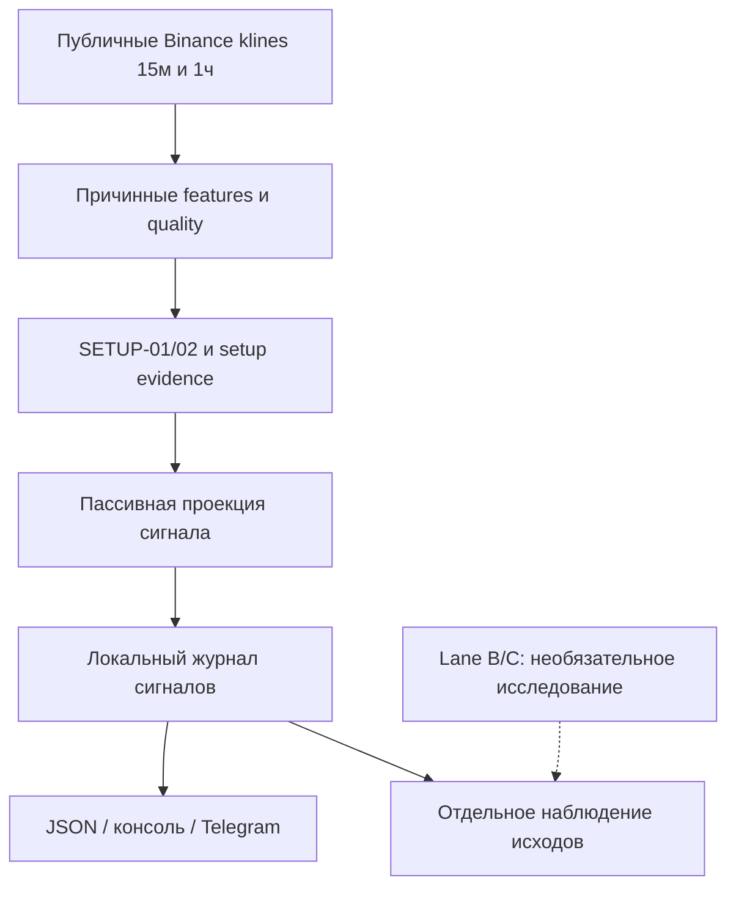

# TrendBot: система сигналов на 15м и исследование дополнительных стратегий

**Ревизия:** 2026-11-06; заменяет исследовательский порядок от 2026-11-05. **Выбор пользователя:** основной таймфрейм сигналов — **15м**, текущий продукт — **сигналы без открытия ордеров**. Этот документ меняет план, а не код: реализация, запуск сервиса, публикация сообщений и изменение статусов задач этой ревизией не выполняются.

## 1. Цель и границы

Получить работающий на публичных данных Binance USD-M поток объяснимых LONG/SHORT-сигналов с журналом, уведомлениями и последующей оценкой. Первый результат — не новая коллекция индикаторов и не подготовка limited-live, а проверяемая цепочка «закрытый бар → сигнал → доставка → наблюдаемый исход».

- **Сейчас исключены все биржевые заявки:** production, testnet и demo; не создавать `OrderIntent`, резервирование капитала, позицию или защитный Algo order. Не подключать private API, торговые ключи или исполнитель даже с выключенным флагом.
- **Работоспособность системы и качество стратегии — разные приёмки.** Исследовательские сигналы можно собирать и показывать с явной маркировкой до доказательства edge. Называть их проверенной рекомендацией, приписывать вероятность успеха или обещать прибыль нельзя.
- SETUP-01 Boundary Rejection и SETUP-02 Center Retest остаются исходными семействами. R1/R2 и новые признаки — отдельные эксперименты, не дополнительные скрытые условия V1.
- [Каноническая спецификация](docs/sources/FINAL_TECH_SPEC.md), §4, содержит `local setup: 5m`. Это историческая база, а не текущий целевой ТФ. Утверждённая пользователем поправка «15м + signal-only» записывается в [PROJECT_SPEC](docs/PROJECT_SPEC.md) и рабочих документах; канонический файл и его SHA-256 не менять.
- `P17-M01-T001` остаётся `BLOCKED`, его существующая подготовка не трогается. Отсутствие live-параметров, private reconciliation и exchange-test evidence **не является зависимостью системы публичных сигналов** и не снимается ради её запуска. Implementation-задачи signal-only нужно отдельно внести в штатный граф перед изменением кода; SR-01–SR-08 ниже пока не строки `docs/TASKS.md`.

## 2. Брейншторм: что строить первым

| Вариант | Сильная сторона | Компромисс / решение |
|---|---|---|
| A. MA-only: направление по скользящим на 15м | Минимальная сложность, понятный контроль для сравнения | Пересечения запаздывают и могут часто менять направление в боковике. Оставить прозрачным baseline, не объявлять самостоятельным edge. |
| **B. Структурные сигналы 15м + контекст 1ч** | Переиспользует имеющиеся SETUP-01/02 и причинные price-context/quality контракты; позволяет объяснить каждый сигнал | **Выбранный путь.** Сначала довести получение и проверку сигналов, затем добавлять по одной доказанной гипотезе. |
| C. Сразу обязательные OI/funding/L2 | Дополнительная информация о деривативах и ликвидности | Больше требований к покрытию, задержкам и проверке. Первоначально только отдельная диагностика/shadow; не блокировать базовый продукт отсутствием Lane B/C. |

**Почему не просто заменить надпись «5м» на «15м»:** меняются физическая длина окон, задержка подтверждённых pivots, число возможностей и путь цены внутри бара. Возможное уменьшение шума — **[HYPOTHESIS]**, не установленное преимущество. Не переносить результаты, пороги или параметры 5м на 15м как проверенные.

## 3. Временная модель

| Масштаб | Роль в новом плане |
|---|---|
| **15м** | Единственный основной setup/signal ТФ. Финальное подтверждение только после закрытия и фактической доступности соответствующего бара. |
| **1ч** | Первый исследовательский профиль HTF-контекста; только закрытые доступные бары. Выбор профиля не означает доказанную эффективность. |
| 4ч | Отдельный дополнительный контекст/ablation после baseline, не обязательное согласие двух HTF по умолчанию. |
| 5м / 1м | Не основной сигнал и не обязательный «дотриггер». Допускаются отдельно для детализации наблюдаемого исхода или будущего зарегистрированного сравнения. |
| Trades / BBO / L2 | Качество данных, цена после публикации, стоимость и отдельные исследования; не источник скрытого intrabar-сигнала. |

Правила времени:

1. Использовать реальные Binance 15м и 1ч OHLCV с UTC-границами. Предпочтительный источник — соответствующие биржевые klines. Если нужен сбор из младших баров, агрегировать только полные согласованные интервалы; сохранять provenance и максимальное время доступности компонентов. Не заполнять gaps и не смешивать native и агрегированные серии без проверки.
2. Цикл оценки относится к закрытиям `:00/:15/:30/:45`, но запускается по получению подтверждённых данных, не по одному настенному таймеру. Пример: бар `[10:00,10:15)` не может дать финальный сигнал в `10:14:59`; в `10:15` он также неизвестен, если ещё не получен. Закрывающийся одновременно 1ч-бар используется лишь после собственного получения; иначе берётся последний допустимый закрытый HTF-бар по объявленной freshness policy.
3. Хранить event/exchange time при наличии, receive/availability time, close/confirmation time и stable sequence раздельно. `decisionAt` не раньше доступности всех использованных входов. `publishedAt` не подменяет ни close time, ни decision time.
4. Для confirmed pivot считать задержку правого окна в **минутах**, не только в барах; уровень не существует для решения раньше подтверждения. Поздний бар/исправление создаёт новую диагностическую запись, но не перерисовывает опубликованный сигнал.
5. При смене ТФ пересчитать warmup, ATR/channel/MA/pivot windows, minimum-width, freshness, expiration и observation horizon. Сравнение «то же число баров» и «приблизительно та же длительность» — разные заранее зарегистрированные эксперименты; деление periods на три не делает индикаторы эквивалентными. `MaxHoldingTime` и срок жизни сигнала не становятся автоматически равны 15 минутам.
6. Набор параметров, windows и допуски качества явные и версионированные. Пока они не определены, состояние — `UnknownConfiguration`, а не Ready с выдуманными defaults. Профили 5м сохраняются только как явно обозначенные контрольные исследования, не как параллельный основной поток.

## 4. Что пользователь получает

### Карточка и состояния сигнала

| Часть | Обязательное содержание |
|---|---|
| Идентичность | Стабильный `signalId`, symbol/venue, `setupTimeframe=15m`, direction, family, config/formula version и ссылки на исходные события. |
| Время | Интервал сигнального бара, HTF cut, `decisionAt`, `publishedAt`, доступность входов, expiry по явной политике. |
| Объяснение | Конкретные выполненные условия setup, подтверждённый HTF-режим, существенные quality reasons; отсутствие сигнала тоже объяснимо. |
| Ценовой сценарий | `referencePrice` с типом источника и временем; условие/зона предполагаемого входа, структурная invalidation; target/horizon только по заранее определённому правилу. Никаких объёма заявки, плеча или разрешения на торговлю. |
| Статус доказательств | `RESEARCH` до отдельной оценки OOS; `CONFIRMED` означает только подтверждение правил на закрытом баре, **не** проверенную прибыльность. Калиброванная вероятность отсутствует, пока её действительно нет. |
| Наблюдаемый исход | Отдельная связанная запись после публикации: движение/уровни/истечение/unknown и метод измерения. Это не fill и не результат реальной сделки. |

Уведомлять об одном новом подтверждённом сценарии, его существенной отмене или истечении, а не повторять одинаковый сигнал на каждом market event. Идентичность включает семейство, направление, исходный setup/bar и конфигурацию; повтор того же события и рестарт не создают новый сигнал. Повторные бары одного сценария связываются с исходным setup по заранее описанному правилу rearm. Если два семейства сработали одновременно, сохранять обе причины и их зависимость, не выдавать это за два независимых подтверждения.

`NoSetup` — нет условий; `Unknown/Warmup/Stale/Gap` — условий нельзя надёжно оценить; `Cancelled/Expired` — изменение уже опубликованного сценария. Недостающие обязательные параметры ценового сценария дают диагностического кандидата, не полноценную карточку готового сигнала. Цена закрытия — ссылка на наблюдение, не обещанная цена входа.

**Доставка по существующему направлению проекта:** локальный журнал + JSON/консоль как проверяемая основа; Telegram как output-only уведомления, без кнопки открытия ордера и без хранения состояния в чате. Telegram bot token — только environment/secret store, он не является торговым API-ключом. Факт формирования, попытка отправки и подтверждение доставки различаются; идентификатор позволяет распознать возможный повтор, абсолютное exactly-once через внешний API не обещается. Web UI и TradingView-интеграция не нужны для этой цели.

### Техническая граница

Переиспользовать [price-context](docs/architecture/price-context-features.md), [quality](docs/architecture/feature-quality.md), [Boundary](docs/architecture/boundary-rejection.md), [Center](docs/architecture/center-retest.md), [setup evidence](docs/architecture/setup-evidence.md) и причинный replay. `TradingBot.Core` остаётся BCL-only; внешняя доставка и композиция — App/Infrastructure по существующим границам.

Существующий незакоммиченный `src/TradingBot.App/LaneASignalEvaluator.cs` — пассивная подготовка вызовов калькуляторов, **не готовый сервис**. В прочитанном `Program.cs` есть `shadow` и audit export, но нет полного 15м signal runtime. [Operational shadow](docs/architecture/operations.md) требует собственные feed/risk gates; не считать его готовым сигнальщиком и не ослаблять эти gates для данной цели.

Новая signal-only композиция заканчивается до order/risk authorization. Использовать существующие идентичности/evidence и применимые доисполнительные lifecycle-правила, но не симулировать `Filled/PositionOpen`, не фабриковать `Allow`, Lane B/C `Neutral`, reconciliation или portfolio state ради уведомления. Обязательность источников определяется явным signal-профилем; отсутствие необязательного L2 не блокирует Lane A, отсутствие нужного 15м/HTF входа блокирует. Полные Decision/Risk/Execution gates существующих режимов не менять.

## 5. Реализуемый backlog: сначала продукт, затем расширения

Это план будущих задач, а не утверждение, что код уже существует. Не начинать автоматическое продолжение Phase 17. При следующем запросе на реализацию сначала оформить SR-пункты в штатный task graph с нужными требованиями и явными зависимостями от уже DONE-компонентов, без зависимости от limited-live.

| Шаг | Scope / зависимости | Осязаемая приёмка и применимые проверки |
|---|---|---|
| **SR-01. Контракт 15м signal-only** | Начало; App/Core contracts и рабочий backlog. Зафиксировать неизменяемую конфигурацию 15м/1ч, обязательные данные, family/price-scenario/expiry/rearm rules, статусы исследования и запрет execution. | Схема карточки и manifest однозначны; unresolved параметры названы, Ready при них невозможен. Таблица границ и негативный запуск с private/activation settings. Проверки затронутых contracts + docs validator. |
| **SR-02. Реальные данные и coverage** | После SR-01; Exchange public/Infrastructure/DataTool. Получение и warmup 15м/1ч, live close events, recovery и ограниченный архив; point-in-time universe для исторической оценки. | Реальный публичный бар прослежен до закрытия/получения/записи; gaps, duplicate, late, open bar и одновременный HTF close видимы. Исторические availability отсутствуют — явно модель, не якобы live evidence. Focused Exchange/Infrastructure проверки и bounded public-data smoke. |
| **SR-03. SETUP-01/02 → журнал сигналов** | После SR-02; App композиция имеющихся Core evaluators, evidence и durable signal projection. Новые стратегии не добавлять. | На закрытом 15м баре есть объяснимый сигнал либо конкретный NoSetup/Unknown; устойчивые IDs, causal references и immutable revisions. Continuous и restart replay совпадают; повтор/late не дублирует и не меняет прошлое. Focused Core/Replay/Infrastructure/Integration проверки по изменённым компонентам. |
| **SR-04. Доставка и понятная карточка** | После SR-03; JSON/консоль и Telegram output-only с durable delivery state. Никакого торгового управления. | Локальный запуск показывает сформированную карточку; в отдельно разрешённом тестовом Telegram-чате проверить реальное получение и связь с journal ID. Без Telegram-доступа локальная часть проверяется, внешняя доставка остаётся UNVERIFIED, не DONE. Проверить рестарт, отмену/expiry, задержку и возможный повтор без утечки token. |
| **SR-05. Оценка качества именно сигналов** | После SR-03; Backtesting/DataTool, immutable signal-study manifest, заранее фиксированные labels/horizons и критерии. Может выполняться независимо от SR-04. | Один журнал даёт воспроизводимую opportunity table, coverage, directional outcomes, MAE/MFE при наличии пути и отдельно cost-aware hypothetical результат. Causal/publish boundary, overlapping labels, same-bar ambiguity и unknown покрыты. Smoke отчёта на реальных данных плюс существующие relevant replay checks. |
| **SR-06. Непрерывный public signal runtime** | После SR-04 и SR-05; App/Infrastructure, ограниченный prospective shadow-сбор. Ни local paper executor, ни exchange-test не нужны для этой приёмки. | Реальные close events дают наблюдаемые решения, уведомления и outcomes; рестарт/отключение feed/gap/persistence failure не создают ложный Ready. Live/replay prefix parity и отсутствие вызовов private/order transport доказаны. Срок наблюдения/операционные критерии объявлены до запуска; отсутствие setups — допустимый результат, не повод ослаблять правила. |
| **SR-07. Дополнительные гипотезы по одной** | После базового SR-05/SR-06 и собственного достаточного датасета; сначала простые ablations и R1, затем R2; Lane B/C только с пригодным покрытием. | Отдельные versions/family IDs, baseline и зарегистрированный эксперимент; отрицательный результат сохраняется, V1 не меняется автоматически. Кандидат остаётся RESEARCH до независимой проверки. Проверки причинности/границ каждого нового consumer-visible поведения. Не является зависимостью готовности базового сигнальщика. |
| **SR-08. Итоговая проверка и приёмка** | После SR-01–SR-06; SR-07 не обязателен для базового продукта. | End-to-end public smoke: closed bar → evaluator → persisted card → выбранный output → outcome; restart/replay, zero private/order calls и source hash. Targeted Release build `--warnaserror`, affected tests/format и `tools/validate-docs.ps1`; evidence, ограничения и runbook в рабочих docs/HANDOFF. Отдельный вердикт о софте и отдельный о торговом качестве. |

**Критический путь:** SR-01 → SR-02 → SR-03 → (SR-04 и SR-05 независимо) → SR-06 → SR-08. Проверка полного runtime не подменяется unit tests. Нужные параметры/датасет — явные prerequisites; синтетический fixture не превращается в доказательство эффективности. Эта ревизия плана не выполняет перечисленные будущие проверки.

## 6. Протокол измерения сигналов

1. **Заранее определить вопрос.** Направление на фиксированном будущем горизонте и достижение target раньше invalidation — разные labels. Long/short, единицы измерения, horizons, expiry, контроль, число попыток, thresholds успеха и минимальную точность оценки объявить до результатов. Числа не брать из книжных примеров или исторических pump seeds. Нет определения — нет оценки «сигнал верный».
2. **Два времени начала.** Исход модели считать после `decisionAt`; пользовательскую полезность — после фактического `publishedAt` и объявленной/измеренной задержки получения/реакции. Движение между закрытием бара и доставкой не засчитывать как доступную пользователю прибыль. При отсутствии исторической записи доставки использовать явно названный latency scenario, не выдуманный timestamp.
3. **Отдельные метрики.** Показывать число уникальных возможностей и сигналов, coverage/unknown, частоту и срок жизни, задержку подтверждения/доставки, directional hit rate с его определением, распределение signed forward returns, MAE/MFE и time-to-outcome при наличии пути. Для фильтра — предотвращённые плохие и пропущенные хорошие исходы на общей opportunity table. Не сводить качество к win rate.
4. **Не путать прогноз и fill.** Reference close или касание зоны не доказывают исполнение. Hypothetical expectancy/net R считать отдельно при зафиксированном entry/stop/exit/fill/cost model: обе комиссии, spread, slippage, latency, non-fill, gap и funding при пересечении соответствующего window. Без BBO/пути — ограниченные bounds/unknown. Если TP и SL возможны внутри одного 15м бара, использовать более детальный пригодный путь либо отдельно pessimistic/optimistic bound; не объявлять оптимистичный исход истиной. Drawdown — свойство объявленной симуляции портфеля, не автоматически потока независимых alerts.
5. **Сопоставимые контроли.** Отдельно оценивать SETUP-01 и SETUP-02 на 15м, price/volume baseline и прозрачный MA baseline, на том же universe и календаре. Для разных генераторов сравнивать общий набор допустимых symbol/time opportunities и unmatched/no-signal, не только пересечение победивших сигналов; paired сравнение применять там, где действительно общий кандидат. Выводить результаты по инструментам, направлениям, режимам, ликвидности и без лучшего инструмента. Не выбирать только интервалы с удачным Lane C capture.
6. **Защита от подгонки.** Chronological train → validation → один frozen OOS; walk-forward обучается только на прошлом. Пересекающиеся интервалы информации/исхода разделять purging и причинно обоснованным embargo; не случайный split соседних баров. До применения формального purged-CV сверить первоисточник либо опубликовать свой точный алгоритм. Регистрировать все исследованные family/TF/параметры/фильтры, учитывать множественные сравнения и зависимость по времени/инструментам. Не обнулять журнал попыток при переименовании эксперимента.
7. **Заморозка и независимые gates.** Dataset/universe, входные hashes, formula/config, labels, costs, exclusions и критерии сохраняются до оценки. 15м — новая конфигурация, прежний 5м OOS не является её проверкой. Переиспользовать причинный runner и patterns [research-freeze](docs/architecture/research-freeze.md), но вести отдельную signal-study evidence: существующий promotion report требует reconciliation и другие execution evidence. Не подставлять фиктивные подтверждения или ослаблять `PromotionReviewRecord` ради signal-only исследования.
8. **Проспективная проверка.** Сначала зафиксировать правила, затем собрать новые публичные observations и outcomes. Недостаточный effective sample даёт `INCONCLUSIVE`; data failures — `UNKNOWN`; отсутствие edge — отрицательный результат, а не основание подкрутить тот же OOS. Доставленный исследовательский сигнал не становится автоматически VALIDATED или разрешением на реальные заявки.

## 7. Очередь гипотез после базового потока

Все механизмы ниже — **[HYPOTHESIS]** для Binance USD-M 15м. Литературный источник поддерживает постановку вопроса/метод, не ожидаемую прибыльность данной реализации.

| Приоритет / кандидат | Точное исследование и условие отказа |
|---|---|
| Простой MA baseline, без ZIP | Причинные EMA/SMA и их наклон/разница на закрытых 15м барах; длины, seed, warmup и нормализацию объявить заранее. Сравнить с имеющимся center slope/HTF, а не считать несколько производных цены независимыми голосами. Нормализация ATR — наша отдельная гипотеза, не дословная формула Carver. Если нет добавочной ценности/устойчивости после задержки и costs — оставить контролем. |
| Простые Lane A ablations | Возраст структуры от confirmation availability; trend efficiency `abs(close[t]-close[t-n])/sum(abs(close[j]-close[j-1]))` (нулевой знаменатель = unknown); excursion/recovery относительно ранее доступного band/ATR; длительность acceptance за известным уровнем. Один признак за раз против того же baseline; считать задержку, blocked-good и частоту. Не расширять Core calculator заранее. |
| **R1. Failed Breakout → Reclaim** | Первый новый setup: `LevelKnown → BreachObserved → ReclaimConfirmed → Candidate`, отдельно `Expired/Invalidated/Unknown`. Long: выход ниже заранее подтверждённой поддержки и последующее доступное закрытие выше; short зеркально. Уровень/роль фиксируются до breach; параметры касания, последовательность/допуск same-bar, expiry, invalidation и target/horizon предобъявлены. Начать price-only, без обязательного L2. Сравнить с V1 Boundary и reclaim без предварительного breach; учесть уже прошедший до подтверждения ход. Отказ: эффект исчезает после legal publication/entry, costs, смены режима или OOS. |
| R2. Breakout → Structural Retest → Continuation | Отдельный evaluator/семейство: known level → closed breakout → последующий retest → hold confirmation; нет retest до breakout, нет знания будущего pivot. Сравнить с Center Retest и прямым breakout, показать пропущенные движения из-за ожидания. Исчезновение эффекта после задержки/costs или необходимость hindsight опровергает гипотезу. Не смешивать с R1 и не менять Center Retest. |
| Lane B: OI/funding/liquidations | Только conditional ablation над теми же Lane A/R1 opportunities. `ΔOI` — число открытых контрактов, не направление участников; сохранять единицы/публикацию. Funding forecast, basis и реальный funding payment различаются. Liquidation print не равен полному covered stream. Unknown не заменять Neutral. Нет incremental OOS value сверх price/volume — не делать обязательным фильтром. |
| Lane C: своевременная ликвидность/поток | Spread/depth withdrawal, replenishment, aggressive trade flow + последующий доступный price response. OFI по S5 — сумма изменений best bid/ask, не snapshot imbalance и не trade delta. Binance diff-depth даёт агрегированные обновления, не гарантированно каждый элементарный order event: формулу/частоту и потерю информации декларировать отдельно; snapshot/diff `U/u/pu`, gaps/reconnect и capture version сохранять. Изучать преимущественно короткое окно доступности вокруг решения/публикации, не объявлять эффект на секунды прогнозом на следующие 15 минут. Нет достаточного покрытия/полезности — только диагностика/shadow. |
| Карантин: compression/expansion, pump/exhaustion, ML | Compression сравнивать с обычным confirmed breakout. Pump/exhaustion short не включать без point-in-time low-cap universe, squeeze/gap/ликвидностных данных; manipulation detector ≠ прибыльный short. ML/meta-labeling и объединение множества фильтров не начинать до простых ablations и достаточного датасета. Исторические numeric seeds не становятся defaults. |

## 8. Что проверено в ZIP с индикатором

[Ultimate-Moving-Average-Indicator.zip](книги/Ultimate-Moving-Average-Indicator.zip) просмотрен **без запуска бинарника**. Внутри одна папка с `ultimate-ma.ex4` (около 23,7 KB), `Instructions.pdf`, `Link.txt` и рекламными `.url`; исходника `.mq4/.mq5`, формулы, тестовых векторов и отдельной лицензии на перенос кода нет.

- `.ex4` — скомпилированный формат MT4, не .NET-библиотека и не доступный C# алгоритм. Его расчёт, MTF alignment, использование текущего бара и repainting из комплекта не установлены; это **UNVERIFIED**, не утверждение о наличии перерисовки или вредоносности.
- `Instructions.pdf`, PDF стр. 1–2, — общая установка indicators в MT4/MT5; стр. 3–10 — каталог/реклама, стр. 11 — образовательный disclaimer и права авторов. Документ не описывает алгоритм `ultimate-ma`.
- `Link.txt` ведёт на [MQL5 product 148546](https://www.mql5.com/en/market/product/148546?source=External). По доступной поисковой записи это **Ultimate Moving Average Multi Time Frame для MetaTrader 5**; прямое чтение страницы завершилось timeout. Связь этой MT5-страницы с вложенным MT4-бинарником **не подтверждена**; не приписывать `.ex4` её формулы/версии/заявления.
- **Решение:** не включать бинарник, MT4/MT5 мост или его непроверенные сигналы в критический путь. Проверяемая идея «прозрачная MA + закрытый HTF» уже доступна через существующие MA/price-context kernels. Это независимый baseline, **не копия Ultimate MA**.
- Возврат к точному индикатору возможен при проверенном происхождении, разрешении на использование и исходнике/публичной точной формуле: prefix parity на последовательном добавлении баров, запрет будущих HTF/pivots, проверка shift и закрытого бара, затем отдельное OOS сравнение. Отсутствие этих материалов не блокирует signal-only систему.

## 9. Литература: что перечитано и что действительно следует

Реестр фиксирует **разделы**, а не заявление о полном повторном прочтении всех книг. Номера страниц — PDF, не печатная пагинация. `SOURCE_SUPPORTED` описывает источник; `PROJECT_VERIFIED` — прочитанный контракт репозитория; `HYPOTHESIS` — наше проверяемое предположение; `UNVERIFIED` — недостающие данные/проверка.

| ID / источник | Повторно проверенные разделы | Применение и граница переноса |
|---|---|---|
| S1. [Aronson, Evidence-Based Technical Analysis, 2007](книги/Evidence-Based%20Technical%20Analysis%20Applying%20the%20Scientific%20Method%20and%20Statistical%20Inference%20to%20Trading%20Signals%20by%20David%20Aronson.pdf) | Гл. 1, objective rules, PDF стр. 22–25; гл. 6, выбор лучшего правила и data-mining bias, PDF стр. 275–281. | Однозначная программируемая формулировка сигнала и учёт отбора победителя среди многих правил. Исследовательская прибыль не доказывает predictive power. Binary long/short модель автора не обязывает наш сервис всегда иметь сигнал. |
| S2. [Pardo, The Evaluation and Optimization of Trading Strategies, 2-е изд., 2008](книги/The%20Evaluation%20and%20Optimization%20of%20Trading%20Strategies.pdf) | Гл. 10, sample/robustness, PDF стр. 293–301; гл. 11, walk-forward и его компоненты, PDF стр. 326–329. | Сначала выбор параметров на прошлом, затем тест на соседнем невиданном периоде; диапазон режимов и чувствительность. Упомянутые автором числа сделок/лет и обратные исторические прогоны не принимать за наш causal protocol или критерий достаточности. |
| S3. [Chan, Quantitative Trading, 2-е изд., 2021](книги/Quantitative%20Trading%20How%20to%20Build%20Your%20Own%20Algorithmic%20Trading%20Business.pdf) | Гл. 5, semiautomated system и paper comparison, PDF стр. 121–126, 132–135. | Генерация идеи и автоматическое исполнение разделимы; перспективный сбор выявляет timing/operational расхождения. Наша signal-only ветка останавливается **до** описанной автором загрузки orders брокеру; paper account не требуется для сигналов. |
| S4. [Chan, Algorithmic Trading: Winning Strategies and Their Rationale, 2013](книги/Algorithmic%20Trading%20Strategies%20to%20Avoiding%20Market%20Pitfalls.pdf) | Титул и предупреждение о prototype examples, PDF стр. 5–6, 15–16; гл. 1, lookahead/data snooping, PDF стр. 22–25. | Неизвестный intrabar high/low и повторная подстройка OOS искажают оценку; малое число параметров не спасает от множества сложных правил. Книжные prototypes не торговые рецепты. Советы о real-money проверке не входят в нынешний scope. |
| S5. [Cont–Kukanov–Stoikov, The Price Impact of Order Book Events](https://arxiv.org/pdf/1011.6402) | Доступен полный preprint v3, 2011; §§2.1–2.3, 3.1, PDF стр. 3–8. Журнальная версия — JFEC 2014. | Теперь сверено определение event-level OFI, включающее quote changes/cancellations, и отличие от trade imbalance. Данные — 50 американских акций, не Binance. Contemporaneous price impact не доказательство будущего directional edge на 15м. |
| S6. [Carver, Systematic Trading, 2015](книги/Systematic%20Trading%20A%20unique%20new%20method%20for%20designing%20trading%20and%20investing%20systems.pdf) | Гл. 7, forecasts/simple rules, PDF стр. 141–155; гл. 12, speed/costs, стр. 217–234; приложение B, EWMAC, стр. 329–332. | Forecast отделён от sizing, дополнительные MA-варианты коррелируют, скорость нужно оценивать вместе с costs. Авторский EWMAC использует разницу EWMA с volatility standardisation; дневные periods/scalars и его рекомендации по leverage не переносить в 15м crypto. Forecast scale автора — не вероятность успеха. |
| S7. [Cartea–Jaimungal–Penalva, Algorithmic and High-Frequency Trading, 2015](книги/Algorithmic%20and%20High-Frequency%20Trading.pdf) | §4.3.5, walking LOB / temporary-permanent impact, PDF стр. 104–107; §4.4, cancellations, стр. 107–109. | Зависимость hypothetical исполнения от размера/ликвидности и различие posted/cancelled/executed. Не делать equities-калибровки, optimal control или HFT обязательной частью 15м alerts. |
| S8. [Anastasopoulos et al., Order Flow and Cryptocurrency Returns, JFM 79, 2026, 101047](https://doi.org/10.1016/j.finmar.2026.101047), PDF в [ScienceDirect ZIP](книги/ScienceDirect_articles_04Nov2026_08-26-57.785.zip) | Введение и §§2.1–2.2, PDF стр. 1–4. | Daily/weekly, 84 cryptoassets, агрегированные международные signed volumes. Статья не исследует Binance USD-M 15м/L2; её coefficients/Sharpe и выбор surviving balanced panel не импортировать в наш результат. |
| S9. [Neubert–Rams–Gruhn, Cryptocurrency Perpetual Futures and Swaps, working paper, 2026](книги/ssrn-6639558.pdf) | Метод и статус исследований, PDF стр. 1–10; liquidation/OI limitations, стр. 19–25. | Funding, leverage/liquidation и measurement quality важны для hypothetical экономической оценки. Обзор не объявлять рецензированным и не считать проверкой направленных сигналов. |
| S10. Fang et al., Cryptocurrency Trading: A Comprehensive Survey, в [локальном сборнике](книги/Cryptocurrency%20Trading%20A%20Comprehensive%20Survey.pdf) | Титул сборника 2025 и оглавление; §§5.1–5.5, 6.1, PDF стр. 82–89. | Это сборник Blockchain, Crypto Assets, and Financial Innovation с отдельной обзорной главой, не PDF одной статьи. Различать real-time signal software, execution, MA/structure families. Обзор старых работ не даёт доказательства edge или выбора 15м. |

Дополнительно сверены титулы: `Financial Risk Management for Cryptocurrencies.pdf` содержит **Lalit Mohanty, Cryptocurrency Investing: Explaining it from A to Z**, а `Financial Mathematics for Cryptocurrencies.pdf` — **Lingjie Ma, Quantitative Investing: From Theory to Industry (2020)**. Не ссылаться на них под ошибочными именами. `Machine Trading` Chan (2017), предисловие PDF стр. 11–13, также предупреждает о prototypes/hidden biases; конкретные модели непрочитанных глав здесь не используются. Harris draft 2002 и ранее упомянутые pump-manipulation работы остаются фоновыми ссылками, не новым доказательством 15м сигналов.

**Вывод для плана:** литература обосновывает воспроизводимую проверку, простые контроли, причинность и отдельный учёт costs/latency. Она не выбирает за пользователя 15м, не определяет прибыльные periods/thresholds и не доказывает полезность неизвестного ZIP-индикатора. Новый приоритет — SR-01–SR-06: получить честный поток исследовательских сигналов; SR-07 расширяет его только по измеримым результатам, а исполнение ордеров остаётся отдельной будущей задачей.
