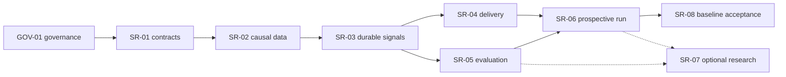

# Execution plan

This plan turns [`PROJECT_SPEC.md`](PROJECT_SPEC.md) into independently verifiable work. Milestones and task counts are intentionally variable: a milestone is split when it has a separate contract, evidence boundary, or recovery risk. A task is `DONE` only after its acceptance criteria and listed validation pass.

The startup selector chooses the first `READY` task in document order whose dependencies are `DONE`. Multiple `READY` tasks are valid when their dependencies are complete. Zero `READY` tasks is valid only when the backlog records an explicit unresolved blocker; an ordinary dependency chain is not an implicit blocker.

Every replay-facing milestone preserves the causal tuple of event time, exchange time when available, receive/availability time, and stable processing sequence. Shared risk math is kept separate from fill simulation. Private execution, local paper simulation, exchange test execution, and real-money activation are separate gates.

## Current planning priority — 2026-11-06

The user requests **15-minute primary signals without opening orders**, not continuation of limited-live work. Follow the revised [signal-only research plan](../additional-strategy-research-plan.md): public 15-minute/1-hour data → existing Lane A setups → durable signals → output-only notifications → prospective outcome evaluation. Additional MA/structure/Lane B/C hypotheses are separate comparisons, not prerequisites for delivering the baseline signal system.

- The independent signal branch is formally registered. P15-M03-T001 and P15-M03-T002 are DONE; P15-M03-T003 through T031 remain BLOCKED. Preserve existing task evidence and the Phase 17 blockers. There is no Phase 19, no SR-07 dependency on baseline SR-08, and no production, testnet, demo, paper-order, or real-order scope.

Audit checkpoint (2026-11-09): GOV-01.1/01.2 are recorded in P01-M03 and verified with native PowerShell 7. The validator accepts the formal mapping in P15-M03. P15-M03-T001 and P15-M03-T002 are DONE; later signal tasks remain BLOCKED pending prerequisites and separate authorizations. The architecture review records causal defects and earlier tooling failures; do not use that historical audit as current check evidence. No implementation task starts through this planning update.

## Signal-only detailed work plan

**Статус: планирование зарегистрировано, само по себе не разрешает реализацию.** Ниже 33 work items в девяти группах; их однозначное соответствие formal IDs находится в [TASKS](TASKS.md#signal-only-work-item-mapping), а статусы/dependencies/acceptance/evidence — только в formal task rows. GOV-01.1/01.2 завершены; P15-M03-T001 и P15-M03-T002 — DONE; последующие SR tasks остаются `BLOCKED`. Runtime, scripts, параметры V1, canonical source и P17 не меняются.

### Brainstorming decision

Цель и пользователь уже определены [исследовательским планом, §§1–4](../additional-strategy-research-plan.md#L5-L80): объяснимые research-сигналы для владельца, 15m setup / initial closed 1h context, output-only. Не переоткрываем выбор TF и разрешение торговли вопросами, на которые источники уже ответили.

| Вариант декомпозиции | Польза | Риск / решение |
|---|---|---|
| Только восемь крупных SR задач | Короткий backlog | Слишком широкая приёмка: feed, causal fixes, restart и delivery легко принять одним непроверенным флагом. Не выбран. |
| По проверяемому результату и границе отказа | Отдельные causal, identity, atomicity, delivery и scientific gates; видимый evidence каждого шага | **Выбран:** девять групп и 33 ограниченные задачи, одна предметная приёмка на задачу. |
| Сначала по модулям Core/Exchange/Infrastructure | Удобно разделить файлы между исполнителями | Контракты/интеграция могут разойтись; провоцирует framework и копии evaluators до проверки продукта. Не выбран как основной порядок. |

### Scope and quality gates

- Продукт: только public native closed 15m + closed available 1h → существующие quality/context/SETUP-01/02 → passive projection → isolated durable signal journal → JSON/console/Telegram outbox → independent outcomes. Нет risk authorization, OrderIntent, reservation, Position, protective/private transport, demo/testnet/paper orders и ослабления shadow gates.
- Каждая задача закрывается отдельным изолированным diff с названными результатом, consumer-visible acceptance, релевантными проверками и actual smoke. Несвязанные изменения не включаются; при нескольких авторах paths не пересекаются. Оценки времени/выигрышности не назначены.
- До изменения exported contract изучить consumers/references и текущие архитектурные границы. Regression tests ловят поведение, boundaries, transitions и ошибки; не pin wording/default copies/mock forwarding. Исправление бага имеет failing-before/passing-after evidence, где практически возможно.
- На выходе хранить task/config/formula/source/dataset/run identities, точные команды/exit codes, smoke trace и ограничения. Только реально выполненное — VERIFIED; утверждение источника — SOURCE_CLAIM; предполагаемый эффект — HYPOTHESIS; недостающие данные — UNKNOWN/INCONCLUSIVE по протоколу.
- Неполная обязательная конфигурация не даёт Ready. RESEARCH, confirmed-on-closed-bar, statistically VALIDATED, API acknowledgment и order authorization независимы; signal contract последнего вообще не содержит.
- Нельзя объявить baseline готовым только по unit tests, public GET или perpetual UnknownConfiguration. Полный явный профиль и настоящая input→output→outcome/restart trace обязательны; отсутствие setups при таком профиле допустимо.
- SR-04 и SR-05 могут идти независимо после SR-03 при непересекающихся paths. На начальной интеграции ordering/frozen contract важнее параллелизма. SR-08 стоит до optional SR-07 в плановом порядке; missing optional Flow/OB/POC/B/C/ML не блокирует baseline.

### Sources and precedence

- **A:** [additional-strategy-research-plan.md](../additional-strategy-research-plan.md), ревизия 2026-11-06, §§1–7 задают продукт/SR/метод; §9 содержит литературный реестр с проверенными тогда разделами и ограничениями переноса. В этой плановой работе книги заново целиком не прочитаны.
- **B:** [мои предложения..txt](../%D0%BC%D0%BE%D0%B8%20%D0%BF%D1%80%D0%B5%D0%B4%D0%BB%D0%BE%D0%B6%D0%B5%D0%BD%D0%B8%D1%8F..txt), строки 13–107 и 113–210: S1–S6, TF/timing и будущая автономия — candidate studies, не отмена A/approved scope.
- **P:** [Prizrak_v2.1.zip](../Prizrak_v2.1.zip), Pine 1563 строки; формулы/line map/temporal risks в [Pine audit](research/PRIZRAK_V21_ALGORITHM_AUDIT.md). Last-bar display POC не historical rolling POC, price-volume pressure не биржевой order flow, TV strategy не инструкция включить execution.
- Найденные несuffixed имена и SHA-256 зафиксированы в [architecture review §2](research/TRENDBOT_FINAL_ARCHITECTURE_REVIEW.md); идентичность отсутствующим `(4)`/`(1)` версиям не утверждается. Canonical [FINAL_TECH_SPEC §4](sources/FINAL_TECH_SPEC.md) неизменен; для нового signal profile действует [approved amendment](PROJECT_SPEC.md#approved-current-scope--2026-11-06), не замена исторических 5m bytes.
- [Signal roadmap](research/SIGNAL_ONLY_IMPLEMENTATION_ROADMAP.md) is the historical architecture/coarse-registration proposal. Its old unified diff is superseded by the formal one-to-one mapping in `TASKS.md`; do not apply it. [Research decisions](research/STRATEGY_RESEARCH_DECISIONS.md) records reconciliation, H0/controls/reject criteria.
- Primary API источники у соответствующих задач. Binance schema/route/weights нужно перепроверить непосредственно перед implementation: текущий reader английской страницы вернул navigation, не полный контракт; поле/лимит не считать заново VERIFIED. Telegram `sendMessage`/`retry_after` прочитаны как контракт API, без отправки запросов с token.

### GOV-01: Tooling and registration

GOV-01 tooling and formal registration are complete. Their evidence is in [TASKS](TASKS.md#signal-only-work-item-mapping) and [HANDOFF](../HANDOFF.md); no SR implementation or trading work has started.

#### GOV-01.1

**Восстановить поведенческую проверку документационного графа.**

- Результат: Behavioral fixture harness обновлён: dynamic task counts и изменения строк по ID/колонке вместо буквального P17 evidence; native PowerShell 7 доступен через `pwsh`.
- Приёмка: Положительные и отрицательные cases проверяют duplicate/unknown refs/coverage/cycles/status, несколько READY, объяснимый zero READY и переход selector; wording/copy-only assertions удалены, не перепривязаны. P17 и canonical не подгоняются под тест.
- Проверка: Нативные `pwsh -NoProfile -File tools/tests/validate-docs.Tests.ps1` и `pwsh -NoProfile -File tools/validate-docs.ps1`; source hash и graph preservation.
- Источники: [A §1: separate graph before code](../additional-strategy-research-plan.md#L9-L13); [Roadmap §§1,7–9](research/SIGNAL_ONLY_IMPLEMENTATION_ROADMAP.md); [Fixture defects: lines 80,88,117–132](../tools/tests/validate-docs.Tests.ps1#L80-L132).

#### GOV-01.2

**Зарегистрировать signal-only implementation branch.**

- Результат: Все 33 work items зарегистрированы самостоятельными formal task rows фаз P01-M03 и P15-M03; таблица в TASKS даёт ровно один mapping на work ID. Исторические 119 rows сохранены; SR groups не являются вторым источником статусов.
- Приёмка: Mapping уникален; формальные rows валидируют coverage/dependencies/status/cycles; SR-08 стоит до optional SR-07, но SR-07 не входит в зависимости baseline. Ни Phase 19, ни implementation READY; runtime/canonical/P17 не изменены.
- Проверка: Native PowerShell 7 fixture suite и validator на зарегистрированном graph, source hash, mapping cardinality, preservation of old rows, requirement coverage, graph and selector.
- Источники: [A §5: registration and critical path](../additional-strategy-research-plan.md#L82-L97); [Roadmap §§1,7–9](research/SIGNAL_ONLY_IMPLEMENTATION_ROADMAP.md); [Graph rules](../tools/validate-docs.ps1#L48-L92).

### SR-01: Contracts and public-only profile

Принять однозначные public-only contracts до работы с runtime. Core BCL-only; настройки, scenario policy и доказательность не смешиваются.

#### SR-01.1

**Описать версионированный public 15m/1h профиль.**

- Результат: Определить schema конфигурации: native 15m/1h, required sources, periods/MA/ATR/width units, seed/history start, warmup/freshness, universe bounds и Unknown registry. Не переносить 5m/Pine defaults и не искать оптимальные числа.
- Приёмка: Все обязательные поля/единицы/versions перечислены; недостающие значения дают UnknownConfiguration. Private/activation/quantity/leverage/portfolio fields отвергаются без чтения секретов. Для будущей публикации нужен отдельно объявленный полный профиль.
- Проверка: Contract/config negative cases на forbidden и missing поля, версии/единицы; архитектурные BCL boundaries.
- Contract field registry and fail-closed semantics: [public-signal-profile.md](architecture/public-signal-profile.md). No complete profile or numeric strategy values are declared.
- Источники: [A §3: native TF, time, unknowns](../additional-strategy-research-plan.md#L25-L42); [Approved scope](PROJECT_SPEC.md#approved-current-scope--2026-11-06); [Feature quality](architecture/feature-quality.md).

#### SR-01.2

**Разделить signal, evidence, delivery и outcome contracts.**

- Результат: Определить immutable signal/card schema: stable signalId и отдельный recordHash; direction/family/version/config/input hashes, bar interval, HTF cut, decisionAt, reference source/time, quality reasons. Publication receipt/outcome — отдельные связанные записи.
- Приёмка: ConfirmedOnClosedBar не равен VALIDATED/Allow/OrderAuthorized; probability остаётся null без calibration. Unsupported schema/hash conflict отвергается; I/O и trading side effects отсутствуют.
- Проверка: Behavioral contract tests на конфликт идентичности/версии, missing required scenario fields и несовместимые causal cuts; canonical round-trip только для действительно публичного wire contract.
- Источники: [A §4: card and evidence states](../additional-strategy-research-plan.md#L44-L61); [Roadmap §4: full schema](research/SIGNAL_ONLY_IMPLEMENTATION_ROADMAP.md); [Setup evidence identities](architecture/setup-evidence.md); [versioned signal contracts](architecture/signal-contracts.md).

#### SR-01.3

**Зафиксировать scenario identity, expiry, invalidation и rearm.**

- Результат: Определить passive episode transition table и anchor до события; versioned expiry/rearm/invalidation policies и overlap links двух семейств. Restart/run/publish clocks не входят в logical signalId.
- Приёмка: Повтор одного события/сценария не создаёт новый alert; новый rearm отделим от продолжения, cancel/expire являются связанными immutable events. Unknown обязательной policy не превращается в готовую карточку; Filled/PositionOpen не симулируются.
- Проверка: Переходы episode, duplicate/late/opposite/overlap, expiry/rearm boundary, непрерывный и восстановленный pure projection на одинаковых inputs.
- Источники: [A §4: dedup and scenario lifecycle](../additional-strategy-research-plan.md#L50-L59); [Setup lifecycle: only applicable pre-execution semantics](architecture/setup-lifecycle.md); [Roadmap §§3–4](research/SIGNAL_ONLY_IMPLEMENTATION_ROADMAP.md).

### SR-02: Causal public data and coverage

Устранить две доказанные causal/identity проблемы, затем доказать native closed feed, durable recovery и coverage. Цена поступления данных важнее wall-clock расписания.

#### SR-02.1

**Исправить pre-close Bar leakage в replay-prefix.**

- Результат: В отдельном runtime diff ввести единый close-aware eligibility для single snapshot и multi-source prefix; сохранить event/receive/availability/sequence, не маскировать дефект event=close.
- Приёмка: В legal counterexample Bar event/availability=minute 1, close=minute 3 и Trade=minute 2, handler Trade не видит финальный Bar; при close+availability boundary он появляется. Delivery и prefix согласованы, equal-time sequence сохранён.
- Проверка: Failing-before/passing-after interleaved regression, одно- и multi-source replay, boundary/duplicate/determinism checks и actual replay smoke.
- Источники: [A §3: causal eligibility](../additional-strategy-research-plan.md#L35-L42); [Audit §5: verified defects](research/TRENDBOT_FINAL_ARCHITECTURE_REVIEW.md); [Core eligibility](../src/TradingBot.Core/CausalEventContracts.cs#L125-L132); [Multi-source replay](architecture/multi-source-replay.md).

#### SR-02.2

**Сделать kline identity и UTC интервалы TF-aware.**

- Результат: На ingestion boundary сохранять venue/product/symbol/timeframe/open, revision hash и source metadata. Разделить raw inclusive Binance close и endExclusive; подготовить versioned cutover без изменения historical IDs.
- Приёмка: 15m/1h с одинаковым open не конфликтуют и не сливаются; REST/WS представления одной accepted revision дедуплицируются только по объявленному правилу. Недопустимые grid/duration/open bars дают diagnostic, не Core-ready input.
- Проверка: Replay mixed-TF counterexample, native interval/UTC/inclusive-close boundaries, source revision conflict; сверка актуального Binance schema до изменения adapter.
- Источники: [A §3: native bars and UTC](../additional-strategy-research-plan.md#L37-L42); [Audit §5: verified defects](research/TRENDBOT_FINAL_ARCHITECTURE_REVIEW.md); [Current REST mapping](../src/TradingBot.Exchange.Binance/BinanceRestContracts.cs#L529-L547); [Binance klines: re-check before implementation](https://developers.binance.com/docs/derivatives/usds-margined-futures/market-data/rest-api/Kline-Candlestick-Data).

#### SR-02.3

**Составить native REST warmup и close-driven WebSocket feed.**

- Результат: App собирает public adapter 15m/1h; оценки запускаются принятым closed 15m input, не wall-clock timer. HTF join фиксирует последний доступный closed 1h в freshness policy; history/seed start известны.
- Приёмка: При co-closing 15m/1h обе arrival sequences дают законный cut без future HTF; более поздний HTF не переоценивает committed прошлое. Pivot right-window latency видима, required warmup/stale/gap блокируют Ready.
- Проверка: Open/late/reordered/co-close/pivot confirmation boundary tests, prefix append parity на recorded availability; наблюдение реального public WS close в bounded smoke.
- Источники: [A §3: receive-driven evaluation](../additional-strategy-research-plan.md#L35-L42); [Public REST/WS architecture](architecture/market-data.md); [Price context / HTF](architecture/price-context-features.md); [ADR causal tuple](decisions/ADR-003-event-market-data-transport.md).

#### SR-02.4

**Сохранить public intake, sequence и recovery checkpoint.**

- Результат: Сделать изолированный durable bar-input ledger/ограниченный архив и monotonic intake sequence; duplicate receipts, correction diagnostics, future-only backfill, restart seed/history recovery. Не маркировать Bars как L2 в существующем capture.
- Приёмка: Crash не теряет accepted checkpoint и не выдаёт повторный trigger; corrected/late inputs не переписывают прошлые решения. Disk/SQLite failure видимы; retention не удаляет нужную активной generation seed history.
- Проверка: Reopen/retry/conflict/crash transaction tests, uninterrupted vs restarted input replay и temp-store smoke; никаких migrations защищённых trading DB.
- Источники: [A SR-02: recovery and archive](../additional-strategy-research-plan.md#L89); [Persistence patterns, not trading ledger](architecture/persistence.md); [Roadmap §3: recovery](research/SIGNAL_ONLY_IMPLEMENTATION_ROADMAP.md).

#### SR-02.5

**Доказать bounded public ingestion и измерить coverage.**

- Результат: Получить ограниченный реальный 15m/1h slice с source hashes, expected/covered intervals, gap/correction/unknown ledger и PIT-universe metadata для historical studies. Historical REST availability явно modeled, prospective — recorded.
- Приёмка: Прослеживается реальный closed input до durable row и восстановленного replay; public GET не выдаётся за длительный WS/prospective run или full-market coverage. Нет synthetic gap fill и selection только удачных инструментов.
- Проверка: Actual REST+WS close/reconnect smoke, coverage report/reopen и deterministic replay IDs; сохранить run/source/config hashes без секретов.
- Источники: [A SR-02 and PIT controls](../additional-strategy-research-plan.md#L89-L89); [A §6: universe and coverage](../additional-strategy-research-plan.md#L103-L107); [Coverage limitations](research/TRENDBOT_FINAL_ARCHITECTURE_REVIEW.md).

### SR-03: Existing setups and durable signals

Повторно использовать SETUP-01/02 без изменения формул. Получить атомарную пассивную проекцию и отдельный signal composition root.

#### SR-03.1

**Спроецировать существующие SETUP-01/02 в passive observations.**

- Результат: Скомпоновать имеющиеся context/quality/evaluators и passive episode projection для обоих направлений; сохранить exact Core formulas, evidence и quality reasons. S1/S4 не создают клонов evaluator.
- Приёмка: На каждом eligible cut различимы Confirmed/NoSetup/Unknown/Invalidated и оба family overlaps. Required unknown блокирует полноценную карточку, optional B/C не превращается в mandatory gate/Neutral.
- Проверка: Existing setup/quality regressions + consumer-visible projection transitions и same-input parity; не добавлять tests копирования вызовов/mock echoes.
- Источники: [A SR-03: reuse evaluators](../additional-strategy-research-plan.md#L90); [B S1/S4: overlap, not identity](../%D0%BC%D0%BE%D0%B8%20%D0%BF%D1%80%D0%B5%D0%B4%D0%BB%D0%BE%D0%B6%D0%B5%D0%BD%D0%B8%D1%8F..txt#L13-L71); [Boundary](architecture/boundary-rejection.md); [Center](architecture/center-retest.md); [Quality](architecture/feature-quality.md).

#### SR-03.2

**Атомарно сохранить signal, scenario, checkpoint и outbox.**

- Результат: Infrastructure реализует isolated signal store с stable logical IDs, immutable events/hash conflict detection и одним projection commit для signal/diagnostic+scenario/rearm+consumed cursor+outbox.
- Приёмка: Crash before commit не продвигает cursor; crash after commit/retry не создаёт новый signal/outbox row. Повтор доставки не увеличивает opportunities; поздний input не изменяет ранее записанный сигнал.
- Проверка: Real temp SQLite commit/reopen/dedup/concurrency/failure tests и continuous/restarted canonical output parity; не использовать OrderIntent/portfolio tables.
- Источники: [A §4: stable IDs and revisions](../additional-strategy-research-plan.md#L50-L59); [Roadmap §4: transaction invariants](research/SIGNAL_ONLY_IMPLEMENTATION_ROADMAP.md); [SQLite journal patterns](architecture/persistence.md).

#### SR-03.3

**Добавить отдельный public-only composition root и journal smoke.**

- Результат: App получает явную signal-only команду, strict public config и per-instrument serial consumer; DataTool остаётся в разрешённом графе ссылок. Не переделывать shadow посредством выключения gates.
- Приёмка: Реальный closed bar проходит feed→existing evaluators→durable record/diagnostic→reopen; instrument cursor и provenance видимы. Composition не создаёт private signer/executor/risk authorization/intents/positions; forbidden settings отвергаются.
- Проверка: Actual CLI/journal smoke и restart duplicate scenario; негативные config/forbidden-transport probes; relevant App/Integration/architecture checks.
- Источники: [A §4: shadow is not signal root](../additional-strategy-research-plan.md#L76-L80); [Existing entrypoint](../src/TradingBot.App/Program.cs#L26-L41); [Operations boundaries](architecture/operations.md); [Roadmap §6: threat model](research/SIGNAL_ONLY_IMPLEMENTATION_ROADMAP.md).

### SR-04: Local output and Telegram delivery

Сначала локальная объяснимая карточка, затем durable output-only delivery. Local/API-accepted/user-read — разные факты.

#### SR-04.1

**Вывести объяснимую JSON/console карточку.**

- Результат: Рендерить committed signal event с identity, interval/HTF cut, scenario/reference provenance, quality reasons, RESEARCH и отдельным output receipt; missing configuration показывать как diagnostic, не LONG-ready.
- Приёмка: Пользователь отличает scenario reference от fill и Confirmed от VALIDATED; повтор/expiry/cancel связан с исходным ID. Поле publishedAt не выдумывается до соответствующего channel receipt.
- Проверка: Actual CLI/JSON output на real-data journal + error/unknown/overlap cases; contract checks на временные границы и недопустимые значения, не snapshot wording tests.
- Источники: [A §4: user card and output](../additional-strategy-research-plan.md#L44-L61); [Signal schema](research/SIGNAL_ONLY_IMPLEMENTATION_ROADMAP.md).

#### SR-04.2

**Реализовать durable output-only Telegram sender.**

- Результат: Отправлять только committed outbox rows: claim/lease, bounded retry/max age/expiry/backoff, attempts и API message acknowledgment. Timeout-after-accept становится UnknownDelivery; stable ID позволяет распознать duplicate.
- Приёмка: Нет exactly-once/read receipt promise, бесконечного retry, inbound order command/button. Respect retry_after; permanent error/expired message не уходит в цикл. Token/URL/headers/raw exceptions не попадают в journal/log/manifest.
- Проверка: Crash до send/после accept/до ack, lease recovery, rate-limit/permanent failure/expiry и redaction tests на безопасных sentinel fixtures; temp outbox reopen smoke.
- Источники: [A §4: delivery semantics](../additional-strategy-research-plan.md#L57-L61); [Roadmap §5: durable outbox](research/SIGNAL_ONLY_IMPLEMENTATION_ROADMAP.md); [Telegram sendMessage](https://core.telegram.org/bots/api/methods/sendmessage.md); [Telegram retry_after](https://core.telegram.org/bots/api/types/responseparameters.md).

#### SR-04.3

**Подтвердить локальную и отдельно разрешённую Telegram доставку.**

- Результат: На temp signal runtime проследить signalId→outbox→attempt→API acknowledgment/ошибка; отдельно разрешённый test destination и token provision не записывать в evidence. Проверить restart/retry/cancel/expired output.
- Приёмка: Local output и external send имеют раздельные verdicts. Без разрешённого test chat или API receipt Telegram остаётся UNVERIFIED и этап delivery не DONE; acknowledgment не выдаётся за чтение человеком.
- Проверка: Actual local output и отдельно разрешённый sendMessage smoke; redacted evidence с opaque destination/run IDs и durable acknowledgment после reopen.
- Источники: [A SR-04: tangible external acceptance](../additional-strategy-research-plan.md#L91); [Telegram success contract](https://core.telegram.org/bots/api/methods/sendmessage.md); [Roadmap §§5,8](research/SIGNAL_ONLY_IMPLEMENTATION_ROADMAP.md).

### SR-05: Frozen signal evaluation and outcomes

Независимо от доставки после SR-03 подготовить signal-specific study/outcomes/reporting, не переиспользуя execution promotion approval.

#### SR-05.1

**Заморозить signal-study manifest и метод оценки.**

- Результат: Отдельный signal manifest связывает dataset/PIT universe/config/formula/seed/labels/horizons/splits/cost-latency/exclusions hashes, primary estimand/H0 и precision/reject policy. Chronological walk-forward, purging/embargo алгоритм и trial registry объявлены до оценки.
- Приёмка: Changed inputs дают новый study/evidence, OOS после просмотра не становится новым OOS. Missing criteria дают Unknown, не guessed success gate. Reconciliation/risk/fill approval existing promotion report не подделывается.
- Проверка: Manifest immutability/changed-input invalidation и label/split temporal overlap boundaries; reproducible study-definition smoke без исполнения ордеров.
- Источники: [A §6: frozen method](../additional-strategy-research-plan.md#L99-L108); [Frozen protocol / H0 / reject criteria](research/STRATEGY_RESEARCH_DECISIONS.md); [Existing freeze: reuse patterns only](architecture/research-freeze.md); [ADR-012: separate execution promotion](decisions/ADR-012-promotion-gates.md).

#### SR-05.2

**Сделать независимый outcome observer.**

- Результат: Наблюдать отдельные immutable outcomes для decision-time и channel published-time boundaries; signed returns, MAE/MFE, horizon/expiry/invalidation и first-passage bounds по пригодному последующему пути.
- Приёмка: Не засчитывается ход до публикации; full OHLC бара с публикацией внутри не считается after-publication path. TP/invalidation в одном OHLC bar дают detailed-path result либо bounds/Unknown, не optimistic fill. Censoring и missing path видимы.
- Проверка: Consumer-visible tests на публикацию внутри бара, same-bar ambiguity, ties/unknown/censoring/overlap и restart outcome dedup; actual observer/journal smoke.
- Источники: [A §6: two clocks and no fake fills](../additional-strategy-research-plan.md#L101-L108); [Metrics and scientific boundaries](research/STRATEGY_RESEARCH_DECISIONS.md).

#### SR-05.3

**Построить opportunity table и воспроизводимый отчёт.**

- Результат: Отчёт по общему eligible symbol/time universe включает no-signal, blocked, unknown, overlap и unmatched events; coverage/frequency/publication delay, directional labels/returns, MAE/MFE/bounds и declared uncertainty. MA-only/price-volume controls описаны явно.
- Приёмка: Два прогона того же frozen journal/manifest дают одинаковый canonical report; exclusions/denominators и dataset/run IDs доступны. Hypothetical net expectancy только с пригодными cost/latency/funding inputs; результат не объявляется реальной доходностью.
- Проверка: Real-data report CLI smoke + deterministic metrics/boundary checks; у неизвестных показателей явный reason. Реальное OOS сравнение hypotheses остаётся SR-07, не condition software readiness.
- Источники: [A SR-05 and metrics](../additional-strategy-research-plan.md#L92-L92); [A §6: controls and splits](../additional-strategy-research-plan.md#L103-L108); [Frozen protocol / H0 / reject criteria](research/STRATEGY_RESEARCH_DECISIONS.md); [Frozen manifest limitations](architecture/research-freeze.md).

### SR-06: Bounded prospective runtime

После обеих веток SR-04/SR-05 подтвердить настоящий public run в заранее объявленных bounds; это не deployment и не paper/test executor.

#### SR-06.1

**Предобъявить bounded prospective run envelope.**

- Результат: До запуска зафиксировать symbols, полный required signal profile, duration/resources/storage/health/freshness/retry bounds, observed outputs, restart/failure drills и критерии software acceptance. Это локальный public-only run, не deployment/24h claim.
- Приёмка: Каждое mandatory неизвестное значение блокирует Ready/publication; нет dummy defaults. Отсутствие setups при полном валидном профиле допустимо, постоянный UnknownConfiguration не выдаётся за готовый сигнальщик.
- Проверка: Preflight выбранной команды/config и bounded cancellation/storage policy; zero private/order composition evidence, сохранённый run envelope hash.
- Источники: [A SR-06: bounded prospective acceptance](../additional-strategy-research-plan.md#L93); [Roadmap §§6,8](research/SIGNAL_ONLY_IMPLEMENTATION_ROADMAP.md); [Operations: not permission to weaken shadow](architecture/operations.md).

#### SR-06.2

**Провести prospective run, recovery и replay parity.**

- Результат: Запустить отдельный public signal root в объявленных bounds: реальные closed 15m/1h→decision→journal→output→outcome. Сохранить recorded availability/sequence; exercise disconnect, gap, DB failure, restart и graceful stop.
- Приёмка: Continuous/restarted replay тех же записанных inputs совпадает с live semantic trace; при аварии нет ложного Ready/двойных сигналов. Наблюдаются quality/coverage/delivery health и zero forbidden calls; не запускаются paper/demo/testnet orders.
- Проверка: Actual runtime/CLI interaction, failure/restart drills и recorded causal-prefix parity с run/config/source hashes; проследить также NoSetup/Unknown ветки.
- Источники: [A SR-06: real path, parity, failures](../additional-strategy-research-plan.md#L93); [ADR event ordering](decisions/ADR-003-event-market-data-transport.md); [Recovery and limits](research/SIGNAL_ONLY_IMPLEMENTATION_ROADMAP.md).

### SR-08: Final baseline acceptance

Закончить software baseline до optional studies. Положительный торговый результат не подменяет software checks и не является обязательным исходом исследования.

#### SR-08.1

**Проверить весь baseline и закрыть consumer-visible дефекты.**

- Результат: Проверить одну сквозную trace native input/HTF cut→existing evaluator→durable scenario→delivery receipt→outcome; собрать causal/restart/idempotency/error/redaction/zero-private evidence. Проверки выбираются по реально изменённым компонентам.
- Приёмка: Все baseline acceptance выполнены без SR-07; format/build/test failures устранены в согласованном scope либо остаются явно блокирующими, не скрываются exclusions. Нет утверждений о Linux/remote CI без реального прогона.
- Проверка: Pinned SDK, locked restore, relevant Release build --warnaserror/tests/format; native docs suite/validator, source SHA-256, diff; actual E2E smoke. Permanent tests только на plausible consumer-visible bugs.
- Источники: [A SR-08: final verification](../additional-strategy-research-plan.md#L95-L97); [Existing check evidence and limits](research/TRENDBOT_FINAL_ARCHITECTURE_REVIEW.md); [Project quality rules](PROJECT_SPEC.md#constraints-and-quality).

#### SR-08.2

**Оформить software acceptance, runbook и следующий handoff.**

- Результат: Обновить operator runbook/start-stop/recovery/delivery escalation и docs/task evidence. Раздельно вынести software verdict, statistical RESEARCH/UNKNOWN/INCONCLUSIVE и неавторизованное исполнение; приложить run/dataset/config IDs.
- Приёмка: Новый оператор воспроизводит public-only запуск/восстановление по runbook без секретов в тексте. DONE выставляется только по наблюдавшимся acceptance/checks; P17/канонический source/gates не меняются, SR-07 не нужен для baseline Done.
- Проверка: Runbook smoke на изолированном store и source/doc/links check; итоговый evidence checklist, следующий first-READY task по фактическому graph.
- Источники: [A §1: software vs edge](../additional-strategy-research-plan.md#L7-L13); [A SR-08: evidence and handoff](../additional-strategy-research-plan.md#L95); [Research decisions: distinct verdicts](research/STRATEGY_RESEARCH_DECISIONS.md).

### SR-07: Optional registered research

Только после SR-05/SR-06 и отдельной research authorization. Не влияет на baseline acceptance; отрицательное исследование является допустимым завершённым результатом. TF, R1/R2, каждая Flow wave и каждая additive feature получают собственные manifests/versions, не V1 defaults.

#### SR-07.1

**Выполнить frozen baseline controls и простые Lane A ablations.**

- Результат: После отдельной research authorization сравнить SETUP-01, SETUP-02, MA-only/price-volume и по одному простому признаку на общей opportunity table. Все variants/threshold trials, matched/unmatched и costs/latency учтены.
- Приёмка: У каждой study свои manifest/version/H0/estimand/precision и reject/inconclusive policy; no-signal/unknown не выброшены. Negative OOS result сохраняется, baseline formulas не меняются автоматически.
- Проверка: Reproducible causal/OOS/prospective report с CI и time/symbol dependence; no optimal period/probability claim без dataset/run IDs.
- Источники: [A §7: controls/ablations](../additional-strategy-research-plan.md#L114-L117); [B §5: research order](../%D0%BC%D0%BE%D0%B8%20%D0%BF%D1%80%D0%B5%D0%B4%D0%BB%D0%BE%D0%B6%D0%B5%D0%BD%D0%B8%D1%8F..txt#L189-L202); [Frozen protocol / H0 / reject criteria](research/STRATEGY_RESEARCH_DECISIONS.md).

#### SR-07.2

**Исследовать price-only R1 / S2 Failed Breakout→Reclaim.**

- Результат: Зарегистрировать distinct family и known-level→breach→reclaim FSM; anchor/role известны до breach, same-bar/expiry/invalidation объявлены. Начать без обязательного Flow/L2.
- Приёмка: Сравнение с Boundary и reclaim без prior breach учитывает движение до reclaim publication. Hindsight/отсутствие incremental OOS value после delay/costs→reject; inadequate coverage/precision→Unknown/Inconclusive.
- Проверка: Level birth/confirmation, strict sequence/reset/expiry boundary regressions, prefix parity и frozen real-data study report.
- Источники: [A R1: exact hypothesis and reject](../additional-strategy-research-plan.md#L118); [B S2](../%D0%BC%D0%BE%D0%B8%20%D0%BF%D1%80%D0%B5%D0%B4%D0%BB%D0%BE%D0%B6%D0%B5%D0%BD%D0%B8%D1%8F..txt#L31-L35); [R1 study card](research/STRATEGY_RESEARCH_DECISIONS.md).

#### SR-07.3

**Исследовать R2 / S3 Structural Breakout→Retest.**

- Результат: Отдельная family known-level→closed-breakout→later-retest→hold; controls direct breakout и Core Center Retest. Учитывать missed runaway opportunities, не только успешные retests.
- Приёмка: Нет retest до breakout, future pivot или переименования SETUP-02. Increment исчезает после ожидания/costs либо требуется hindsight→reject; unresolved intrabar path→Inconclusive.
- Проверка: State/level availability/reset tests, prefix replay и независимый frozen comparison с coverage/CI.
- Источники: [A R2: structural retest](../additional-strategy-research-plan.md#L119); [B S3 differs from Center](../%D0%BC%D0%BE%D0%B8%20%D0%BF%D1%80%D0%B5%D0%B4%D0%BB%D0%BE%D0%B6%D0%B5%D0%BD%D0%B8%D1%8F..txt#L49-L53); [Core Center control](architecture/center-retest.md); [Frozen protocol / H0 / reject criteria](research/STRATEGY_RESEARCH_DECISIONS.md).

#### SR-07.4

**Исследовать три Flow-only wave как разные формулы.**

- Результат: Три отдельные study identities: stochastic-style, RSI-style, ATR-normalized. Зафиксировать source/seed/na/nz/warmup/smoothing/clamp/threshold/FSM; pressure не называть измеренным order flow. Не копировать Pine defaults в V1.
- Приёмка: Для каждой волны нужны независимые output vectors, prefix parity, HTF-boundary и realtime-vs-reload проверки до numerical equivalence claims. Без source exports/достаточных данных parity UNKNOWN. H0 против эквивалентного price/volume/RSI/normalized control; нет increment→reject promotion.
- Проверка: Formula vectors и synthetic boundary/cold-start tests плюс отдельно frozen causal/OOS Flow-only reports; provenance/license условия проверить до переноса чужого кода.
- Источники: [B S5: separate waves](../%D0%BC%D0%BE%D0%B8%20%D0%BF%D1%80%D0%B5%D0%B4%D0%BB%D0%BE%D0%B6%D0%B5%D0%BD%D0%B8%D1%8F..txt#L85-L89); [Prizrak ZIP: Pine 332–364,855–1004](../Prizrak_v2.1.zip); [Pine audit §§4–6,8,10](research/PRIZRAK_V21_ALGORITHM_AUDIT.md); [TV execution model](https://www.tradingview.com/pine-script-docs/language/execution-model/); [Frozen protocol / H0 / reject criteria](research/STRATEGY_RESEARCH_DECISIONS.md).

#### SR-07.5

**Проверить Flow+R1 timing и price-only control.**

- Результат: Для каждой отдельной wave сравнить availability-based before/same/after reclaim и R1 без Flow на одном наборе возможностей. Timing windows/labels/trials зарегистрировать до OOS.
- Приёмка: Поздний Flow не получает credit за движение до публикации; считать blocked-good/bad, frequency и delay. Нет incremental published-time OOS value сверх R1→reject additive filter, а не подкрутка того же OOS.
- Проверка: Timing/cursor boundary tests и paired/full-opportunity frozen reports с uncertainty и multiplicity.
- Источники: [B §4: four timing controls](../%D0%BC%D0%BE%D0%B8%20%D0%BF%D1%80%D0%B5%D0%B4%D0%BB%D0%BE%D0%B6%D0%B5%D0%BD%D0%B8%D1%8F..txt#L172-L188); [A §6: publication and controls](../additional-strategy-research-plan.md#L101-L108); [Frozen protocol / H0 / reject criteria](research/STRATEGY_RESEARCH_DECISIONS.md).

#### SR-07.6

**Сравнить 30m/1h setup и другие HTF отдельно от продукта.**

- Результат: Отдельные native TF/family studies с заранее выбранным closed HTF: same-bar-count и same-duration windows — разные experiments. 15m/1h signal baseline остаётся неизменным.
- Приёмка: PIT universe/calendar и publication/cost estimand сопоставимы; выбор winner после OOS не превращается в production TF decision. Недостаточная точность→Inconclusive; no robust increment→reject change.
- Проверка: Causal native-grid/HTF cut checks и independent frozen TF reports; любая будущая production amendment требует отдельного решения владельца.
- Источники: [A §3: approved timeframe roles](../additional-strategy-research-plan.md#L25-L42); [B §2: research TF, not proven optimum](../%D0%BC%D0%BE%D0%B8%20%D0%BF%D1%80%D0%B5%D0%B4%D0%BB%D0%BE%D0%B6%D0%B5%D0%BD%D0%B8%D1%8F..txt#L114-L126); [TF reconciliation and study card](research/STRATEGY_RESEARCH_DECISIONS.md).

#### SR-07.7

**Проверить OB/POC incremental value и provenance.**

- Результат: OB birth availability отделить от нарисованного source candle; для POC объявить source/bin/window: exact trades и OHLCV approximation разные features. Last-bar display POC исключить из historical labels/filters.
- Приёмка: Исследования только additive к price-only R1/R2 на общей covered table; учесть lost coverage/maintenance. Last-bar/visual-toggle dependence либо no incremental OOS value→reject, не обязательный filter.
- Проверка: Prefix/OB-birth/invalidation/display-toggle/cold-start/POC tie-zero-volume tests, source-quality report и frozen ablation.
- Источники: [B OB/POC are additive features](../%D0%BC%D0%BE%D0%B8%20%D0%BF%D1%80%D0%B5%D0%B4%D0%BB%D0%BE%D0%B6%D0%B5%D0%BD%D0%B8%D1%8F..txt#L113); [Prizrak ZIP: Pine 378–421,626–833,1052–1094](../Prizrak_v2.1.zip); [Pine audit §7: two distinct POC paths](research/PRIZRAK_V21_ALGORITHM_AUDIT.md); [Frozen protocol / H0 / reject criteria](research/STRATEGY_RESEARCH_DECISIONS.md).

#### SR-07.8

**Измерить необязательные Lane B/C ablations.**

- Результат: Отдельные studies для OI/funding/liquidation и depth/trades; PIT units/availability/capture U/u/pu/recovery/gaps/exclusions обязательны. Event-level OFI не подменять snapshot imbalance или Pine pressure.
- Приёмка: Unknown coverage остаётся Unknown; contemporaneous price impact не выдаётся за будущий 15m edge. Нет incremental OOS/user-time value либо пригодного capture→не mandatory filter, только диагностика/отрицательный результат.
- Проверка: Causal join/capture-quality/prefix regressions и registered ablations на общей price-only opportunity table; source S5/S9 из literature registry перепроверить перед claims.
- Источники: [A Lane B/C: availability and coverage](../additional-strategy-research-plan.md#L120-L121); [A §9: Cont/Neubert source limits](../additional-strategy-research-plan.md#L144-L148); [B conditional evaluation](../%D0%BC%D0%BE%D0%B8%20%D0%BF%D1%80%D0%B5%D0%B4%D0%BB%D0%BE%D0%B6%D0%B5%D0%BD%D0%B8%D1%8F..txt#L150-L160); [Frozen protocol / H0 / reject criteria](research/STRATEGY_RESEARCH_DECISIONS.md).

#### SR-07.9

**Исследовать S6 compression→expansion последней простой семьёй.**

- Результат: Объявить compression/release episode и past-only volatility reference/quantile, units/normalization/expiry. Контроль — обычный confirmed breakout; не требовать для S6 необязательный Lane B/C dataset.
- Приёмка: Future quantiles/regime selection запрещены. Если обычный breakout не хуже или эффект существует лишь на подобранном TF/window→reject; нет precision/coverage→Inconclusive.
- Проверка: Window/episode/quantile causal boundaries, prefix parity и independent frozen OOS/cost-latency comparison.
- Источники: [A §7: quarantine](../additional-strategy-research-plan.md#L122); [B S6](../%D0%BC%D0%BE%D0%B8%20%D0%BF%D1%80%D0%B5%D0%B4%D0%BB%D0%BE%D0%B6%D0%B5%D0%BD%D0%B8%D1%8F..txt#L103-L107); [S6 study / reject criteria](research/STRATEGY_RESEARCH_DECISIONS.md).

#### SR-07.10

**Оценить router/ensembles/ML только при доказанной необходимости.**

- Результат: Отдельное разрешение после простых studies и пригодного dataset: predeclared regime/router/ensemble/ML model versions, training-only fitting, feature/trial registry, unconditioned simple-family control. Не реализовывать strategy framework заранее.
- Приёмка: Ошибки regime classifier и delay учтены, complex winner не выбирается на том же OOS. Без practically relevant independent increment/достаточной precision отказаться или оставить Inconclusive; ни один model не авторизует orders.
- Проверка: Leakage-safe splits/fit boundaries, reproducible frozen OOS/prospective study и complexity/cost sensitivity; отрицательные trials сохранены.
- Источники: [A §7: ML quarantine](../additional-strategy-research-plan.md#L122); [B regime detector is a hypothesis](../%D0%BC%D0%BE%D0%B8%20%D0%BF%D1%80%D0%B5%D0%B4%D0%BB%D0%BE%D0%B6%D0%B5%D0%BD%D0%B8%D1%8F..txt#L127-L160); [B future product is not current execution permission](../%D0%BC%D0%BE%D0%B8%20%D0%BF%D1%80%D0%B5%D0%B4%D0%BB%D0%BE%D0%B6%D0%B5%D0%BD%D0%B8%D1%8F..txt#L203-L210); [Frozen protocol / H0 / reject criteria](research/STRATEGY_RESEARCH_DECISIONS.md).

### Unresolved decisions and stop conditions

| Решение | Когда реально блокирует | Безопасное поведение |
|---|---|---|
| Tooling/registration and PowerShell 7 | GOV-01 is complete in P01-M03 | No longer a blocker; its checks are recorded in HANDOFF. Do not reopen GOV or modify P17 to select work. |
| Явный полный signal profile: periods/seeds/required history/freshness/width/scenario/expiry/rearm/universe | До Ready-card и prospective acceptance | Контракты могут представлять Unknown; ни один runtime не изобретает numbers. |
| Test destination/provisioning и разрешение external send | До SR-04.3 external acceptance | Local output можно проверить отдельно; Telegram UNVERIFIED, весь delivery gate не DONE. Секреты сейчас не запрашиваются. |
| Dataset/PIT coverage, label/horizon/cost-latency assumptions, estimand/precision/multiplicity | До statistical SR-05/SR-07 run | Software/reporting и edge verdict разделены; неизвестные cost/path metrics остаются Unknown. |
| Bounded duration/resources/storage/health и разрешение public run | До SR-06 | Нет service/deployment запуска по одному наличию плана. |
| Нет пригодных Flow vectors/OB/trade/Lane B/C данных либо ML evidence | Только соответствующая optional study | UNKNOWN/INCONCLUSIVE/reject; baseline и независимые optional studies не блокируются. |

При новом discovered contract conflict, failed causal parity, утрате durable state или невозможности наблюсти требуемую приёмку остановить затронутую задачу, сохранить evidence и blocker. Не сужать acceptance молча, не выдавать mock/синтетическую прибыль за real-data proof. Следующий шаг: startup selector сейчас не выбирает READY task; P15-M03-T001 (SR-01.1) остаётся BLOCKED до отдельной реализации-authorization. Неопределённые profile values остаются unknown и не придумываются. GOV закрыта; SR implementation и торговля не начинались.

## Phase 00 — Specification Freeze

### P00-M01 — Source, requirements, and architectural baseline

- Goal: preserve the final 108-section source specification and index stable requirements.
- Dependencies: none.
- Implement: source archive, requirements index, Phase 0 architecture notes, ADR catalog, unknowns, and missing references.
- Acceptance: source copy is byte-preserved; requirement IDs are unique and covered; contradictions and unknown values are explicit; `docs/decisions` is the canonical ADR path.
- Validation: source SHA-256, docs validator, and review of the requirement/ADR index.
- Tasks: `P00-M01-T001` source archive; `P00-M01-T002` requirements index; `P00-M01-T003` architecture/ADR baseline.

## Phase 01 — Repository Bootstrap

### P01-M01 — Buildable solution and local CI contract

- Goal: create the exact project graph and a repeatable local validation path without product behavior.
- Dependencies: P00-M01.
- Implement: pinned SDK, local Git `main`, five production projects, five test projects, DataTool, central package/build settings, lock files, README, CI, and smoke tests.
- Acceptance: Core is BCL-only; project graph is acyclic and matches approved boundaries; App/DataTool only print scaffold status; `graft/` is ignored and untouched.
- Validation: restore, locked restore, format, Release build with warnings as errors, tests, and docs validation.
- Tasks: `P01-M01-T001` scaffold; `P01-M01-T002` boundary/smoke tests; `P01-M01-T003` verification and handoff.

### P01-M02 — Approved planning correction and graph handoff

- Goal: resolve the planning contradictions before Phase 2 while leaving the product bootstrap inert.
- Dependencies: P01-M01.
- Implement: corrected requirements/ADRs; independently verifiable Phase 2–18 roadmap; task graph and dynamic validator; fixture cases and CI invocation; current handoff.
- Acceptance: every invariant has a requirement/task/ADR trail; all P01-M02 tasks are `DONE`; P02-M01-T001 is the first `READY` task after this milestone; the canonical source remains unchanged.
- Validation: focused validator fixtures, current validator, source hash/diff, and review of the graph and handoff. Remote GitHub CI remains unverified.
- Tasks: `P01-M02-T001` specification and ADR correction; `P01-M02-T002` roadmap and backlog; `P01-M02-T003` dynamic validator and fixtures; `P01-M02-T004` verification and handoff.

### P01-M03 — Native documentation gate and formal signal registration

- Goal: close the behavioral docs-fixture gate and register the approved signal-only work within the existing phase graph.
- Dependencies: P01-M02.
- Implement: count-independent fixture behavior, native PowerShell 7 validation evidence, one-to-one mapping for all 33 work items, and requirement/task coverage.
- Acceptance: both governance tasks are evidenced DONE; all 33 work IDs map once; the 119 prior task rows, statuses, evidence, and P17 blockers remain unchanged; signal work is not implementation authorization.
- Validation: native PowerShell 7 fixture suite and validator, source SHA-256, graph/requirement/mapping checks, preserved-row comparison, and selector evidence.
- Tasks: `P01-M03-T001` GOV-01.1 fixture repair; `P01-M03-T002` GOV-01.2 formal registration and verification.

## Phase 02 — Core Contracts

### P02-M01 — Immutable domain contract foundation

- Goal: define the minimum value types and event contracts used by every later lane.
- Dependencies: P01-M02.
- Implement: immutable InstrumentId, Price, Quantity, Money, UTC timestamp, MarketEvent, Trade, Bar, BookDelta, FundingUpdate, OIUpdate, Setup, Decision, RiskDecision, OrderIntent, and Position contracts with explicit local invariants.
- Acceptance: invalid local values are rejected, value equality and decimal precision are deterministic, collections are immutable snapshots, serialization is added by P02-M01-T003, and Core still has no non-BCL references.
- Validation: unit, property/invariant, serialization, and compile-boundary tests.
- Tasks: `P02-M01-T001` base Core types; `P02-M01-T002` event/value invariants; `P02-M01-T003` contract serialization tests.

### P02-M02 — Causal event and shared-risk contracts

- Goal: make causal replay fields and shared risk semantics explicit in Core contracts.
- Dependencies: P02-M01.
- Implement: event/receive/availability/stable-sequence fields, quality flags, risk-math versioning, and a side-effect-free fill-simulation boundary.
- Acceptance: equal-time events have deterministic order; replay envelopes carry the ordering tuple; fill assumptions cannot authorize an order.
- Validation: invariant, replay-order, serialization, and boundary tests.
- Tasks: `P02-M02-T001` causal timing contract; `P02-M02-T002` shared risk-math contract; `P02-M02-T003` fill-simulation boundary.

### P02-M03 — Core boundary evidence

- Goal: verify that the expanded contracts remain reusable and dependency-safe.
- Dependencies: P02-M02.
- Implement: contract compatibility notes and deterministic fixture vectors.
- Acceptance: every new invariant has an executable fixture and no exchange/runtime dependency enters Core.
- Validation: architecture and deterministic contract checks.
- Tasks: `P02-M03-T001` boundary fixtures; `P02-M03-T002` contract evidence report.

## Phase 03 — Persistence and Replay Foundation

### P03-M01 — Journal and deterministic replay envelope

- Goal: persist artificial events and reproduce them exactly.
- Dependencies: P02-M03.
- Implement: SQLite migrations, journal, StrategyRun, ConfigVersion, replay envelope, and Parquet boundary.
- Acceptance: an artificial stream survives restart and replays in causal order with no lookahead.
- Validation: persistence, restart, serialization, replay, and SQLite busy/failure tests.
- Tasks: `P03-M01-T001` SQLite journal; `P03-M01-T002` replay envelope; `P03-M01-T003` deterministic persistence tests.

### P03-M02 — Durable intent, reservation, and reconciliation records

- Goal: establish durable state before any future side effect.
- Dependencies: P03-M01.
- Implement: order-intent journal, atomic portfolio reservations, fills/positions, reconciliation checkpoints, and unknown/manual-position markers.
- Acceptance: restart preserves intent and reservation state; a partial fill cannot release more capacity than reserved; unknown state blocks retry until reconciled.
- Validation: transaction, restart, concurrency, partial-fill, and recovery tests.
- Tasks: `P03-M02-T001` durable order intents; `P03-M02-T002` atomic reservations; `P03-M02-T003` reconciliation records.

## Phase 04 — Binance Public Market Data

### P04-M01 — Public REST/WebSocket adapter

- Goal: normalize current Binance USD-M public market data.
- Dependencies: P03-M02.
- Implement: exchangeInfo, server time, tickers, bars, trades, mark/funding, OI, liquidations, depth, and local orderbook recovery.
- Acceptance: current official schemas, weights, auth requirements, reconnect behavior, and sequence rules are documented and fixture-tested.
- Validation: exchange fixtures, rate limits, reconnect, stale stream, and orderbook gap/recovery tests.
- Tasks: `P04-M01-T001` REST market data; `P04-M01-T002` WebSocket streams; `P04-M01-T003` orderbook/reconnect fixtures.

### P04-M02 — Private protocol catalog and Algo Service check

- Goal: capture current private API facts before any implementation depends on them.
- Dependencies: P04-M01.
- Implement: official endpoint catalog, current Binance Algo Service notes, `ALGO_UPDATE` event/schema fixture, auth/rate/error/freshness matrix.
- Acceptance: unknown fields remain marked unknown; the catalog records the verification date and source; no SDK is introduced into Core.
- Validation: documentation/source review and fixture schema checks.
- Tasks: `P04-M02-T001` current endpoint catalog; `P04-M02-T002` Algo Service/`ALGO_UPDATE` fixture; `P04-M02-T003` freshness and error matrix.

### P04-M03 — Bounded early research capture

- Goal: begin Lane C/research evidence from public data before private execution exists.
- Dependencies: P04-M01.
- Implement: bounded capture manifest, retention/provenance rules, gap/duplicate markers, and quality counters.
- Acceptance: capture is versioned and bounded; it has event/receive/stable-sequence fields; it has no dependency on private execution and emits no orders.
- Validation: capture/restart, manifest, gap, duplicate, and quality-observability fixtures.
- Tasks: `P04-M03-T001` bounded capture envelope; `P04-M03-T002` provenance and retention; `P04-M03-T003` quality counters.

## Phase 05 — Universe Manager

### P05-M01 — Candidate universe pipeline

- Goal: select and refresh eligible perpetual symbols with deterministic metadata filters.
- Dependencies: P04-M02.
- Implement: eligibility metadata, metadata-only candidate filters, and versioned selection snapshots.
- Acceptance: metadata eligibility is reproducible and does not consume future feature data; existing candidate-filter and snapshot tasks remain auditable.
- Validation: fixture, determinism, rate-limit, and restart tests.
- Tasks: `P05-M01-T001` eligibility metadata; `P05-M01-T002` candidate filters; `P05-M01-T003` selection snapshots.

### P05-M02 — Minimum screener feature contract

- Goal: define the smallest feature set needed by screening without creating a dependency on Phase 5 from the feature engine.
- Dependencies: P05-M01-T001.
- Implement: bounded lookbacks, warmup/quality state, and versioned screener feature snapshots.
- Acceptance: screener features are computed only from available data, expose warmup/quality state, and can be replayed independently.
- Validation: feature golden, no-lookahead, and restart checks.
- Tasks: `P05-M02-T001` minimum screener features; `P05-M02-T002` screener freshness/quality; `P05-M02-T003` screener snapshots.

### P05-M03 — Staged selection

- Goal: apply staged candidate reduction only after metadata eligibility and minimum screener evidence exist.
- Dependencies: P05-M02.
- Implement: independently explainable selection stages and provenance for each stage.
- Acceptance: stage boundaries are deterministic, versioned, and do not use future data; no Phase 5/6 dependency cycle exists.
- Validation: staged fixture, determinism, rate-limit, and provenance checks.
- Tasks: `P05-M03-T001` first selection stage; `P05-M03-T002` second selection stage; `P05-M03-T003` final selection stage.

## Phase 06 — Feature Engine

### P06-M01 — Price and context features

- Goal: calculate reusable market context from normalized events.
- Dependencies: P05-M01-T003 and P05-M03-T003.
- Implement: ATR, moving averages, pivots, RVOL, VWAP, POC, dynamic levels, channel, and trend state.
- Acceptance: each feature declares lookback and warmup; calculations are deterministic and no-lookahead; final periods remain configuration experiments.
- Validation: golden fixtures, property/invariant, and replay-parity tests.
- Tasks: `P06-M01-T001` rolling indicators; `P06-M01-T002` levels/channel/context; `P06-M01-T003` feature golden tests.

### P06-M02 — Feature quality and readiness evidence

- Goal: make feature freshness, gaps, warmup, and provider quality visible to downstream lanes.
- Dependencies: P06-M01.
- Implement: data-quality status, readiness reasons, coverage metrics, and replay-visible quality events.
- Acceptance: stale, incomplete, duplicated, or gapped inputs cannot silently produce a ready feature; evidence is persisted with the feature version.
- Validation: quality fixtures, stale-data tests, and replay parity checks.
- Tasks: `P06-M02-T001` feature quality state; `P06-M02-T002` readiness observability; `P06-M02-T003` quality regression fixtures.

## Phase 07 — Lane A V1

### P07-M01 — Price/structure setups

- Goal: implement only Boundary Rejection and Center Retest setup families.
- Dependencies: P06-M02.
- Implement: setup observations, structural conditions, invalidation, and setup evidence.
- Acceptance: both directions are explicit; no experimental setup family leaks into V1; evidence is serializable.
- Validation: unit, replay, property, and no-lookahead tests.
- Tasks: `P07-M01-T001` Boundary Rejection; `P07-M01-T002` Center Retest; `P07-M01-T003` setup fixture suite.

### P07-M02 — Setup evidence and lifecycle input

- Goal: turn Lane A observations into versioned evidence suitable for lifecycle processing.
- Dependencies: P07-M01.
- Implement: evidence schema, invalidation reasons, and causal input snapshots.
- Acceptance: evidence is traceable to input sequence and cannot imply an order by itself.
- Validation: serialization, replay, and no-lookahead checks.
- Tasks: `P07-M02-T001` evidence schema; `P07-M02-T002` lifecycle input fixtures.

## Phase 08 — Setup Lifecycle and Decision Engine

### P08-M01 — Idempotent lifecycle with explicit decision outcomes

- Goal: run setups through lifecycle states and produce ALLOW/BLOCK/SHADOW decisions.
- Dependencies: P07-M02.
- Implement: state machine, stable setup identity, duplicate/out-of-order handling, and Decision Engine boundary.
- Acceptance: the same event twice cannot create duplicate entry; transitions are deterministic and terminal states are explicit.
- Validation: state-machine, idempotency, replay, and failure-injection tests.
- Tasks: `P08-M01-T001` lifecycle state machine; `P08-M01-T002` Decision Engine; `P08-M01-T003` idempotency/recovery tests.

### P08-M02 — Decision persistence and recovery

- Goal: persist decision reasons and recover lifecycle state without semantic drift.
- Dependencies: P08-M01.
- Implement: decision projections, reason codes, replay checkpoints, and late-event handling.
- Acceptance: a restart preserves identity, causal position, reason codes, and ALLOW/BLOCK/SHADOW outcome.
- Validation: restart, late-event, duplicate, and deterministic replay tests.
- Tasks: `P08-M02-T001` decision projection; `P08-M02-T002` reason-code contract; `P08-M02-T003` lifecycle recovery fixtures.

## Phase 09 — Replay and OHLCV Backtest

### P09-M01 — Research simulation harness

- Goal: measure Lane A over historical OHLCV with deterministic simulated outcomes.
- Dependencies: P08-M02.
- Implement: replay runner, no-lookahead clock, simulated risk/TP/SL, time exits, fees/slippage/fill assumptions, and result journal.
- Acceptance: identical events produce identical decisions and results; limitations of OHLCV microstructure are explicit.
- Validation: determinism, backtest, replay, and failure-injection tests.
- Tasks: `P09-M01-T001` replay runner; `P09-M01-T002` simulated risk/TP/SL; `P09-M01-T003` backtest regression suite.

### P09-M02 — Shared risk math and separate fill simulation

- Goal: prove that research simulation uses the same risk semantics without allowing fill assumptions to authorize orders.
- Dependencies: P09-M01.
- Implement: versioned risk-math adapter, separate fill model, and parity report.
- Acceptance: risk outputs match the shared contract across replay and planning; fill model assumptions are isolated, declared, and replaceable.
- Validation: parity, determinism, and side-effect boundary tests.
- Tasks: `P09-M02-T001` shared risk-math parity; `P09-M02-T002` fill simulation isolation; `P09-M02-T003` assumption report.

### P09-M03 — Frozen research input preparation

- Goal: prepare evaluation inputs before seeing out-of-sample results.
- Dependencies: P09-M02.
- Implement: frozen dataset/config identifiers and predeclared promotion questions without invented thresholds.
- Acceptance: OOS inputs cannot be changed by the result report; unresolved criteria are explicit blockers.
- Validation: manifest immutability and replay reproducibility checks.
- Tasks: `P09-M03-T001` frozen OOS manifest; `P09-M03-T002` predeclared criteria record.

## Phase 10 — Lane B

### P10-M01 — Derivatives behavior confirmation

- Goal: add OI, funding, liquidations, and failed-continuation evidence.
- Dependencies: P09-M03.
- Implement: Lane B features, freshness windows, setup-specific requirements, and shadow evidence.
- Acceptance: stale or missing derivatives data is explicit and cannot silently become confirmation.
- Validation: fixture, stale-data, determinism, and replay tests.
- Tasks: `P10-M01-T001` OI/funding inputs; `P10-M01-T002` liquidation/behavior evidence; `P10-M01-T003` freshness and replay tests.

### P10-M02 — Lane B quality and decision handoff

- Goal: expose derivatives quality and hand off only versioned evidence to the decision path.
- Dependencies: P10-M01.
- Implement: quality flags, causal joins, and shadow-only handoff records.
- Acceptance: missing/stale provider state is visible in the decision trace and cannot bypass lifecycle or risk.
- Validation: quality, join-order, replay, and failure-injection checks.
- Tasks: `P10-M02-T001` derivatives quality state; `P10-M02-T002` causal evidence join; `P10-M02-T003` Lane B handoff fixtures.

## Phase 11 — Risk Engine

### P11-M01 — Independent risk authorization

- Goal: turn decisions into risk decisions with explicit limits.
- Dependencies: P10-M02.
- Implement: sizing, exposure, daily/portfolio limits, kill switch, stops, take profit, cooldown, and fail-closed behavior.
- Acceptance: risk cannot be bypassed by strategy; unknown/stale state blocks authorization; thresholds remain configuration evidence, not invented constants.
- Validation: unit, property, failure-injection, daily/portfolio-limit, and kill-switch tests.
- Tasks: `P11-M01-T001` sizing/limits; `P11-M01-T002` protective levels; `P11-M01-T003` fail-closed risk tests.

### P11-M02 — Portfolio reservations and manual-state handling

- Goal: connect risk authorization to atomic capacity and explicit unknown/manual position states.
- Dependencies: P11-M01.
- Implement: reservation lifecycle, partial-fill protection, manual-position detection, and reconciliation blocks.
- Acceptance: reservations are atomic; partial fills cannot over-release capacity; unknown/manual positions block new entries until reconciled.
- Validation: concurrency, restart, partial-fill, manual-state, and recovery tests.
- Tasks: `P11-M02-T001` reservation integration; `P11-M02-T002` partial-fill protection; `P11-M02-T003` unknown/manual-position fixtures.

## Phase 12 — Private API and Execution

### P12-M01 — Idempotent order lifecycle and reconciliation

- Goal: support private exchange state without enabling live money.
- Dependencies: P11-M02.
- Implement: order/fill/position models, private streams, reconciliation, unknown order recovery, native stops, partial fills, and reduce-only exits.
- Acceptance: accepted, rejected, partial, cancel, timeout, and unknown outcomes converge safely after restart.
- Validation: execution, idempotency, reconciliation, recovery, and failure-injection tests.
- Tasks: `P12-M01-T001` private adapter; `P12-M01-T002` execution state machine; `P12-M01-T003` reconciliation/recovery tests.

### P12-M02 — Private execution development gate

- Goal: verify private execution in controlled development/test paths without conflating it with real-money activation.
- Dependencies: P12-M01.
- Implement: durable intent-before-side-effect enforcement, test adapter contracts, protective-order behavior, and activation handoff evidence.
- Acceptance: private execution can be developed and tested without a live activation path; real-money enablement requires later gate evidence and an explicit user command.
- Validation: test-adapter, idempotency, recovery, and gate-separation checks.
- Tasks: `P12-M02-T001` private development harness; `P12-M02-T002` protective/reduce-only checks; `P12-M02-T003` activation-separation evidence.

## Phase 13 — Lane C

### P13-M01 — Shadow microstructure lane

- Goal: add orderflow, L2, heatmap, absorption, walls, replenishment, and withdrawal evidence in shadow mode.
- Dependencies: P04-M03-T003 and P06-M02-T003; this lane deliberately does not depend on P12 private execution.
- Implement: history capture, features, veto/confirmation outputs, freshness, and sequence checks.
- Acceptance: Lane C cannot place orders and all thresholds remain dataset-driven; capture can run before private execution.
- Validation: orderbook, flow, stale-data, shadow, and determinism tests.
- Tasks: `P13-M01-T001` L2/trade history; `P13-M01-T002` microstructure features; `P13-M01-T003` shadow/veto tests.

### P13-M02 — Lane C quality and research evidence

- Goal: make microstructure data quality and bounded-capture limitations visible to replay and promotion review.
- Dependencies: P13-M01.
- Implement: quality reports, provider/gap exclusions, shadow reason codes, and bounded retention evidence.
- Acceptance: quality failures veto or mark evidence as unavailable; no private execution dependency is introduced.
- Validation: quality, retention, replay, and shadow checks.
- Tasks: `P13-M02-T001` microstructure quality report; `P13-M02-T002` capture exclusion ledger; `P13-M02-T003` Lane C evidence fixtures.

## Phase 14 — Full Historical Replay

### P14-M01 — Multi-source replay dataset

- Goal: replay aligned L2, trades, OI, funding, and liquidation data.
- Dependencies: P13-M02 and P10-M02.
- Implement: dataset manifests, alignment, missing-data policy, and deterministic multi-lane runner.
- Acceptance: manifests are immutable/versioned and reproduce complete decisions with causal ordering and quality status.
- Validation: full replay, determinism, gap, and no-lookahead tests.
- Tasks: `P14-M01-T001` dataset manifest; `P14-M01-T002` aligned replay; `P14-M01-T003` end-to-end regression.

### P14-M02 — Promotion evidence and frozen OOS gate

- Goal: evaluate frozen out-of-sample evidence against criteria declared before results.
- Dependencies: P14-M01.
- Implement: OOS report, data-quality/reconciliation evidence, promotion decision record, and unresolved-blocker handling.
- Acceptance: inputs, configuration, exclusions, and criteria are frozen; no invented numeric threshold appears; a changed model invalidates affected evidence.
- Validation: manifest immutability, report reproducibility, and gate-review fixtures.
- Tasks: `P14-M02-T001` frozen OOS evaluation; `P14-M02-T002` promotion evidence bundle; `P14-M02-T003` gate blocker record.

## Phase 15 — 24/7 Shadow VPS

### P15-M01 — Operational shadow runtime

- Goal: run real market data and hypothetical decisions continuously with zero real orders.
- Dependencies: P14-M02.
- Implement: systemd service, health/reconnect loops, structured logs, metrics, signal/risk/order simulation, and restart recovery.
- Acceptance: restarts recover state; stale data and kill switch stop hypothetical entries; real order count stays zero.
- Validation: shadow soak, restart, reconnect, disk/SQLite, and observability checks.
- Tasks: `P15-M01-T001` service/runtime; `P15-M01-T002` health/metrics; `P15-M01-T003` shadow soak and recovery.

### P15-M02 — Shadow data-quality and gate observability

- Goal: expose operational quality, reconciliation, and zero-order evidence needed for paper review.
- Dependencies: P15-M01.
- Implement: dashboards/log fields, alert reasons, quality snapshots, and audit export.
- Acceptance: stale/gap/reconciliation/gate state is observable and retained with the shadow run.
- Validation: observability, alert, restart, and audit checks.
- Tasks: `P15-M02-T001` quality health signals; `P15-M02-T002` shadow audit evidence.

### P15-M03 — Independent public signal-only branch

- Goal: register public 15m/1h passive signal work separately from shadow, private execution, paper/test, and limited-live gates.
- Dependencies: P01-M03, plus the existing DONE library prerequisites listed on individual formal rows in `TASKS.md`.
- Implement: the 31 SR work items as individually verifiable contracts, causal data/recovery, passive signals, output, outcome studies, bounded public operation, baseline acceptance, and optional research.
- Acceptance: every SR row remains BLOCKED until its formal dependencies are DONE and its separate scope is authorized; SR-08 precedes optional SR-07 in task order, with no SR-07 dependency on baseline. No Phase 19, runtime change, canonical-source change, or P17 modification is introduced by registration.
- Validation: work-item mapping and requirement coverage in the native docs validator; execution checks belong to the future authorized tasks and are not claimed here.
- Tasks: `P15-M03-T001` SR-01.1 profile; `P15-M03-T002` SR-01.2 signal contracts; `P15-M03-T003` SR-01.3 scenario lifecycle; `P15-M03-T004` SR-02.1 close-aware replay; `P15-M03-T005` SR-02.2 timeframe identity; `P15-M03-T006` SR-02.3 public feed; `P15-M03-T007` SR-02.4 intake recovery; `P15-M03-T008` SR-02.5 coverage; `P15-M03-T009` SR-03.1 passive setup projection; `P15-M03-T010` SR-03.2 atomic signal persistence; `P15-M03-T011` SR-03.3 public composition root; `P15-M03-T012` SR-04.1 JSON/console; `P15-M03-T013` SR-04.2 durable Telegram; `P15-M03-T014` SR-04.3 delivery proof; `P15-M03-T015` SR-05.1 frozen study; `P15-M03-T016` SR-05.2 outcomes; `P15-M03-T017` SR-05.3 opportunity report; `P15-M03-T018` SR-06.1 run envelope; `P15-M03-T019` SR-06.2 prospective parity; `P15-M03-T020` SR-08.1 baseline checks; `P15-M03-T021` SR-08.2 handoff; `P15-M03-T022` SR-07.1 controls; `P15-M03-T023` SR-07.2 R1; `P15-M03-T024` SR-07.3 R2; `P15-M03-T025` SR-07.4 Flow formulas; `P15-M03-T026` SR-07.5 Flow timing; `P15-M03-T027` SR-07.6 timeframe studies; `P15-M03-T028` SR-07.7 OB/POC; `P15-M03-T029` SR-07.8 Lane B/C; `P15-M03-T030` SR-07.9 S6; `P15-M03-T031` SR-07.10 routing/ML.

## Phase 16 — Paper/Test Environment

### P16-M01 — Local paper simulation

- Goal: exercise the shared risk path and separate fill simulation locally.
- Dependencies: P15-M02.
- Implement: local paper configuration, simulated/live-like fills, reconciliation, and reports without exchange credentials.
- Acceptance: paper simulation cannot activate real orders; shared risk math and fill assumptions are separately reported; restart recovery works.
- Validation: paper, execution, recovery, and determinism checks.
- Tasks: `P16-M01-T001` paper configuration; `P16-M01-T002` paper executor; `P16-M01-T003` paper evidence.

### P16-M02 — Exchange test environment

- Goal: verify the private lifecycle against an exchange test environment as a separate gate.
- Dependencies: P16-M01.
- Implement: test credentials/configuration, test exchange adapter, private streams, reconciliation, and reports.
- Acceptance: only test-environment credentials are accepted; all lifecycle cases converge; evidence is kept separate from local simulation and live activation.
- Validation: test-environment, idempotency, recovery, and secret-scan checks.
- Tasks: `P16-M02-T001` test-environment configuration; `P16-M02-T002` test executor; `P16-M02-T003` test-environment evidence.

## Phase 17 — Limited Live

### P17-M01 — Constrained live gate

- Goal: prepare a bounded limited-live activation only after evidence review, without inventing a numeric risk threshold.
- Dependencies: P16-M02.
- Implement: documented seed configuration, one-position/isolation controls where approved, kill switch, manual escalation, and audit trail.
- Acceptance: the seed and any limits are evidence-backed and explicitly approved; no default percentage or automatic expansion is inserted; safeguards and rollback are verified.
- Validation: gate review, recovery, risk-limit, and incident-drill checks.
- Tasks: `P17-M01-T001` limited-live configuration; `P17-M01-T002` live guardrails; `P17-M01-T003` operational gate evidence.

### P17-M02 — Explicit real-money activation command

- Goal: keep activation as a human-controlled, auditable transition.
- Dependencies: P17-M01.
- Implement: activation command contract, preflight checklist, approval record, and immediate disable/rollback path.
- Acceptance: no scheduled job, test result, or service restart can activate real orders; only the documented explicit user command can pass the final gate.
- Validation: negative activation tests, audit, rollback, and fail-closed checks.
- Tasks: `P17-M02-T001` activation command; `P17-M02-T002` preflight/approval record; `P17-M02-T003` rollback and negative-path fixtures.

## Phase 18 — Production

### P18-M01 — Production operations and continuous validation

- Goal: operate the system with evidence-backed limits and maintenance.
- Dependencies: P17-M02.
- Implement: production runbook, alerts, backups, upgrades, incident recovery, and dataset feedback loop.
- Acceptance: production checks, rollback, observability, and periodic causal replay validation are documented and exercised.
- Validation: release, recovery, persistence, replay, and operational acceptance suites.
- Tasks: `P18-M01-T001` production service; `P18-M01-T002` maintenance/alerts; `P18-M01-T003` release acceptance.

### P18-M02 — Continuous promotion and evidence maintenance

- Goal: keep frozen evaluation, data quality, and activation evidence current without silently changing gates.
- Dependencies: P18-M01.
- Implement: evidence expiry/review records, replay refresh policy, and change-to-gate invalidation rules.
- Acceptance: changes to data, risk math, fill assumptions, or execution invalidate affected evidence and require the relevant gate again.
- Validation: evidence invalidation and recovery drills.
- Tasks: `P18-M02-T001` evidence maintenance; `P18-M02-T002` continuous validation.
