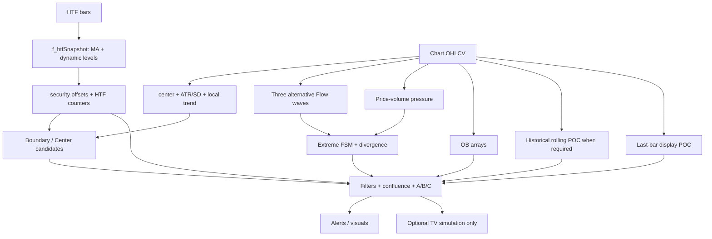

# Prizrak v2.1 — аудит алгоритмов и временной семантики

Дата: 2026-11-09. Режим: read-only анализ источника; Pine не компилировался и не запускался. Никакие TV/.NET ордера этим аудитом не включаются.

## 1. Источник и сила доказательства

- **VERIFIED:** в workspace найден `Prizrak_v2.1.zip`, не файл с буквальным именем `Prizrak_v2.1(1).zip`. SHA-256 ZIP: `ad2027d352509ff6911acabe8b515f0faa9456a20e428ce84021f1e027c73e62`. Идентичность отсутствующему варианту имени без его байтов — **UNKNOWN**.
- **VERIFIED:** архив содержит один обычный `Prizrak_v2.1.pine`, 99 625 байт, 1563 строки. Все строки прочитаны. SHA-256 Pine: `4332e9836b4443c8d72f7f0d3f297eb2b70d8e56eb7648dc19c7ebf7b6766d4e`. Перед извлечением проверены traversal, абсолютные пути, symlink, расширение и размер; копия извлечена в отдельный системный temp-каталог с атрибутом read-only. Исходный ZIP не изменён.
- Далее `P:L` означает строку извлечённого Pine с указанным хешем; это устойчивее ссылки на временный машинный путь.
- **SOURCE_CLAIM:** заголовок называет код `Independent ATR Market Structure Toolkit + Flow`; P:108–110 утверждает независимый функциональный аналог, а не защищённую исходную формулу. Подлинность оригинальному закрытому Prizrak, авторство и лицензия на перенос кода — **UNKNOWN**. Исследовать описанные математические гипотезы можно без объявления такого переноса.
- `Ultimate-Moving-Average-Indicator.zip` из §8 `additional-strategy-research-plan.md` — другой архив с описанным там `.ex4`. Он не является источником данного Pine-аудита и здесь не запускался/не декомпилировался.

**VERIFIED** ниже означает формулу/ветвление, прочитанные в исходнике. Это не подтверждение численного поведения Pine runtime. Для встроенных `ta.*`, `na`, seeds и MTF остаётся отдельная необходимость выходных векторов.

## 2. Полная карта функций и зависимостей

| Функция / блок | Строки P | Входы → результат / потребители |
|---|---|---|
| `strategy`, inputs | 1–171 | TV свойства, HTF/channel/OB/profile/Flow/filter/strategy/display config; значения — источник, не defaults TrendBot |
| `f_ma` | 177–188 | src, length, type → EMA/SMA/WMA/RMA; все четыре вызываются каждый бар; HTF snapshot |
| `f_center` | 190–199 | close/HLC3 → EMA/RMA/HLC3 EMA/Custom Close; local channel |
| `f_dynamicLevels` | 205–239 | pivots, ATR, persistent support/resistance → role reversal/break event; HTF |
| `f_htfSnapshot` | 243–253 | MA + levels + `offsetInHtf` → tuple time/close/MA/levels/events |
| `f_findOppositeCandle` | 255–261 | исторические свечи 1..lookback → ближайшая противоположная свеча; OB |
| `f_stopPrice` | 263–276 | direction/method/entry/bands/signal OHLC/ATR → TV stop |
| `f_targets` | 278–301 | channel или fixed RR → два TV target |
| `f_trendText`, `f_alertMessage` | 303–315 | enum-like state → строка; alerts |
| `f_clamp100`, `f_flowSmooth` | 322–329 | clamp; EMA/RMA каждый бар → wave/pressure smooth |
| `f_flowWave` | 332–348 | три независимых raw wave → clamp → optional smoothing → clamp |
| `f_flowStateText`, `f_flowClassCode` | 350–373 | presentation state/class → текст/код, не вероятность |
| `f_localPoc` | 378–421 | последние OHLCV → historical rolling approximate POC |
| `f_flowAlertMessage` | 423–448 | wave/pressure/context/OB/POC → строка и расстояние POC/ATR |
| HTF request/alignment/FSM | 454–517 | security tuple → counted distinct HTF snapshots → persistent regime |
| local channel/trend/gates | 523–554 | MA, ATR/SD, volume/wicks → bands и gates |
| boundary/center candidates | 560–620 | gates + текущий closed bar → взаимоисключающие направления; Boundary precedence |
| OB lifecycle | 626–711 | displacement + source candle → box arrays; expiry/break/cap |
| display profile/POC | 717–833 | last-bar-only allocation → line/table/POC touch alert |
| wave/pressure/divergence | 842–905 | raw waves; price-volume transform; paired confirmed pivots |
| две Flow FSM | 907–1004 | extremes → EARLY/return/invalid events; suppression/rearm |
| confluence/classification | 1007–1139 | ATR history, HTF, dynamic/OB/POC, pressure/divergence → confirmed/blocked/class/TV candidate |
| market-mode label/plots | 1145–1246 | UI only; часть скрытых plots — alert placeholders |
| alerts | 1252–1336 | conditions + dynamic `alert(..., alert.freq_all)` на closed chart bar |
| TV strategy/BE | 1342–1511 | optional simulated entries/exits/50% targets/BE/plots |
| state table | 1518–1562 | last-bar display; не dataset исторических решений |

## 3. A — channel, setup и HTF

### Channel и local trend

Обозначения: `C/O/H/L/V` — chart OHLCV; `A=ta.atr(channelAtrLen)`; `E=ta.ema(C,centerLen)`.

- EMA center = `E`; RMA center = `ta.rma(C,N)`; HLC3 Smooth = `ta.ema((H+L+C)/3,N)`.
- Custom Close = `E + response*(C-E)`; в Core такого center enum нет.
- half-width = `A*channelAtrMult` либо `ta.stdev(C,stdLen)*stdMult`; bands = center ± half-width. StandardDeviation ожидает population/biased built-in contract; точные `na`, warmup и float vectors не были исполнены. Core явно считает population SD в decimal.
- P:529: width percent = `100*(upper-lower)/abs(center)`, а не абсолютная цена и не знаменатель close.
- P:531–536: persistent local trend меняется по одному знаку slope center; flat center **сохраняет прежнее направление**. Нет требования `C>=center` для Bull. Core `CalculateLocalTrend` (760–781) требует slope **и** положение close; иначе Neutral. Это существенная, а не косметическая разница.

### Boundary

P:573–579 LONG требует confirmed bar, enabled family, width%, optional volume/candle, `L<=lower`, `(C>lower OR bullishRejection)`, `abs(C-center)>=ATR*minDistanceAtr`, `C<center`, local allowed, HTF allowed. SHORT зеркален.

`bullishRejection = C>O AND lowerWick>=max(abs(C-O),mintick)*ratio`. Поэтому в исходнике возможно принятие rejection-веткой **без strict close reclaim**. Проверка close в собственной половине канала и distance отсутствуют в V1 Core. Pine width gate процентный; Core `MinimumChannelWidth` — положительный абсолютный полный span. Параметр countertrend допускает local mismatch; при отключённом HTF-фильтре HTF не требуется.

**VERIFIED:** это не эквивалент `BoundaryRejectionSetupEvaluator.EvaluateDirection` (315–394), где LONG требует `L<=lower AND C>lower`, confirmed HTF/LocalTrend Bull, полный width>=minimum и quality. Не заменять evaluator Pine-формулой.

### Center Retest

P:584–590 LONG: confirmed/enabled/width%/volume/candle gates, slope-trend Bull, `L<=center`, `C>=center`, `C>O`, HTF allowed. **Нет `O>=center`**. В Core `CenterRetestSetupEvaluator.EvaluateDirection` (298–373) open-hold обязателен и minimum-width отсутствует. Pine поэтому принимает некоторые body-cross-through свечи и исключает узкие каналы, которые Core оценивает иначе. Countertrend не отменяет retest local direction.

P:597–603 подавляет конфликтующие направления и предпочитает Boundary при совпадении семейства. Core возвращает обе семейные observations; будущая passive projection должна сохранить overlap, не представлять его независимым подтверждением.

### Confirmed pivots / dynamic S/R

P:205–239 сначала проверяет старые levels, затем добавляет подтвердившиеся pivots:

- resistance break: `C>resistance+ATR_now*breakBuffer`; support break: `C<support-ATR_now*breakBuffer`;
- break flips role, очищает прежний slot; resistance имеет precedence при одновременной истинности;
- candidate support = pivot low − `nz(ATR_at_pivot,ATR_now)*padding`; принимается, только если ниже текущего close;
- candidate resistance зеркален и должен быть выше close.

ATR padding относится к **pivot bar**, fallback — ATR confirmation bar. Break buffer пересчитывается от **текущего** ATR. В Core `CalculateStructuralLevels`, `FindPivotCandidates`, `ApplyBreak`, `TryAtrAt` buffer заморожен при доступности confirmation window; anchor не сдвигается padding-ом, ties отвергаются strict pivot test. У Pine tie-handling делегирован `ta.pivot*` и не доказан равным. Нет основания объявлять одинаковые уровни/flip times.

P:488–512 считает distinct aligned HTF timestamps. Bull/Bear count сбрасывает противоположный, neutral сбрасывает оба, но **не сбрасывает `htfTrend`**. Core может подтвердить Neutral после N distinct HTF bars (`CalculateHtfContext`, 875–898). Даже при одинаковых MA потоки regime могут расходиться.

## 4. B — три PrizrakFlow wave отдельно

Пусть `clip(x)=max(0,min(100,x))`, `S_N` — выбранный EMA/RMA. `src=flowSource`, по исходному input это close, но `input.source` допускает внешний series; его происхождение тоже должно быть frozen.

| Метод | Raw formula P:332–344 | Семантика и cold-start риск |
|---|---|---|
| Stochastic-style | `hi=max(H,Lkb)`, `lo=min(L,Lkb)`; если `hi-lo>mintick`, `100*(src-lo)/(hi-lo)`, иначе 50 | Диапазон именно chart high/low, не extrema src. Custom src вне диапазона затем clamp. Нет собственного full-lookback readiness gate; early history зависит от built-ins |
| RSI-style | `ta.rsi(src,Lkb)` | RSI использует сглаженные gains/losses изменений src; стандартная запись `100-100/(1+RMA(max(Δsrc,0))/RMA(max(-Δsrc,0)))`. Seed, `na`, нулевые gain/loss и первые валидные значения должны подтверждаться TV vectors, не нашим произвольным 50 |
| ATR-normalized | если `ATR(Lkb)>mintick`, `50+50*(src-S_Lkb(src))/(ATR(Lkb)*scale)`, иначе 50 | Масштаб относительно MA/ATR, не stochastic и не RSI; при недоступном/маленьком ATR выбирается fallback 50, а не явный Unknown |

Общее после выбора: `raw=clip(rawMethod)`; вычислить `candidate=S_smoothLen(raw)` на каждом баре; wave=`clip(extraSmooth?candidate:raw)`. Signal line=`S_signalLen(waveCalculated)` в P:845: **ни один entry/FSM не использует crossing signal line**; она выводится скрытой data-window линией P:1202. Это не скрытый MACD-like trigger.

Все три raw ветви вычисляются до выбора; значения `flowLookback`, smooth types/lengths, extra smoothing и signal smoothing — разные исследовательские измерения. Эквивалентность физического окна при переходе 5m→15m→30m не следует из одинакового числа баров. Warmup+seed `HistoryStart` регистрируются независимо. Pine float/series/`na` нельзя заменить decimal arrays с иной инициализацией и назвать переносом.

## 5. C — buyer/seller pressure: точная формула

P:855–872:

1. `D=max(nz(localAtr,mintick),mintick)`.
2. `usable=flowUseVolume AND volume!=na AND SMA(V,N)!=na AND SMA(V,N)>0`.
3. `factor=usable?clamp(V/SMA(V,N),0.25,2):1`.
4. `q=(0.40*(C-Cprev)/D + 0.35*(C-O)/D + 0.25*(C-center)/D)*factor`, где первая delta использует `nz(...,0)`.
5. `M=highest(abs(q),N)`; raw buyer=`M>0?clip(100*max(q,0)/M):0`; raw seller=`M>0?clip(100*max(-q,0)/M):0`.
6. Оба raw ряда независимо EMA/RMA smoothing; выбирается raw или smoothed. `net=buyer-seller`.
7. EARLY buyer-turn = crossover(buyer,seller) **OR** `(buyer>=earlyThreshold AND buyer>seller)`; SHORT зеркален. Crossover-ветвь сама не требует раннего minimum threshold.
8. CONFIRMED long-quality требует `buyer>=confirmedThreshold`, candle и divergence gates. **Не требует buyer>seller**. Для сглаженных рядов обе стороны могут одновременно иметь положительную величину. Neutral band управляет цветом histogram, а не торговым veto.

**VERIFIED, несоответствие комментария:** P:853–854 обещает fallback при zero volume, но P:857 не проверяет `V>0`. При `V=0` и положительной средней `usable=true`, factor=0.25; это не price-only factor=1. SMA включает текущий объём. Это также не Core RVOL (текущий объём / среднее предыдущих N, `rolling-indicators.md:42`).

**VERIFIED:** нет bid/ask, aggressor classification, trades, OI или L2. Buyer/seller — детерминированная переработка цены и bar volume, не измерение реальных покупок/продаж. **HYPOTHESIS:** такая нелинейная память может добавить информацию относительно price-only control; причинная/статистическая добавочная ценность пока **UNKNOWN**. Outlier в окне normalization меняет последующие масштабы/threshold crossings.

## 6. D — extremes, EARLY, CONFIRMED, BLOCKED, divergence, rearm

Две независимые persistent FSM; состояния 0 Neutral, 1 Extreme, 2 Early, 3 Returned, 4 Invalidated (P:907–1004). Изменения только при confirmed chart bar и flowEnabled.

- LONG начинает episode при wave<lower, SHORT при wave>upper. Счётчик bars-in-extreme увеличивается только внутри соответствующего strict extreme.
- EARLY возможен уже на первом extreme bar, если minimum count и pressure/candle/divergence проходят. Это closed-bar предупреждение в extreme, **не intrabar** сообщение и не подтверждённый выход из extreme.
- LONG return: crossover выше lower, но wave<upper; SHORT зеркален. Threshold equality не crossover. Jump сразу в противоположный extreme инвалидирует episode.
- EARLY adverse invalidation: close выходит за сохранённый low/high ± **текущий** localATR*invalidationMultiplier; проверяется пока wave остаётся в extreme. Это не полностью определённая долговечная сценарная invalidation.
- Return переводит FSM в state 3 **до** post-filters. `return && filters` даёт CONFIRMED, иначе BLOCKED. Позднейшее улучшение filters не переоценивает тот же return.
- States 3/4 rearm только на последующем neutral-zone bar. Если сразу после return снова extreme той же стороны, этот episode подавляется до neutral reset. Нет wall-clock expiry/независимого timeout. Эти semantics надо зарегистрировать, а не автоматически назвать дефектом или скопировать в signal lifecycle.

Divergence P:877–905: price pivot и wave pivot должны подтвердиться **на одном pivot bar**. LONG: новый price low ниже предыдущего paired price low, новый wave low выше предыдущего paired wave low; SHORT зеркален. Пары обновляются только при одновременной валидности; lag=right chart bars, validity отсчитывается от **confirmation**, не от painted anchor. Visual-only не gate; Filter требует recent same-direction divergence; Booster влияет на class B.

Confluence P:1007–1096:

- recent ATR setup — `barssince<=window`, включает текущий бар; в этих ATR conditions нет существующего HTF gate;
- FLOW ONLY снимает только ATR-mode requirement: отдельные HTF/middle/optional filters продолжают действовать;
- FLOW+ATR требует recent ATR; FULL CONFLUENCE дополнительно HTF; EARLY WARNING в switch фактически `true`, остальные filters сохраняются;
- `allowCountertrend` допускает HTF mismatch в Flow, хотя input называется local countertrend boundary;
- dynamic proximity использует пересечение диапазона свечи с зоной уровня ±ATR distance; OB proximity — distance **close** до box, POC — distance close до точки. Это разные наблюдения;
- A = aligned HTF **и** recent ATR; B = хотя бы одно из HTF/ATR/dynamic/OB/POC/divergence boost; C = остальное. Это эвристические классы confluence, не calibrated confidence и не validation;
- class применяется к confirmed event; early/blocked/invalid имеют отдельные labels. Общий state-text предпочитает LONG FSM, если обе нетривиальны.

**VERIFIED research-source issues:**

- Divergence mode `Off` не выключает вычисление `flowBullDivergence/flowBearDivergence` и их alerts P:1282–1285,1325–1328; выключены visuals и специфические filter/boost effects. Это static control-flow finding; TV run не выполнен.
- Для BLOCKED не-HTF причин есть chart labels, но dynamic blocked alerts P:1329–1332 только HTF. Нет полного устойчивого reason journal.
- `alert.freq_all` допускает несколько разных сообщений на одном закрытии: extreme+EARLY, ATR+Flow и т.д. Нет durable event ID, receipt/restart semantics или outbox. P:1252–1254 прямо отличает `alertcondition` от практических strategy `alert()`.

## 7. E — OB и два разных POC

### Order Blocks

P:630–711: bullish displacement=`C-lowest(L[1],impulseWindow)>=ATR_ob*multiplier` плюс bullish body; bearish зеркально. Только rising edge impulse boolean (`not impulse[1]`) создаёт block. Ищется ближайшая историческая opposite candle 1..searchBack; zone body или wicks. Birth — **текущий confirmation/impulse bar**, хотя box рисуется начиная с **прошлой source candle**. Это ретроспективная геометрия, не доступность OB на исходной свече.

Invalidation — strict close ниже bull bottom / выше bear top, wick не ломает. Expiry=`bar_index-birth>lifetime` (не >=). Capacity ограничивает общее число, не отдельно каждый direction. Движок зависит от графических boxes и трёх parallel mutable arrays. `showOrderBlocks=false` или clear уничтожает **данные**, тем самым меняет Flow filters/classes и доступность OB stop: display config не независим от алгоритма. При новом block проверка invalidation старых boxes уже прошла; new block не проверяется тем же циклом до следующего бара.

Это approximation свечной структуры, не доказательство институциональных ордеров. В .NET отдельного OB detector нет; не переносить mutable drawing handles в Core. Для эксперимента нужны immutable source/confirmation/invalidation references и отдельный detector version. Сложность: поиск O(searchBack), scan O(activeBlocks); causal provenance и lifecycle дороже самих сравнений.

### Display POC

P:740–785 вычисляется только при `barstate.islast`. На диапазоне `[lowestLow,highestHigh]` создаётся фиксированное число bins; candle volume распределяется пропорционально overlap цены с bin. Узкая свеча (`range<=mintick`) отдаёт весь V bin с HLC3. Выбирается первый максимальный bin, результат — его **середина**. Missing volume превращается в 0. Flat-range branch выдаёт close только при положительном текущем volume. Линия P:815–827 растянута в прошлое, но **это не historical POC series**. `pocTouched` P:833 и display/table/alerts не доказывают историческое наличие этого уровня.

### Historical rolling POC

`f_localPoc` P:378–421 действительно считает rolling OHLCV approximation на каждом баре, **если** `flowNeedRollingPoc` P:1052 true: required POC filter либо Flow backtest Channel TP2 POC/dynamic target. Он не использует будущее в явном цикле 0..available−1, но early history берёт неполное окно без UnknownWarmup. Degenerate branch `binSize<=mintick` возвращает close **даже без положительного volume**; display branch проверяет иные условия. Поэтому даже эти две approximate POC реализации не идентичны на границах.

`flowPocReference=rolling if non-na else currentPoc` P:1056. Когда rolling **не запрошен**, class B всё ещё использует `flowPocNear` P:1093–1094. На historical не-last bar currentPoc обычно na; на realtime last bar он посчитан. **INFERENCE:** один и тот же recent event может получить иной confluence class после reload/смены last bar; это явный last-bar dependency, независимый от HTF. Возможный эффект class→TV selection зависит от режима, поэтому нужен отдельный prefix/reload test, а не заявление, что все сигналы обязательно repaint.

Rolling allocation O(lookback*rows) на бар, worst declared bounds 500*60; это оценка операций из loops, не benchmark. Display profile платит эту цену только на last bar. Core `CalculatePoc` POC по последним **N точным price-volume observations**, binned с явным bin size от minimum trade price, выдаёт **начало** нижнего winning bin; OHLCV не подставляет. Два метода имеют разные данные, окна, bin anchors и output convention.

## 8. F — причинность и independent parity plan

P:461–483 выбирает `offsetInHtf=1` realtime / 0 historical; `chartAlignmentOffset=0` realtime / 1 historical; `request.security(...gaps_off,lookahead_off)`. Исторический HTF tuple сдвигается на один **chart bar**; realtime запрашивает предыдущий **HTF bar**. Эти offsets нельзя считать взаимозаменяемыми по комментарию P:454–460.

**VERIFIED:** chart `barstate.isconfirmed` не удостоверяет, что HTF закрыт и доступен. **UNKNOWN:** полная historical/live equivalence этого tuple, delayed pivots и persistent counters без TV vectors. Official [Other timeframes and data](https://www.tradingview.com/pine-script-docs/concepts/other-timeframes-and-data/#lookahead) различает confirmed historical и developing realtime values; [Bar states](https://www.tradingview.com/pine-script-docs/concepts/bar-states/#barstateisconfirmed) отдельно предупреждает об `isconfirmed` в security. `lookahead_off` сам по себе не сертификат отсутствия repaint.

Обязательные независимые будущие проверки:

1. Экспорт неизменных OHLCV + полных input settings + symbol/chart type/session/timezone + Pine hash. Для каждого prefix K выполнить чистый прогон на [0..K], сравнить **все ранее опубликованные** values/events с прогоном [0..K+1..M]. Отдельно states, class, suppression, OB birth и rolling POC; исключение visual endpoint не должно исключать class dependencies.
2. Записать prospective bar-close outputs, затем reload тех же баров как historical; сравнить по bar interval и HTF input cut, не по позиции label. Чисто historical prefix не проверяет realtime branch.
3. HTF-boundary vectors на :00 и соседних :45/:15 для 15m/1h: chart close до HTF arrival, HTF arrival до chart close, совпадение с разным stable sequence; right pivot window завершён/не завершён; equal extrema, gaps, first available HTF, historical→realtime transition, reconnect/reload. HTF, не являющийся строго старшим, отклоняется явно.
4. Seed/cold-start vectors: пусто/короче периода/ровно warmup, постоянная цена, no/zero volume, zero ATR, outside-source range, all-gain/all-loss RSI, threshold equality, one-bar jump через обе extreme zones, blocked return затем filter recovery.
5. Cross-language golden vectors сравнивают matching outputs **сначала при одинаковой формуле**, документируя decimal-vs-float tolerance, начальный seed, `na/nz`, pivot ties, inclusive windows и bar-close timestamps. Для заведомо разных formulas — тест различия, а не подгонка Core к Pine.

Ничего из этого не выдаётся за выполненную Pine parity. Official [Execution model](https://www.tradingview.com/pine-script-docs/language/execution-model/) подтверждает последовательную историю, persistence `var`, rollback и смену статуса elapsed realtime после reload; это документационное основание тестов, не эмпирическая проверка данного скрипта.

## 9. G — TV simulation не является исполнением TrendBot

P:2–17: `pyramiding=0`, commission percent=0.04 на filled order, slippage=1 tick, `process_orders_on_close=true`, every-tick=false, on-fill=false. Эти **SOURCE_CLAIM defaults данного файла** не принимаются в V1 TrendBot.

P:1357–1469: заявки только enableBacktest + confirmed + flat + единственное выбранное направление. Planned entry=close; quantity=`equity*riskPct/100/(abs(entry-stop)*pointValue)` при distance>mintick. Нет Binance tick/step/min-notional/margin/funding/spread/queue/latency model. Stop принудительно минимум tick с loss-side; OB fallback явно превращается в Signal candle при отсутствии нужного OB. Fixed RR и channel targets различаются; Flow channel TP1 всегда center, так что некоторые сигналы не станут TV trade из-за invalid targets. Два выхода по 50%.

P:1475–1495: BE trigger проверяет `high>=TP1` / `low<=TP1`, **не receipt фактического TP1 fill**, и перемещает stop к planned entry, не обязательно `strategy.position_avg_price` после slippage. Последующий exit пытается закрыть 100% remainder. Порядок fill/exit reservation, gap и same-bar ambiguity требует TV run/export; комментарий «conservative» не достаточное доказательство.

Official [Strategies / Broker emulator](https://www.tradingview.com/pine-script-docs/concepts/strategies/#broker-emulator) описывает OHLC path assumptions и gap fills; [process_orders_on_close](https://www.tradingview.com/pine-script-docs/concepts/strategies/#process_orders_on_close) допускает same-closing-tick fills, недостижимые для уведомления, полученного позже. TV simulation не используется для оценки пользовательской цены после `publishedAt` и не переносится в signal-only runtime.

## 10. Pine → .NET: ни один полный алгоритм не объявлен identical

| Pine | Существующий .NET путь / символ | Классификация | Почему не numerical equivalence |
|---|---|---|---|
| `f_ma` SMA/WMA | `Core/RollingIndicatorMath.cs:Mean,WeightedMean`; `PriceContextFeatureCalculator:MovingAverageSeries` | cannot verify | textbook weights совпадают; нет общих TV vectors, `na` и float/decimal contract |
| EMA/RMA / `f_flowSmooth` | `RollingIndicatorMath:RecursiveMean` | conceptually similar but different formula/seed contract | Core mean seed первых N; Pine ta.* seed не задан нашим кодом; warmup не общий |
| ATR | `RollingIndicatorMath:TrueRanges`, `PriceContextFeatureCalculator:AtrValue` | conceptually similar but different seed/warmup | Core N+1 готовность, явный history start, SMA/RMA выбор; Pine `ta.atr` |
| EMA/RMA/HLC3 center + ATR/SD bands | `PriceContextFeatureCalculator:CalculateChannel,PopulationStandardDeviation` | conceptually similar but different contract | HLC3 Core EMA/RMA, Pine только EMA; seeds/quality/rounding |
| Custom Close | `PriceContextChannelCenterKind` | missing | нет такого enum/формулы |
| dynamic levels/pivots | `CalculateStructuralLevels,FindPivotCandidates,ApplyBreak` | conceptually similar but different formula | frozen confirmation buffer против pivot padding + changing break buffer; ties/registration order |
| HTF snapshot/counters | `CalculateHtfContext` | conceptually similar but different formula/time alignment | Core causal histories; может подтвердить Neutral; Pine sticky regime и security offsets |
| local trend | `CalculateLocalTrend` | conceptually similar but different formula | Core price side + slope + neutral, Pine slope-only sticky |
| boundary | `BoundaryRejectionSetupEvaluator:EvaluateDirection` | conceptually similar but different formula | strict reclaim, price side, width units, quality и optional gates отличаются |
| center retest | `CenterRetestSetupEvaluator:EvaluateDirection` | conceptually similar but different formula | open-hold обязателен только Core; width gate только Pine |
| volume confirmation | `RollingIndicatorCalculator`, `ScreenerFeatureCalculator` RVOL | conceptually similar but different formula | current-inclusive SMA против preceding N; threshold отдельный |
| три Flow waves, pressure, divergence/FSM/classes | `LaneCFeatureEvaluator` не аналог этого Flow | missing | Lane C измеряет captured trades/depth; это другая информационная семья |
| OB detector | `PriceContextFeatureCalculator` | missing | dynamic pivots не Order Blocks |
| display/rolling approximate POC | `PriceContextFeatureCalculator:CalculatePoc` | conceptually similar but different formula/data | OHLCV uniform allocation против exact trades; bin center против start |
| `f_stopPrice`,`f_targets`, TV fill/BE | `RiskEvaluationEngine`, `SimulatedRiskSimulator`, `OhlcvFillSimulator` | conceptually similar but different formula/assumptions | чужие trade assumptions; сигналам не нужны risk/position/fill |
| alert/string/state visuals | `Program.Main`, `LaneASignalEvaluator` | missing end-to-end delivery | нет passive signal card/outbox/Telegram; chart render не durable service |

Пути в этой таблице относительны `src/TradingBot.Core/`, кроме явно названного App и `src/TradingBot.Backtesting/SimulatedRiskSimulation.cs`. Полная signal-only композиция и исследовательские решения определены в соседних [архитектурном review](TRENDBOT_FINAL_ARCHITECTURE_REVIEW.md), [decision register](STRATEGY_RESEARCH_DECISIONS.md) и [roadmap](SIGNAL_ONLY_IMPLEMENTATION_ROADMAP.md).
