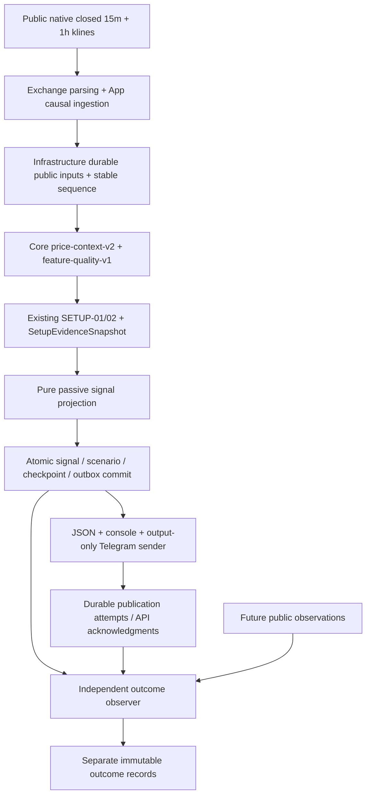
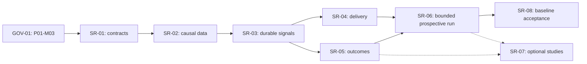

# Signal-only 15m/1h — contracts и проверяемая дорожная карта

Дата: 2026-11-09. Статус: **design reference; formal registration complete, implementation not started**. Принятая product boundary берётся из `PROJECT_SPEC:Approved current scope — 2026-11-06` и `additional-strategy-research-plan.md:§§1–6`. Graph: 19 phases, 43 milestones, 152 tasks (110 DONE, 42 BLOCKED, 0 READY); GOV-01.1/01.2 are DONE, all 31 SR tasks remain BLOCKED. The 33 work IDs map one-to-one in `docs/TASKS.md`; the original 119 task IDs/statuses/evidence and P17 blockers are preserved.

Существующий код/дефекты/проверки: [architecture review](TRENDBOT_FINAL_ARCHITECTURE_REVIEW.md). Формулы источника: [Pine audit](PRIZRAK_V21_ALGORITHM_AUDIT.md). Frozen methodology и H0/reject criteria: [research decisions](STRATEGY_RESEARCH_DECISIONS.md).

## 1. Registration outcome and history

**VERIFIED:** `tools/validate-docs.ps1:60–65` permits only phases 00–18; no Phase 19 was added. The formal work was registered in P01-M03 and P15-M03, separately from execution/shadow gates. The unique work-ID mapping and formal status/dependency source are in [`TASKS.md`](../TASKS.md#signal-only-work-item-mapping).

Historical pre-repair note: the fixture harness depended on fixed totals and literal P17 wording, and PowerShell 7 was not initially available. This is superseded: GOV-01.1 repaired behavioral fixtures, official Microsoft.PowerShell 7.6.9.0 is installed, and native fixture/validator runs passed; exact outputs are recorded in [`HANDOFF.md`](../../HANDOFF.md).

GOV-01.1 and GOV-01.2 are formally DONE. The 33 work items are registered with one formal ID each; all SR rows remain BLOCKED. Registration did not change runtime, canonical source, trade behavior, any pre-existing task row/evidence/status, or P17 blockers. The selector has no READY task because the registered signal branch is blocked and the prior graph has an explicit blocker.

GOV-01 acceptance is verified: fixtures use ID/column mutations and dynamic graph discovery rather than fixed totals or blocker wording; positive/negative graph behavior, multiple READY, explainable/unexplained zero READY, and selector transition are covered. Native PowerShell 7 fixture suite, docs validator, source hash, and registered graph checks passed. No P17 text was altered to satisfy tests.

## 2. Минимальная pipeline и обязанности



- **Exchange.Binance:** wire schema, public REST/WS, native interval metadata, closed flag/raw T/E, protocol errors and public reconnect. Никаких вычислителей стратегий.
- **Core (BCL-only):** existing pure context/quality/setup/evidence; proposed small passive projection и immutable signal/scenario/outcome value contracts. Никакого clock/I/O/HTTP/SQLite/Telegram/private API, OrderIntent/RiskDecision/reservation/Position/fill side effect. Не вводить отдельный универсальный strategy framework.
- **Infrastructure:** собственный signal-only SQLite journal/outbox/checkpoints; bounded public input archive и output transport. Переиспользовать transaction/canonical/identity patterns, не общий trading ledger и не OrderIntent journal. Изоляция schema от order-state migration снижает accidental coupling.
- **App:** отдельный явный signal-only composition root/CLI, allowlisted public input + выбранные outputs, per-instrument serial processing, cancellation/health/restart. Не менять `shadow` флагами и не создавать fake Decision Allow, Filled/PositionOpen либо neutral B/C.
- **Backtesting:** signal-study manifest, causal observation labels/metrics и opportunity table; reuse исправленного replay, но без requirement reconciliation или risk approval. Signal outcomes — наблюдения, не simulated fills.
- **DataTool:** bounded acquisition/coverage/study CLI над Infrastructure+Backtesting согласно существующему project graph. Он не должен ссылаться на Exchange/App: acquisition wiring выполняется App либо данные принимаются через существующие допустимые границы, без нового cross-module reference.

## 3. Причинный контракт ingestion/recovery

1. Native Binance `15m` и `1h`, UTC time grid. Нормализовать логический интервал `[open,endExclusive)`, сохраняя raw Binance inclusive close `T`; не потерять дополнительную миллисекунду. Подписываться на closed events `x=true`, а REST warmup помечать фактическим временем получения, не исторической live availability.
2. Source key содержит venue/product/symbol/timeframe/open; отдельные source event/revision identities, payload hash и stream/session sequence. Durable global processing sequence назначается однократно при intake и продолжается после restart. Не использовать Core `bar:{symbol}:{open}` как единственный mixed-TF key: counterexample воспроизведён в review.
3. Отдельно сохранять: bar open/raw close/endExclusive; source event time; exchange E/T если существуют; local receive; availability после parse/validation; stable sequence; decisionAt; publish attempts/acceptedAt. Отсутствующее exchange time остаётся null, receive не замещает market event time.
4. Causal eligibility: закрыт, `end/confirmation <= decisionAt`, event и availability<=cut, sequence<=cut. Prefix close-bound defect общего runner исправляется в SR-02; source Bars нельзя выдавать за L2 в `MultiSourceLaneKind` или CaptureEnvelope.
5. Один durable 15m close trigger оценивается с **последним доступным закрытым 1h** в объявленной freshness policy. Часовой бар, закрывшийся одновременно, но пришедший позже, не используется до собственного receive/availability. Если предыдущий HTF непригоден — Unknown; не бесконечное ожидание, не использование незакрытого HTF. После commit этот cut неизменен.
6. Confirmed HTF pivot известен только после полного правого окна и max availability компонентов; lag в минутах=`right*HTF duration` плюс фактическая задержка данных. HTF confirmation count — distinct closed bars, не дубликаты.
7. Exact duplicate closed payload получает receipt, но не второй evaluation/publication. Конфликтующий final payload сохраняется как correction diagnostic; не перезаписывает прошлый canonical input/сигнал. Conservative baseline — first accepted final per frozen cut; иная future correction policy требует explicit version/generation и не retroactive publication. Пропуски не заполняются синтетическими свечами.
8. Late/reordered bars журналируются по фактической availability/stable order. Старый 15m бар не становится новым signal trigger; уже committed past scenario не переоценивается. Backfill может восстановить пригодность **будущих** окон под объявленной quality policy. История для recursive seeds и HistoryStart сохраняется; случайное обрезание warmup после restart меняет формулу и недопустимо.
9. Restart: читать committed checkpoint, verify config/input hashes, восстановить histories/scenario/rearm/outbox; продолжить seq. Не сканировать прошлое и повторно генерировать alerts. Неполный atomic commit откатывается целиком; committed receipt повторяется идемпотентно.
10. Unknown periods/freshness/history coverage/missing required HTF→diagnostic UnknownConfiguration/Warmup/Stale/Gap; нет numeric sentinel, подстановки Pine defaults или фиктивного Ready. Необязательные price-volume/Lane B/C не становятся gates SETUP-01/02. Вызов pure calculator получает корректный causal prefix, не весь будущий dataset с последующим игнорированием quality reasons.

## 4. Proposed schema contract — без числовых defaults

Это спецификация будущего контракта, не существующие C# types. `signalId` — logical scenario identity; `recordHash` — integrity content; `SetupEvidenceSnapshotId` — evidence-content identity. Они различаются.

| Поле / группа | Тип / invariant / unknown handling |
|---|---|
| schemaVersion / projectionVersion | explicit immutable version; unsupported→reject/diagnostic, не parse-as-current |
| signalId / scenarioAnchorId | SHA-256 canonical tuple `(identityVersion, venue, product, symbol, setupTF, familyVersion, direction, anchorIdentity, configHash)`; clock, run restart ID, delivery attempt в ID не входят. Anchor/rearm rule должен быть задан, иначе diagnostic candidate |
| direction / family | Long/Short; baseline только BoundaryRejection/CenterRetest. R1/R2/каждая Flow wave — другой registered family/version, не alias V1 |
| venue / product / symbol / setupTimeframe / htfTimeframe | Binance USD-M perpetual, 15m/1h; проверять профиль явно, не принять любой timeframe, разрешённый generic calculator |
| formulaVersions / configHash / studyId | price-context-v2, feature-quality-v1, setup family version и новая projection/scenario policy versions; canonical config snapshot; study label RESEARCH. Assembly/commit reference отдельно, dirty source hashes retained |
| inputSetHash / provenance hashes | native source keys, accepted revision hashes, histories/seed start, global/source sequences, snapshot/evidence IDs; raw market data не заменять чужими counters |
| signalBarInterval | UTC `[open,endExclusive)` + raw inclusive close; подтверждён и доступен; один source timeframe |
| htfCut | exact last used 1h bar, confirmation availability/sequence, regime and pivot confirmation references; pending HTF не confirmed |
| causalCursor | decision input cut `(AsOf,MaxStableSequence)` и per-source sequence refs; не позднее decisionAt |
| receive/availability/confirmation evidence | значения использованных inputs; decisionAt>=max обязательных доступностей и closure/confirmation; historical modeled availability маркируется отдельно |
| decisionAt | фактический logical decision completion time; не signal bar close и не post-hoc invented historical timestamp |
| referencePrice | положительное значение, source kind (например observed close/after-publication BBO), source event ID/time/availability; close не guaranteed entry |
| scenario / invalidation | frozen enum/version/level-or-rule/source/cut; не risk stop order. Нельзя строить полноценный Ready card при неизвестной обязательной invalidation/scenario policy |
| expiry / rearm | explicit versioned condition/anchor and timestamp basis; отсутствие expiry/rearm policy→diagnostic, не unlimited повтор alerts. Не равны автоматически 15 минутам |
| targets / observation horizons | только если выбранный card/label contract их требует и правила заранее известны; optional omission явно, required missing→UnknownConfiguration. Не заполнять Pine RR/periods |
| qualityState / qualityReasons / conditionEvidence | original feature states, ages, coverage и stable reason codes; Unknown отличается от NoSetup и Invalidated; объяснения обоих направлений/семейств |
| ruleState | CandidateDiagnostic / ConfirmedOnClosedBar / NoSetup / Invalidated / Expired / Cancelled — предложение semantic vocabulary; это не DecisionOutcome.Allow |
| researchStatus / confidence | RESEARCH; statistically VALIDATED только ссылка на независимый frozen OOS/prospective assessment. Probability/confidence=null с reason до реальной calibration; A/B/C не probability |
| overlap/dependency links | same opportunity/episode/shared input/family dependence; одновременно SETUP-01/02 сохраняют обе причины, но не удваивают «независимые подтверждения» |
| recordHash / previousEventHash | immutable record integrity/revisions; поздняя correction/cancel/expiry — новое связанное событие, не переписанный исходный signal |
| publishedAt | **channel-specific derived receipt**, null до принятия публикации выбранным sink; хранить publication events отдельно, не включать в stable signal ID. Console flush/API ack не доказательство чтения человеком |
| separate outcome | outcomeId, signalId, labelMethod/version, reference decision/publish receipt, evaluatedAt/through, horizon/path source hashes, signed returns/MAE/MFE/first-passage bounds/censoring/Unknown reasons. Не order/fill/PnL фактической сделки |

В signal-only wire/config строго отсутствуют quantity, leverage, portfolio/equity, RiskApproved/OrderAuthorized, executor endpoint, private credential references и callbacks создания order. Не подставлять fake None-approved/zero-risk записи для обхода parser.

### Логические durable записи и ключи

Предпочесть boring SQLite transaction, не broker/event framework. Логические записи могут быть объединены физически при сохранении invariants:

- accepted public input/revision ledger: unique source key+revision hash и immutable raw/canonical provenance;
- consumer checkpoint + scenario state: единственный monotonic consumed sequence на partition/config generation; scenario anchor/rearm хранится с projection;
- signals / signal events: unique stable signalId и event-kind/revision; SHA content conflict→fail closed;
- outbox: unique `(signalEventId,channel,destinationReference,rendererVersion)`, payload hash и state; secret/destination plaintext не выводятся в evidence;
- delivery attempts/acks: unique attempt ID, monotonic attempt number, tryAt, result status, nextAttemptAt/deadline, provider message ID при наличии;
- outcomes: unique `(signalId,labelVersion,observationBoundary,horizon,revision)`, source hashes, quality/censoring.

Projection transaction атомарно сохраняет signal/diagnostic + scenario/rearm + input checkpoint + outbox. Crash после commit до ответа не создаёт вторую карточку; crash до commit не продвигает cursor. Failure записи блокирует **publication**, не создаёт ложный Ready. Outcome observer пишет отдельный журнал и не меняет исторический trigger.

## 5. Durable Telegram outbox и acknowledgment

1. Сначала journal/outbox commit, затем HTTP side effect. Sender получает pending row с lease/claim в ограниченной транзакции, отправляет вне DB transaction; lease и pending state переживают crash.
2. `Pending→Attempting→Accepted` либо `RetryScheduled / Failed / Expired`; каждая попытка сохранена. `Accepted` = успешный API response с message ID, не receipt пользователя и не read acknowledgment. Timeout-after-accept = **UnknownDelivery**, возможный duplicate.
3. Retries ограничены явно заданными max attempts/max age/backoff cap/rate-limit policy; respect Retry-After, cancellation и expiry. Числа в этом аудите не выбираются. Permanent auth/forbidden errors→Failed/diagnostic; нет бесконечного retry. После исчерпания окна доставка не гарантируется: «at-least-once попытки, possible duplicates», а не обещание eventual/exactly-once success.
4. Stable signal/event ID присутствует в карточке. Наш downstream consumer deduplicates по нему; Telegram `sendMessage` не получает выдуманный idempotency key. Человек может увидеть повтор; это честно отражается журналом. Retry не увеличивает research signal count.
5. Для JSON/console сохранять publication boundary/attempt отдельно. `publishedAt` для user-value берётся от выбранного конкретного channel receipt, а не от самого раннего недоставленного намерения; несколько каналов не сливаются в фиктивную zero-latency доставку.
6. Token только environment/external store, разрешённый sender читает его в runtime. Telegram URL содержит token: не логировать URL, raw exception, headers, bodies или configuration dump. Allowlisted diagnostics status/error class/retry timing и internal opaque destination reference. Token не хранится в SQLite/manifest/logs. Ротация token не меняет signalId.
7. Output-only: не poll chat commands, не принимать inbound callback для торгового действия, не добавлять кнопку «создать ордер». Health/delivery failure не обходит feature quality и не активирует execution.

## 6. Public-only threat model и негативные проверки

| Риск | Требуемая граница / tangible acceptance |
|---|---|
| accidental execution composition | signal root не создаёт private signer/client/executor/risk authorization/intent/reservation/position, независимо от существования этих assembly types; injected forbidden transport sink наблюдает zero calls на actual E2E |
| private/activation settings | explicit signal config parser отвергает соответствующие поля/режимы; не читает/не печатает значения секретов ради диагностики |
| SSRF/redirect/credential URL | approved public Binance hosts/routes и Telegram endpoint, HTTPS/WSS, no userinfo/arbitrary endpoints, redirect policy explicit; public feeds без API key/signature |
| poison/oversize frames, gaps/conflicts | bounded buffers/frame sizes, explicit quality reasons and no Ready on required-source failure; no synthetic gap fill |
| mutable state races / restart | один consumer read-modify-write на instrument partition, atomic projection checkpoint/outbox, hash/version validation; cross-instrument work независимо |
| late/missing/corrected bars | immutable source/event ledger, fixed cut, forward-only recovery; replay earlier published records byte-stable |
| disk full/SQLite busy/crash | no partial signal/outbox/checkpoint commit; bounded storage/retention dry-run safe; никаких migrations рабочих trading databases в signal smoke |
| rate limit/outage/ambiguous Telegram accept | bounded retries/expiry + durable attempts + duplicate-visible IDs; API accepted не claim user-read |
| overclaim science / ML selection | RESEARCH label, common opportunity table/Unknown, fixed OOS trials; no estimated success probability без calibration |

## 7. Registered requirements and formal task mapping

REQ-SIGNAL-001 through REQ-SIGNAL-006 are now stable requirements in `PROJECT_SPEC.md`, with task coverage in the formal backlog. `TASKS.md` is authoritative for the 33 one-to-one work-ID/formal-ID mappings, statuses, dependencies, acceptance, and validation; the old coarse group proposal below this roadmap is not a second task graph.



Baseline SR-08 formal tasks P15-M03-T020/T021 precede optional SR-07 tasks P15-M03-T022–T031 in the task order. No SR-07 item is a dependency of SR-08. All SR items remain BLOCKED; no new Phase 19, READY state, or P17 dependency was introduced. GOV evidence and current checks are in `HANDOFF.md`.

## 8. What remains unknown and what does not block planning

- **Before a complete Ready card / public prospective run:** explicit profile periods/seeds/history/freshness/width/HTF confirmation, required-source policy, symbol/universe bounds, expiry/rearm/reference/scenario invalidation. These values are not "optimal"; they must be declared and hashed. Unknown configuration remains diagnostic.
- **Before SR-04.3 external acceptance:** test destination/provisioning and separate send authorization. Local output can be verified independently; Telegram remains unverified without an authorized receipt. No secret is requested here.
- **Before statistical evaluation:** PIT dataset/coverage, split assignments, horizon/target labels, latency/cost/path assumptions, primary estimand/accept/reject precision and multiplicity plan. Historical 5m and Pine defaults are not evidence for these.
- **Before SR-06:** bounded duration/resources/storage/health and explicit public-run authorization.
- **Not baseline prerequisites:** limited-live seed/limits, private credentials/reconciliation, paper/demo/testnet/execution evidence, alternative timeframe studies, OB/POC/Lane B/C/ML. They do not authorize or gate public signal publication.

## 9. Historical unified registration draft — superseded; do not apply

The following unified diff is retained solely as an audit artifact from before GOV-01.1/01.2. It is not the current plan, does not match the final formal mapping/counts/statuses, and must not be applied or treated as authoritative. Current requirements are in `PROJECT_SPEC.md`, formal IDs/statuses/mapping in `TASKS.md`, milestones in `EXECUTION_PLAN.md`, and observed verification in `HANDOFF.md`.

```text
--- a/docs/PROJECT_SPEC.md
+++ b/docs/PROJECT_SPEC.md
@@ -65,6 +65,12 @@
 | REQ-BOOT-001 | Phase 0–1 creates project memory, architecture decisions, the .NET solution scaffold, tests, and CI without product behavior. |
 | REQ-DOC-001 | Every implementation task has a stable ID, dependencies, acceptance criteria, validation, and a current handoff. |
 | REQ-GIT-001 | Keep local Git on `main`, ignore `graft/`, and do not create or push a remote during bootstrap. |
+| REQ-SIGNAL-001 | Compose public-only 15m primary / initial 1h signal observations without orders, private transports, risk authorization, or changes to canonical/P17 gates. |
+| REQ-SIGNAL-002 | Preserve native closed-bar UTC/TF identity, event/receive/availability/decision cuts and stable sequence; make gaps, revisions, coverage, and restart recovery explicit. |
+| REQ-SIGNAL-003 | Persist explainable passive signals/scenarios with stable provenance, unknown configuration reasons, and atomic projection/checkpoint/outbox; unknown never becomes Ready. |
+| REQ-SIGNAL-004 | Deliver JSON/console and output-only Telegram through durable attempts/acknowledgments, redaction, expiry, and bounded retries with possible duplicates. |
+| REQ-SIGNAL-005 | Evaluate separate signal outcomes with frozen signal-study manifests, common opportunity tables, decision/publish boundaries, causal labels, coverage, and uncertainty. |
+| REQ-SIGNAL-006 | Verify bounded prospective public runtime, restart/replay parity, health and zero private/order calls; keep software acceptance independent of statistical edge. |

 ## Planning invariants

--- a/docs/EXECUTION_PLAN.md
+++ b/docs/EXECUTION_PLAN.md
@@ -47,6 +47,15 @@
 - Validation: focused validator fixtures, current validator, source hash/diff, and review of the graph and handoff. Remote GitHub CI remains unverified.
 - Tasks: `P01-M02-T001` specification and ADR correction; `P01-M02-T002` roadmap and backlog; `P01-M02-T003` dynamic validator and fixtures; `P01-M02-T004` verification and handoff.

+### P01-M03 — Signal registration tooling governance
+
+- Goal: repair the documentation fixture harness before registering the independent public signal branch, without changing historical task evidence or P17 blockers.
+- Dependencies: P01-M02.
+- Implement: separately authorized behavioral fixtures with dynamic milestone/task expectations and status-aware blocker transitions; use native PowerShell 7.
+- Acceptance: all positive/negative fixture scenarios pass; current and proposed graphs validate; no canonical/runtime or existing task-row changes are used to mask failures. Authorization and tooling evidence remain an explicit blocker until supplied.
+- Validation: `pwsh -NoProfile -File tools/tests/validate-docs.Tests.ps1`, `pwsh -NoProfile -File tools/validate-docs.ps1`, source SHA-256 and diff review.
+- Tasks: `P01-M03-T001` tooling-governance maintenance and registration verification.
+
 ## Phase 02 — Core Contracts

 ### P02-M01 — Immutable domain contract foundation
@@ -363,6 +372,15 @@
 - Validation: observability, alert, restart, and audit checks.
 - Tasks: `P15-M02-T001` quality health signals; `P15-M02-T002` shadow audit evidence.

+### P15-M03 — Independent public 15m/1h signal delivery
+
+- Goal: deliver the already approved public-only signal profile, independently of paper/test/private/limited-live activation and without reusing shadow by weakening its gates.
+- Dependencies: P01-M03; P07-M02-T002; P04-M01-T003; P06-M02-T003; P14-M01-T002; P09-M03-T002. The TASKS rows define the exact intra-branch order; existing DONE library dependencies do not require private account evidence for signals.
+- Implement: pure signal contracts; native public causal intake and TF-aware identity; existing SETUP-01/02 observations; passive durable projection; JSON/console/output-only Telegram outbox; independent outcome observer and signal-study manifests; bounded prospective runtime. Research experiments remain optional.
+- Acceptance: all requirements REQ-SIGNAL-001 through REQ-SIGNAL-006 are traced; unknown config stays diagnostic; closed-bar/prefix/HTF causality, restart identity, atomicity, delivery ambiguity and zero forbidden calls are exercised. Statistical validation is a separate verdict and no numeric trading threshold is invented.
+- Validation: targeted Core/Exchange/Infrastructure/Replay/Integration checks, actual public input-to-output/outcome and restart/failure smoke, separately authorized Telegram acknowledgment, Release build/format, docs fixtures/validator, canonical SHA-256 and diff review. Full contracts and study criteria are in `research/SIGNAL_ONLY_IMPLEMENTATION_ROADMAP.md` and `research/STRATEGY_RESEARCH_DECISIONS.md`.
+- Tasks: `P15-M03-T001` SR-01 signal contracts; `P15-M03-T002` SR-02 public data/causality/coverage; `P15-M03-T003` SR-03 durable passive signals; `P15-M03-T004` SR-04 output delivery; `P15-M03-T005` SR-05 signal evaluation; `P15-M03-T006` SR-06 bounded prospective runtime; `P15-M03-T008` SR-08 final verification; `P15-M03-T007` SR-07 optional registered research. T008 precedes optional T007 in backlog order, and SR-07 is not a dependency of final baseline acceptance.
+
 ## Phase 16 — Paper/Test Environment

 ### P16-M01 — Local paper simulation
--- a/docs/TASKS.md
+++ b/docs/TASKS.md
@@ -19,6 +19,7 @@
 | P01-M02-T002 | DONE | P01-M02-T001 | Split the Phase 2–18 roadmap and backlog into independently verifiable milestones | REQ-ARCH-004;REQ-EXEC-004;REQ-DATA-002;REQ-DATA-003;REQ-VAL-002;REQ-DOC-001 | Existing IDs and DONE states remain; P05 metadata, screener, and staged selection are separate; Lane C has no private-execution dependency | Plan/backlog graph review | Evidence: roadmap/backlog correction applied |
 | P01-M02-T003 | DONE | P01-M02-T002 | Replace fixed-count docs validation with graph, requirement, status, source, and project checks plus fixtures | REQ-CI-001;REQ-DOC-001;REQ-ARCH-003 | Validator is dynamic and fixtures cover duplicate IDs, unknown refs, uncovered requirements, cycles, status, READY variants, and transition | `tools/tests/validate-docs.Tests.ps1` | Evidence: validator and built-in fixtures added |
 | P01-M02-T004 | DONE | P01-M02-T003 | Verify the corrected memory and publish the next-task handoff | REQ-CI-001;REQ-DOC-001;REQ-GIT-001 | P01-M02 tasks are DONE, first READY is P02-M01-T001, source diff is empty, and remote CI is explicitly unverified | Focused fixtures, docs validator, source hash/diff | Evidence: correction verification recorded |
+| P01-M03-T001 | BLOCKED | P01-M02-T004 | Authorize and repair signal-registration docs fixtures without rewriting historical blockers | REQ-CI-001;REQ-DOC-001 | Dynamic behavioral fixture coverage and native PowerShell 7 suite/validator pass for current and proposed graphs; existing rows and canonical bytes preserved | Native docs fixtures and standalone validator; source SHA-256; diff review | Unresolved blocker: separate tooling-maintenance authorization and usable PowerShell 7 invocation/evidence are absent; this audit authorizes planning only |
 | P02-M01-T001 | DONE | P01-M02-T004 | Add immutable Core value and domain types | REQ-ARCH-001;REQ-ARCH-002;REQ-ARCH-004 | Invariants, equality, and precision behavior are deterministic | Unit/property and compile-boundary tests | Evidence: locked restore, Release build, Core.Tests, format, and docs validation passed |
 | P02-M01-T002 | DONE | P02-M01-T001 | Add event/value invariants and duplicate/order rules | REQ-EVENT-001;REQ-EVENT-002 | Invalid events fail clearly and causal fields remain distinct | Unit/property tests | Evidence: Bar/Setup/Position invariants, event comparison, focused tests and docs validation passed |
 | P02-M01-T003 | DONE | P02-M01-T002 | Serialize Core contracts deterministically | REQ-EVENT-001;REQ-REPLAY-002 | Round trip preserves values and ordering fields | Serialization tests | Evidence: CoreJsonSerializer uses compact camelCase JSON, strict numbers, string enums, rejected unknown members, required constructor parameters, and stable MarketEvent discriminators; 27 Core.Tests passed |
@@ -111,6 +112,14 @@
 | P15-M01-T003 | DONE | P15-M01-T002 | Verify shadow soak and recovery | REQ-OPS-001;REQ-OPS-003;REQ-VAL-001 | Evidence survives restart and replay parity holds | Soak/recovery checks | Evidence: bounded local integration soak processed 256 deterministic observations across four process lifetimes and compared every persisted journal row with an uninterrupted run, including causal timestamps, stable sequence, derived state, outcome, and checkpoint JSON. Restart checkpoint, duplicate idempotence, reconnect/gap fail-closed recovery, SQLite held-writer recovery, and structured zero-real-order records passed. T003 4/4; related shadow integration 25/25, Binance reconnect/depth/architecture 15/15, risk-math replay 2/2, and multi-lane decision replay 3/3 passed. IntegrationTests and transitive Release build with `--warnaserror` passed with zero warnings/errors; scoped format, docs validation, and diff checks passed. Real Binance connectivity, Linux/systemd operation, and long-duration soak remain unverified. |
 | P15-M02-T001 | DONE | P15-M01-T003 | Add shadow data-quality health signals | REQ-DATA-003;REQ-OPS-003 | Quality and zero-order signals are retained with run evidence | Health/alert tests | Evidence: TDD RED new IntegrationTests quality DLL discovered 4 tests and failed on missing coverage fields; Infrastructure.Tests evidence DLL discovered 2 tests and failed on missing evidence type/schema v2. GREEN: required-feed identity coverage deduplicates required and covered streams, unknown coverage is nullable/fail-closed, partial coverage adds missing reasons and gate blocks, stale/gap/recovery behavior remains fail-closed, JSON and BCL metrics publish coverage and zero-order signals. OperationalShadowStore migrates isolated schema v1->v2 transactionally, preserves market journal/checkpoint rows, and appends versioned per-run health JSON with monotonic sequence, checked time, and nullable causal checkpoint link. Timer-only snapshots persist; restart creates a distinct run; health write failure is observable and closes the gate. Focused GREEN: quality 7/7, health evidence 2/2, observability 3/3, runtime 16/16, command 2/2, soak/recovery 4/4. Affected Release builds passed with zero warnings/errors; scoped format, docs validation, and git diff --check are recorded in HANDOFF. Real Binance connectivity, Linux/systemd, and long-duration soak remain unverified. |
 | P15-M02-T002 | DONE | P15-M02-T001 | Export auditable shadow gate evidence | REQ-OPS-003;REQ-VAL-002;REQ-DOC-001 | Paper review can trace data quality, reconciliation, and gates | Audit export checks | Evidence: TDD RED captured the prior CA1859 build failure and missing audit-command surface; GREEN adds a read-only single-transaction RunId snapshot, run-scoped causal journal selection, versioned immutable SHA-256 audit evidence, explicit health-sequence/causal-link blockers, fail-closed metadata/version/nonzero-order refusal, atomic UTF-8 no-overwrite export, and the offline `shadow-audit-export` exit-code contract. Focused audit export tests passed 8/8; affected Release builds, scoped format, docs validation, and diff checks are recorded in HANDOFF. The promotion adapter is OperationalShadow-only with provenance/blockers and no execution authority. Evidence remains synthetic/local; private reconciliation, real Binance connectivity, Linux/systemd operation, and long-duration soak remain unverified. |
+| P15-M03-T001 | BLOCKED | P01-M03-T001;P07-M02-T002 | SR-01: define pure 15m/1h signal/card/scenario and public-only configuration contracts | REQ-SIGNAL-001;REQ-SIGNAL-003;REQ-ARCH-002;REQ-DOC-001 | Explicit version/provenance/quality/reference/expiry/rearm/invalidation and separate rule/research/delivery/outcome states; unknown fields produce diagnostics, never false Ready; no I/O/order authorization | Contract boundary/config rejection/identity/state tests; roadmap schema review | Blocked by dependency: P01-M03-T001; no runtime work authorized in this audit |
+| P15-M03-T002 | BLOCKED | P15-M03-T001;P04-M01-T003;P06-M02-T003;P14-M01-T002 | SR-02: compose native public 15m/1h REST warmup and WebSocket intake with durable coverage/recovery | REQ-SIGNAL-002;REQ-EVENT-002;REQ-DATA-003 | TF-aware identities; no future Bar in interleaved prefixes; closed/HTF availability cuts, gaps/late/revisions/duplicates and restart policy explicit; no retroactive decision rewrite | Exchange/replay/coverage regressions and bounded real public input/restart smoke; historical availability labeled recorded or modeled | Blocked by dependency: P15-M03-T001 |
+| P15-M03-T003 | BLOCKED | P15-M03-T002 | SR-03: project existing SETUP-01/02 into passive durable signals and diagnostics | REQ-SIGNAL-003;REQ-DATA-001;REQ-VAL-001 | Stable signal/scenario IDs and overlap; atomic signal/state/checkpoint/outbox; restart output parity and durable reasons for Confirmed/NoSetup/Unknown; no trade lifecycle state fabricated | Core/Infrastructure/Replay/Integration checks and actual closed-input to reopened signal journal smoke | Blocked by dependency: P15-M03-T002 |
+| P15-M03-T004 | BLOCKED | P15-M03-T003 | SR-04: deliver JSON/console and output-only Telegram via durable outbox | REQ-SIGNAL-004;REQ-SEC-001;REQ-OPS-002 | Durable attempts/acks/expiry; bounded retry, ambiguous accept and duplicates explicit; token/URL redaction; no inbound order controls; actual external acknowledgment separately authorized | Actual local output; crash/send/ack/rate/outage/expiry checks; authorized test-chat receipt linked to journal | Blocked by dependency: P15-M03-T003; external Telegram acceptance additionally requires separately authorized test destination/provisioning, not secrets in planning |
+| P15-M03-T005 | BLOCKED | P15-M03-T003;P09-M03-T002 | SR-05: add independent signal outcome observer and frozen signal-study evaluation | REQ-SIGNAL-005;REQ-VAL-002;REQ-REPLAY-002 | Frozen causal labels/splits/universe/coverage/cost-latency assumptions; common opportunities include unknown/no-signal/overlap; decision and publication metrics separate; intrabar ambiguity bounded | Deterministic signal metrics/replay tests and reproducible real-data report smoke with dataset/run IDs; no fake execution reconciliation | Blocked by dependency: P15-M03-T003; actual evaluation requires declared profile, dataset, estimand and label criteria |
+| P15-M03-T006 | BLOCKED | P15-M03-T004;P15-M03-T005 | SR-06: run bounded prospective public signal runtime with no order/private composition | REQ-SIGNAL-001;REQ-SIGNAL-002;REQ-SIGNAL-006;REQ-OPS-003 | Predeclared bounded duration/resources/health; actual closed feeds to durable output/outcomes; disconnect/gap/DB failure/restart fail closed; live/replay parity and zero forbidden calls | Authorized local public runtime and failure/restart drills with redacted run/evidence IDs; no paper/demo/testnet orders | Blocked by dependencies: P15-M03-T004 and P15-M03-T005 |
+| P15-M03-T008 | BLOCKED | P15-M03-T006 | SR-08: verify end-to-end software acceptance and handoff independently of optional research | REQ-SIGNAL-006;REQ-VAL-001;REQ-DOC-001;REQ-CI-001 | Native input/HTF-to-signal/delivery/outcome trace; restart/idempotency/ambiguity/failure evidence; runbook and explicit software versus statistical verdict; P17 unchanged | Relevant Release warnings-as-errors/tests/format; actual E2E smoke; native docs suite/validator; diff and canonical SHA-256 | Blocked by dependency: P15-M03-T006; SR-07 is not required |
+| P15-M03-T007 | BLOCKED | P15-M03-T005;P15-M03-T006 | SR-07: optionally register and evaluate independent strategy hypotheses outside baseline critical path | REQ-SIGNAL-005;REQ-VAL-002;REQ-STRAT-002 | Controls/ablations, R1/R2, separate Flow waves/timing, TF/OB/POC/B/C/S6/ML have distinct frozen versions, H0/baselines/leakage/reject criteria; retain negative results; no default V1 changes | Registered reproducible causal/OOS/prospective study reports with dataset/run/config IDs; software proof is not edge | Unresolved blocker: separate optional research authorization and suitable frozen dataset/criteria are absent; also blocked by listed dependencies |
 | P16-M01-T001 | DONE | P15-M02-T002 | Configure local paper simulation | REQ-RISK-002;REQ-SEC-001;REQ-EXEC-004 | No production credentials or activation path is accepted | Config/secret checks | Evidence: strict versioned local-paper JSON configuration, decimal round-trip, credentials/activation-field rejection, and read-only load tests passed; see HANDOFF. |
 | P16-M01-T002 | DONE | P16-M01-T001 | Run local paper executor and fill simulator | REQ-REPLAY-001;REQ-RISK-002;REQ-EXEC-002 | Shared risk math and separate fill assumptions are reported | Paper/determinism tests | Evidence: TDD RED first found the missing migration/executor surface at runtime. A continuation RED then discovered 10 focused tests and failed 2/10 at runtime because an EndOfData position was incorrectly blocked; a follow-up equity RED discovered one runtime failure because a second application accepted stale initial equity after realized P/L. No compile-only or zero-discovery RED was used. GREEN `LocalPaperStoreTests` 2/2 and `LocalPaperExecutorTests` 9/9 cover transactional legacy migration, durable intent/reservation before simulation, shared risk/fill separation, atomic virtual ledger, restart/idempotence, dynamic current-ledger equity with stale-equity refusal, EndOfData continuation without a new application, partial take-profit retention/release, conflicting fill refusal, missing evidence, unsupported partial fills, and legacy recovery blocking. Continuations restore the persisted plan, deduplicate equal prefix fills, and release the original reservation only when the virtual position closes. Locked IntegrationTests restore, affected Release builds with `--warnaserror`, focused LocalPaperConfiguration 8/8, RiskMath/SimulatedRisk/FillIsolation/Replay architecture 12/12, Infrastructure architecture 1/1, owned-file scoped format, docs validation, and `git diff --check` passed with zero warnings/errors. |
 | P16-M01-T003 | DONE | P16-M01-T002 | Produce local paper evidence | REQ-VAL-001;REQ-VAL-002;REQ-EXEC-004 | Local simulation cannot authorize real orders | Evidence/gate tests | Evidence: runtime RED discovered 1 evidence test and failed at `NotImplementedException`; GREEN passed the focused local-paper evidence/recovery profile 10/10. `LocalPaperEvidence` reads the persisted run-scoped journal and recomputed ledger, preserves canonical source/configuration/model/plan identities, causal event/exchange/receive/availability timestamps and stable sequences, decisions/risk/plan/fill assumptions, fills, P/L/fees/reservations, blockers, unknowns, and synthetic provenance. Versioned SHA-256 canonical JSON round-trips and tamper rejects; promotion projection is `LocalPaper` with explicit execution-authority exclusion. Uninterrupted, repeated, restarted, partial-take-profit, corruption, configuration/model-change, and interruption-before-intent/after-intent/before-commit/after-commit profiles prove deterministic restart recovery and exactly-once durable fills/ledger. Affected Release builds, locked restore, scoped format, docs validation, and `git diff --check` passed with zero warnings/errors. |
--- a/HANDOFF.md
+++ b/HANDOFF.md
@@ -1,4 +1,11 @@
 # Current checkpoint
+
+## Proposed signal registration checkpoint — 2026-11-09
+
+- P01-M03 and P15-M03 register GOV-01 and SR-01 through SR-08 as BLOCKED planning work, not completed implementation. All 119 historical rows and P17/P18 statuses remain unchanged.
+- First-READY selection remains empty pending the explicit tooling-governance hold; this registration itself does not authorize script/runtime changes. Resolve authorization and PowerShell 7 evidence before the normal task transition.
+- Baseline critical path: SR-01 -> SR-02 -> SR-03 -> (SR-04 and SR-05) -> SR-06 -> SR-08. SR-07 is optional, ordered after final verification, and has its own research/data blocker.
+- Requirements REQ-SIGNAL-001 through REQ-SIGNAL-006 cover public-only composition, causal intake, durable passive signals, output delivery, independent frozen outcomes, and bounded verification. Follow the detailed roadmap; do not resume P17 or choose Pine/30m defaults.

 ## Architecture/research audit — 2026-11-09

```
