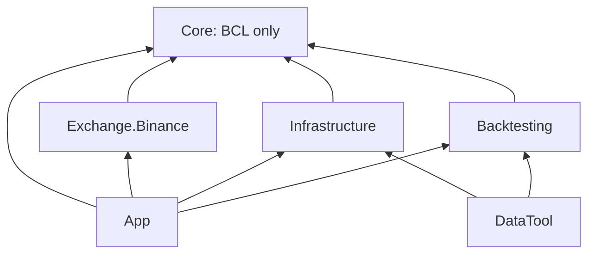

# TrendBot — финальная архитектурная ревизия

Дата: 2026-11-09. Audit record: `AUDIT-2026-11-09-LOCAL-01` — локальная запись этой проверки, не ID бэктеста, frozen dataset или выпуска. Режим: документы + read-only проверка существующего кода. Runtime, параметры V1, canonical source, P17 и execution gates не изменялись.

## 1. Вердикт и обозначения

**ЧАСТИЧНО.** Детерминированные вычислители и значительная инфраструктура существуют. Законченного public 15m/1h signal-only сервиса, durable signal journal, Telegram outbox и независимой оценки outcomes нет. Торговый edge — **UNKNOWN**, не доказан 710 зелёными программными тестами или двумя публичными GET.

- **VERIFIED** — прочитанный код/байты либо непосредственно наблюдавшийся результат команды; граница всегда названа.
- **SOURCE_CLAIM** — утверждение документа, исторического handoff или комментария без повторного подтверждения соответствующего результата.
- **INFERENCE** — инженерное следствие с указанными предпосылками.
- **HYPOTHESIS** — зарегистрируемый исследовательский вопрос, не результат.
- **UNKNOWN** — отсутствуют достаточные данные/решение. `INCONCLUSIVE` — исследование выполнено, но объявленная точность/мощность недостаточна; такого исследования здесь не было.

`path:symbol` — устойчивый anchor; номера строк относятся к исходному audited workspace до добавления audit-notices. Исходные строки сохранены, поэтому поиск символа/заголовка остаётся применимым.

## 2. Workspace, источники, governance

**VERIFIED:** `git status --short --branch`: `main...origin/main`, пять изменённых tracked docs и untracked материалы/C# preparation. `git rev-parse HEAD refs/remotes/origin/main` и public `git ls-remote https://github.com/KirillNedoboy/TrendBot.git refs/heads/main` дали один SHA: `76ea2bac6a8f1baf25783fe9a0923fd47af03179`. Это свежесть main на момент проверки, **не** доказательство GitHub CI и не равенство dirty workspace опубликованному коду. Fetch, push, commit и remote mutations не выполнялись.

До аудита уже изменены: `HANDOFF.md`, `docs/PROJECT_SPEC.md`, `docs/EXECUTION_PLAN.md`, `docs/TASKS.md`, `docs/architecture/execution-model.md` — суммарно 201 insertions / 10 deletions относительно HEAD. Уже untracked: `LaneASignalEvaluator.cs`, `LimitedLiveConfiguration.cs`, `LimitedLiveGuardrails.cs`, два соответствующих IntegrationTests; три материала и `книги/`. Это чужая подготовка, не результат данного аудита. `graft/` не исследовался и не изменялся; содержимое секретов/защищённых рабочих БД не открывалось.

| Запрошенный материал | Фактически найден / прочитан полностью | SHA-256 |
|---|---|---|
| `additional-strategy-research-plan(4).md` | `additional-strategy-research-plan.md`, 153 строки, ревизия 2026-11-06 | `c0cfb5be82d3a97a9c3784afeb76d5c66b3c02007d81e4c38089fd2612637458` |
| `мои предложения..txt` | то же имя, 210 строк | `f6fa387c10694a0cc2bd1c6e325fac438e0addb220a668b31a831e1b4b3312c3` |
| `Prizrak_v2.1(1).zip` | `Prizrak_v2.1.zip`; безопасно извлечён read-only Pine, прочитаны все 1563 строки | ZIP `ad2027d352509ff6911acabe8b515f0faa9456a20e428ce84021f1e027c73e62`; Pine `4332e9836b4443c8d72f7f0d3f297eb2b70d8e56eb7648dc19c7ebf7b6766d4e` |

Буквальные имена с `(4)` и `(1)` не найдены в workspace и проверенных соседних/Downloads местах; их байтовая идентичность найденным вариантам **UNKNOWN**. Аудит относится к указанным хешам, не притворяется чтением недоступной иной версии. `.ex4` из другого Ultimate MA ZIP не запускался.

Прочитаны startup specification/plan/tasks/handoff/canonical source, требуемые architecture docs, ADR-003/004/006/009/010/011/012 и каталог ADR. Canonical source — 3726 строк, SHA-256 **`77E87BF93E538101FC7558F5F73195DCCE58F3BFF2C887E5A290F1A82C16FD54`**. Поправка 2026-11-06 уже явно закреплена в `PROJECT_SPEC.md:Approved current scope`: 15m signals, initial 1h context, no orders, precedence над историческим §4 `local setup: 5m`; source не переписан. Позднейшего локального разрешения перейти на production 30m не найдено.

`TASKS.md` содержит 119 задач: **108 DONE, 11 BLOCKED, 0 READY**. Selector не выбирает задачу; zero READY объяснён unresolved P17 gate. Это не запрет отдельной public-only ветки. Текущий запрос отдельно разрешает аудит и документы, но не реализацию SR. Новые runtime task statuses не применены: [roadmap](SIGNAL_ONLY_IMPLEMENTATION_ROADMAP.md) содержит точный registration proposal и tooling blocker. Существующие task rows/DONE/P17 blockers сохранены.

Доступный интерфейс сессии не предоставлял `task`/`orchestrate` и переключение primary model; делегирование/переключение не имитировалось. Это ограничение координации, не источник проверки кода.

## 3. Решение, зависимости, публичные контракты

**VERIFIED:** `TradingBot.slnx:3–17` — пять production projects, пять test projects, DataTool. XML ProjectReference и Release build подтверждают граф:

| Модуль | Фактические классы / публичные контракты и путь | Реализованный путь / предел |
|---|---|---|
| Core values/events | `DomainValues.cs`: InstrumentId/Price/Quantity/Money/UtcTimestamp/ImmutableValueList; `DomainContracts.cs`: MarketEvent, Trade, Bar, BookDelta, FundingUpdate, OIUpdate, Setup, Decision, RiskDecision, OrderIntent, Position; `CausalEventContracts.cs`: CausalMarketEvent/ReplayEnvelope/CausalEventCursor | Decimal и UTC invariants, immutable snapshots, event/availability/sequence. Наличие order types не означает, что signal-only обязан их создавать |
| Core JSON | `CoreJsonSerializer.cs:CoreJsonSerializer` | strict canonical serialization, unknown members и обязательные constructors; identity evidence не сертификат корректности внешних данных |
| Metadata/screener | `MarketMetadataContracts.cs`, `MetadataCandidateFilter.cs`; `ScreenerFeatureContracts.cs:ScreenerFeatureCalculator,ScreenerBar`; `ScreenerSnapshotContracts.cs` | metadata-only USDT perpetual eligibility; RVOL/acceleration/ATR expansion/turnover/spread/OI anomaly; explicit quality/TTL |
| Staged universe | `StagedSelectionContracts.cs:UniverseSelectionStage`; `CandidatePoolSelectionStage.cs`, `RealtimeMonitorSelectionStage.cs`, `StagedSelectionChainSnapshot.cs` | deterministic caller-configured ranking и provenance; это не point-in-time исторический universe dataset |
| Indicators/context | `RollingIndicatorContracts.cs:RollingIndicatorCalculator`; `RollingIndicatorMath.cs`; `PriceContextFeatureContracts.cs`, `PriceContextFeatureCalculator.cs:Calculate` | causal closed histories, explicit seeds, ATR/MA/RVOL, pivots/levels/channel/trend/HTF, exact price-volume VWAP/POC. Нет встроенного feed или новых Flow/OB/S2/S3 |
| Quality | `FeatureQualityContracts.cs:FeatureQualityPolicy/Evidence/Evaluation`; `FeatureQualityEvaluator.cs:Evaluate`; `FeatureQualitySnapshotContracts.cs` | обе age-метрики и coverage; null TTL не Ready; необязательные series не надо фабриковать |
| Lane A | `BoundaryRejectionSetup{Contracts,Evaluator}.cs`, `CenterRetestSetup{Contracts,Evaluator}.cs`; `SetupEvidence{Contracts,Snapshot}.cs` | обе стороны, Ready/NoSetup/Invalidated/Unknown; canonical per-direction evidence с Replay. Это passive observations, не карточки сервиса |
| Lifecycle/Decision | `SetupLifecycle{Contracts,Engine}.cs:SetupLifecycleEngine,InstrumentLifecycleProcessor`; `DecisionEngine{Contracts,}.cs`; `DecisionReasonCodes.cs`, `DecisionProjectionSnapshot.cs` | external facts, per-instrument serialized read-modify-write, duplicate/late/conflict/recovery; Decision требует EntryArmed. Нельзя симулировать OrderPending/PositionOpen ради сигнала |
| Lane B | `LaneBInputContracts.cs`, `LaneBFreshnessContracts.cs`, `LaneBShadowContracts.cs:LaneBEvaluator`, `LaneBQualityContracts.cs`, `LaneBJoinContracts.cs`, `LaneBDecisionEvidenceMetadata.cs` | versioned OI/funding/liquidation/external failed-continuation observations; rule-table shadow, unknown не Neutral; не R1 structural detector |
| Lane C | `LaneCFeature{Contracts,Evaluator}.cs`, `LaneCShadow{Contracts,Evaluator}.cs`, `LaneCQuality{Contracts,Evaluator}.cs` | captured depth/trades reconstruction, spread/depth/aggressor/wall/absorption candidates, thresholds unknown, passive Decision evidence. Не Pine price-volume pressure |
| Risk/execution Core | `LinearPerpetualRiskMathCalculator.cs`, `RiskEvaluation{Contracts,Engine}.cs`, `PortfolioContracts.cs`, `OperationalExecutionContracts.cs`, `Execution{Lifecycle,Recovery}Contracts.cs`, `ProtectiveExecutionContracts.cs`, `FillSimulationContracts.cs` | самостоятельные risk/execution contracts и gates; reuse не даёт signal-only права создавать intents/reservations/fills |
| Exchange public REST | `BinancePublicRestClient.cs:IBinancePublicRestClient,BinancePublicRestClient`; `BinanceRestContracts.cs:BinanceKline,BinanceRestOptions,BinanceApiException` | exchangeInfo/time/tickers/klines/trades/mark/funding/OI/depth; injected HttpClient/TimeProvider; open bars не Core Bar; kline causal provenance требует дополнительного ingestion boundary |
| Exchange public WS/book | `BinanceMarketWebSocketClient.cs`, `BinanceDepthWebSocketClient.cs`, `BinanceWebSocketContracts.cs:BinanceSubscription,BinanceStreamEnvelope,IBinanceWebSocketTransportFactory`; `BinanceLocalOrderBookRecovery.cs` | public market/depth routes, fragmented frames, session sequence, reconnect and gap diagnostics, snapshot/diff recovery. Не готовая 15m+1h warmup/live composition |
| Exchange private | `BinancePrivate{Contracts,RestClient,StreamParser,WebSocketClient}.cs`, `HmacSha256BinanceRequestSigner.cs`, `BinanceProtectiveOrderMapper.cs` | изолированные signed/test-capable transport APIs; не состав signal-only root. В аудите private network не вызывалась |
| Infrastructure journals | `SqliteEventJournal.cs`, `SqliteDatabase.cs`, `Sqlite{OrderIntentJournal,PortfolioReservationStore,PortfolioOperationalStore,ExecutionStateStore}.cs` | transactions/WAL/canonical data/idempotency/recovery. Event journal не signal journal; общие execution tables не нужны новому signal-only режиму |
| Infrastructure snapshots | `Sqlite{ScreenerSnapshotStore,UniverseSelectionSnapshotStore,FeatureQualitySnapshotStore,DecisionProjectionStore}.cs`; `FeatureQualityMetricsPublisher.cs` | persisted evidence и identity validation; DecisionProjection содержит decision/lifecycle, не заменяет passive signal projection |
| Capture/research persistence | `ParquetCaptureStore.cs`, `CaptureDatasetManifest.cs`, `CaptureQualitySnapshot.cs`, `LaneCQualityReport.cs`, `LaneCCaptureExclusionLedger.cs`, `MultiSourceDatasetManifestStore.cs`; Core `CaptureContracts.cs,MultiSourceDatasetContracts.cs` | bounded public depth/trades, manifests/quality/exclusions. CaptureEnvelope не принимает Bars; MultiSourceLaneKind не имеет Bars. Нельзя маркировать klines как L2 в production |
| Отдельные operational stores | `OperationalShadowStore.cs`; `LocalPaperStore.cs`; `SqliteExchangeTestStore.cs`, `ExchangeTestPersistedSnapshot.cs` | независимые shadow/paper/test persistence и audit scopes. Только shadow имеет zero-real-order public runtime; paper/test — иные разрешения |
| Backtesting | `ReplaySnapshot.cs:ReplaySnapshotBuilder`; `HistoricalReplayRunner.cs:ReplayRunner,HistoricalReplayRunner`; `MultiSourceReplay.cs:MultiSourceReplayRunner`; `SimulatedRiskSimulation.cs:SimulatedRiskSimulator,OhlcvFillSimulator`; `BacktestRegressionReport.cs` | replay/prefixes/fill assumptions/canonical trace, не измеренный edge и не notification outcomes. Prefix defect ниже ограничивает no-lookahead claim |
| Freeze/promotion | `ResearchFreeze.cs:FrozenResearchManifest,FrozenResearchManifestJournal,FrozenResearchEvaluationSnapshot`; `PromotionCriteria.cs`; `FrozenOosEvaluation.cs:FrozenOosEvaluationDefinition,FrozenOosEvaluator,FrozenOosEvaluationReport` | input hashes/registered questions/changed-input invalidation. Risk/fill policy strings и reconciliation-bound report делают это не готовым signal-specific study contract |
| App actual entrypoint | `Program.cs:Program.Main` (26–41), `Bootstrap.Run`; `OperationalShadowCommand.cs`, `OperationalShadowAuditCommand.cs` | default печатает scaffold; доступны `shadow` и offline audit-export. Нет signal command |
| App preparation | untracked `LaneASignalEvaluator.cs:Evaluate` (21–42) | четыре вызова pure context/quality/Boundary/Center; нет I/O, durable ID, profile enforcement 15m/1h, lifecycle, card, outbox/outcome |
| App shadow | `OperationalShadowRuntime.cs`, `OperationalShadowGate.cs`, `OperationalShadowHealth.cs`, `OperationalShadowMetrics.cs`, `BinanceOperationalShadowMarketDataSource.cs`, audit evidence/export classes | public data + explicit caller Decision/Risk snapshot; source требует depth recovery, default command без symbol idle, с symbol подписывает aggTrade/ticker/markPrice, **не klines** (`OperationalShadowCommand.cs:133–163`) |
| App research/execution composition | `LaneCHistoryCapturePipeline.cs`, `LaneCQualityReportService.cs`, `LaneCEvidenceBundle.cs`; `PromotionEvidenceBundle.cs`, `PromotionReviewRecords.cs`; `ExecutionCoordinator.cs`, `PrivateExecutionDevelopmentHarness.cs`, `ActivationSeparationEvidenceBuilder.cs`; `LocalPaper{Configuration,Executor,Evidence}.cs`, `ExchangeTest{Configuration,Runtime,Executor,Evidence}.cs`, `BinanceExchangeTestTransport.cs` | разные библиотеки/гейты; public signal publication их execution path не требует |
| P17 preparation | untracked `LimitedLiveConfiguration.cs:LimitedLiveConfiguration,LimitedLiveParameterApproval`; `LimitedLiveGuardrails.cs:Evaluate` | inert review/preparation; существование не меняет BLOCKED и не создаёт approval |
| DataTool | `tools/TradingBot.DataTool/Program.cs:Bootstrap.Run,Program.Main` | фактически только scaffold output, нет acquisition/study CLI |
| Tests | Core, Exchange, Infrastructure, Replay, Integration; linked `tests/Fixtures/CoreFixtureVectors.cs,DecisionProjectionFixtures.cs` | xUnit v3/Microsoft.Testing.Platform. Выполнено 710 tests; synthetic cases не external operation |
| Docs/CI/deploy | `docs/architecture/*`, `docs/decisions/ADR-001…012`, compatibility `docs/adr/README.md`; `.github/workflows/ci.yml`; `deploy/systemd/tradingbot-shadow.service` | CI Windows+Ubuntu configured; unit ExecStart — App shadow. Ни Linux run, ни deployment, ни remote CI этого dirty state не проверены |

`Directory.Packages.props` централизует Sqlite 10.0.12, Parquet.Net 6.1.0, Test SDK 18.10.1, xunit.v3 4.0.1, runner 4.0.0. Core/Exchange/Backtesting не имеют package refs; Infrastructure имеет Sqlite/Parquet, App композиционные references, DataTool — Infrastructure+Backtesting. Lock files существуют; SDK 10.0.401 pinned (`global.json`, rollForward disabled).

## 4. Матрица готовности и пробелов

| Capability | Статус | Доказательство | Ограничение / риск |
|---|---|---|---|
| Core SETUP-01/02, обе стороны | реализовано, VERIFIED source + existing tests | `BoundaryRejectionSetupEvaluator:EvaluateDirection`, `CenterRetestSetupEvaluator:EvaluateDirection`; corresponding Core.Tests + LaneASetupFixtureTests | не Pine equivalence; не edge; неизвестны новые signal-profile параметры |
| causal feature-quality/context | реализовано с ограничениями | `PriceContextFeatureCalculator:PrepareHistory,CalculateChannel,CalculateHtfContext`; quality evaluator | caller должен давать правильные timeframe grids, eligible histories и TTL; batch future diagnostics fail-closed, а не silent Ready |
| public klines REST/WS | частично до signal product | `GetKlinesAsync`, `BinanceKlineEvent`, `BinanceSubscription.Kline`; два реальных GET ниже | dual-TF identity defect; нет полного 15m/1h durable ingestion, warmup, close-driven service/recovery |
| causal replay | частично | existing runner tests проходят; отдельный smoke воспроизводит pre-close prefix | no-lookahead claim нельзя обобщать на весь публичный Bar contract |
| evidence persistence/restart | реализовано для имеющихся journals | `SqliteEventJournal`, snapshots, shadow store; SQLite reopen smoke | нет атомарного signal+scenario+outbox+cursor transaction |
| стабильный signal ID / rearm | отсутствует | есть SetupEvidenceSnapshotId и lifecycle fingerprint, но нет SignalId/Card contract | evidence hash меняется с cursor/input; нельзя использовать как scenario id или каждый раз новый alert |
| 15m/1h executable signal profile | отсутствует | `Program.Main`, passive evaluator | нет enforced public-only config/command, native feed и full card |
| JSON/console signal output | отсутствует | App пишет scaffold либо shadow health JSON | structured logs не semantic signal-card publication |
| Telegram + durable outbox/ack | отсутствует | targeted source search `Telegram/Outbox/sendMessage` не нашёл реализации | timeout-after-accept дубли; tokens в URL опасны без redaction; ничего не отправлялось |
| outcome observer / signal metrics | отсутствует | backtest simulator моделирует fills/risk, не наблюдение после publication | close price ≠ user entry; unknown intrabar order и delayed publication |
| real 15m/1h coverage | не верифицировано как dataset | только 3 closed bars каждого TF в bounded GET | нет point-in-time universe, delisted history, frozen public study/run IDs или prospective close/restart coverage |
| operational shadow | частично / локальные synthetic проверки VERIFIED | shadow suites внутри 710; source и operations docs | default root не injects evaluation; real Binance WS+Linux/systemd/24h не проверены |
| local paper / exchange test | реализованные изолированные paths, external evidence UNKNOWN | P16 source/tests и HANDOFF current checkpoint | green fixtures не доказывают actual exchange acceptance/reconciliation. Не использовать их для signal delivery |
| statistical VALIDATED status | отсутствует | `research-freeze.md:64–65`, HANDOFF limitations | ни одна family/TF/parameter не имеет показанного real frozen OOS result |
| autonomous real-money authorization | отсутствует/заблокировано | TASKS P17-M01-T001 и следующие; approval contracts | не менять hold; у signal-only вообще нет order authority |

## 5. Дефекты и проверяемые последствия

### P0 — подтверждённых активных нарушений не найдено

Не наблюдался запуск private/live/test execution, deployment или публикации сигналов. Это не security-сертификация всех потенциальных программных API. P0 boundary для будущей работы: не пытаться сделать signal-ready через ослабление `OperationalShadowGate`, Decision/Risk, P17 или изготовление fake portfolio/reconciliation/Allow.

### P1-01 — Bar.CloseTime отсутствует в общей prefix eligibility

**VERIFIED by runtime counterexample:** `CausalEventCursor.IsEligible` (`CausalEventContracts.cs:125–132`) проверяет EventTime/AvailabilityTime/StableSequence, но не Bar.CloseTime. `ReplaySnapshotBuilder.Build` (54–57) использует только его. `ReplayRunner` задерживает **delivery** до `max(event,availability,close)` (313–327), но строит prefix из всей коллекции (280–282). MultiSource delivery тоже ждёт close, а prefix (252–258) фильтрует только event/availability/global sequence.

Минимальные легальные contract inputs: Bar `EventTime=00:01, Open=00:00, CloseTime=00:03, receive=availability=00:01, seq=0`; Trade `event=receive=availability=00:02, seq=1`. В handler Trade обе pipeline возвращают этот Bar в prefix **в 00:02**. `DomainContracts.cs:Bar` разрешает такие раздельные времена; это не malformed fixture. Наблюдалось `single_prefix_before_bar_close.hasFutureBar=true`, `multi_prefix_before_bar_close.hasFutureBar=true`.

Риск: произвольный replay consumer может прочитать будущие окончательные OHLC до close. PriceContext/Screener имеют собственные close checks (`ScreenerBar.IsEligible`, `PrepareHistory`), так что нельзя утверждать, что все существующие evaluators уже используют будущее; дефект именно общего replay-prefix контракта. Binance mapping обычно ставит event=close, что маскирует случай, но не исправляет общий API.

Исправление **предложено, не применено:** единая bar-aware eligibility для snapshot и multi-source prefixes с close bound; сохранить четыре времени, не подменять event=close для обхода. Regression — interleaved earlier Trade + later-close Bar, а не один Bar. Существующий `MultiSourceReplayTests.BarCannotEnterTheSharedPrefixBeforeItsCloseTime` (101–118) проверяет только delivery при единственной строке и поэтому пропускает дефект. Включить исправление в SR-02 перед приёмкой causal replay для сигналов, отдельным авторизованным runtime change.

### P1-02 — identity не различает 15m и 1h

**VERIFIED:** `BinanceKline.ToCoreBar` (`BinanceRestContracts.cs:542`) строит `bar:{symbol}:{openMilliseconds}`. `BinanceKlineEvent` (`BinanceWebSocketContracts.cs:289`) аналогично без TF; interval доступен в StreamName, но не в Core Bar. Две закрытые native kline с одинаковым symbol/open и различными 15m/1h close дают `sameId=true,differentClose=true`; одно-stream `HistoricalReplayRunner` останавливается с `IdentityConflict` до delivery.

Риск: объединение setup/HTF как «обычных bar events» ломает replay/dedup или теряет TF provenance. Раздельные histories/stream names могут избежать конкретной коллизии, поэтому это не утверждение, что любой multi-source run сломан. Новый ingestion должен явно хранить `(venue,product,symbol,timeframe,open)` и корректную revision identity, не извлекать TF из цены. Не менять существующие IDs задним числом без versioned cutover.

### P1-03 — end-to-end продукта пока нет; gates не заменяют интеграцию

`LaneASignalEvaluator.cs:21–42` без callers в runtime, `Program.Main` без signal command, shadow subscriptions без klines, DataTool scaffold. Нет durable signal/outbox/outcome schema. Следствие: нельзя показать delivered research alert и считать feature libraries готовым сервисом. Исправление: отдельная SR ветка, [минимальная pipeline и contracts](SIGNAL_ONLY_IMPLEMENTATION_ROADMAP.md), не ещё один strategy evaluator.

### P1-04 — базовая документационная fixture suite несовместима с текущим текстом

`tools/tests/validate-docs.Tests.ps1:80,88` жёстко ждёт 41 milestone/119 tasks. Строки 117,119,132 ищут прежнее `Blocked by listed dependency` в P17; строка 124 ищет прежний exact T001 blocker. Текущие пользовательские строки TASKS уже содержат другие объяснения.

В UTF-8 Windows PowerShell 5.1 compatibility execution прошли первые семь cases, затем exit 1: **`Task 'P17-M01-T002' evidence marker was not found: Blocked by listed dependency`**. Это pre-existing failure, до audit edits. Нативный `pwsh` недоступен; проверка не выдана за PowerShell 7 success. Standalone validator при этом проходит. Добавление реальных SR rows дополнительно сломает hardcoded count expectation.

Исправление предложено отдельно: оставить поведенческие graph/status/cycle/coverage tests, убрать wording/count coupling; не переписывать пользовательские blockers ради tests, не pin новые слова и не объявлять suite зелёной. По текущему разрешению меняются только docs; tooling repair не выполнен. Registration patch оставлен неприменённым.

### P2 — исследовательские и эксплуатационные ограничения

- Pine и Core расходятся в local trend, strict reclaim, open-hold, width units, seeds и HTF Neutral; см. [Pine audit](PRIZRAK_V21_ALGORITHM_AUDIT.md), а не implicit V1 defaults.
- Display-only POC попадает в Flow classification через fallback; OB display switches меняют algorithm state; pressure volume=0 не соответствует комментарию. Это source findings, не выполненная TV parity.
- `dotnet format` baseline exit 2: LF/charset в untracked `LaneASignalEvaluator.cs`, уже существовавшем до аудита. Не нормализован без разрешения runtime edits.
- REST klines не несут сами по себе receive/availability wrapper; ToCoreBar ставит event=raw close и не сохраняет interval/WS E как отдельные Core fields. UTC grid, inclusive Binance T→endExclusive, correction/finality и restart sequencing — ответственность новой ingestion composition.
- `MultiSourceLaneKind` нет Bars; `CaptureEnvelope` разрешает depth/trades/diagnostics. Нельзя выдавать existing capture за kline archive или mislabel bars как L2. `FrozenOosEvaluationReport` требует reconciliation, existing manifest — risk/fill policy. Нужен signal-specific study contract без fake approvals.
- Feature `KnownCoverage` — coverage текущего требуемого окна, не доказательство полноты рынка/всего universe. Исторический REST fetch не восстанавливает первоначальную availability.
- Mutable transport/book dictionaries, lifecycle keyed state, shadow health state и SQLite checkpoint существуют; immutable result не делает целый runtime stateless. Bounds/restart проверены отдельными fixtures, но signal-specific state/delivery failures ещё не проверяемы, потому что этого runtime нет.
- Некоторые architecture/overview/non-goal тексты сохраняют историческое bootstrap/future wording; текущий статус следует code + current checkpoint + task evidence, не одной старой фразе.

## 6. Реально выполненные проверки

В командах `dotnet` ниже использован существующий локальный SDK executable по абсолютному пути; обычное имя `dotnet` сначала не нашлось в PATH. Ничего не устанавливалось.

| Проверка | Фактический результат | Что доказано / чего нет |
|---|---|---|
| `dotnet --info` | SDK 10.0.401, host 10.0.12, win-x64 | соответствует global.json; не Linux |
| `dotnet restore TradingBot.slnx --locked-mode` | exit 0, все проекты up-to-date | locked dependencies доступны |
| `dotnet build TradingBot.slnx -c Release --no-restore --warnaserror` | exit 0, 0 warnings, 0 errors | весь dirty workspace компилируется, включая preparation |
| `dotnet test TradingBot.slnx -c Release --no-build --no-restore` | exit 0, **710 passed / 0 failed / 0 skipped**, пять assemblies | existing synthetic suite зелёная, но два новых контрпримера ею не покрыты |
| `dotnet format TradingBot.slnx --no-restore --verify-no-changes` | exit 2, ENDOFLINE/CHARSET в `LaneASignalEvaluator.cs` | pre-existing baseline formatting failure; не исправлено |
| запуск App DLL без args | exit 0, `TradingBot.App scaffold ready.` | настоящий default surface инертен |
| запуск DataTool DLL | exit 0, `TradingBot.DataTool scaffold ready.` | acquisition/study CLI не реализован |
| отдельный throwaway C# smoke с ProjectReference на App | exit 0; оба replay counterexamples и TF identity collision выше воспроизведены | наблюдался defect, а не «всё passed»; repository runtime/tests не изменялись |
| passive evaluator без параметров | Boundary и Center LONG = `UnknownConfiguration` | no fake Ready при unknown settings |
| SQLite event journal write → close → reopen → duplicate | first=true, repeat=false, sameEnvelope=true | реальные local durability/idempotency для event journal, не для отсутствующего signal journal |
| public `GetKlinesAsync(BTCUSDT,15m/1h,limit:4)` через существующий адаптер | каждый ответ 4 rows, 3 closed; native UTC grid/duration valid | bounded public REST connectivity, 6 closed observations; не live WS, не frozen evaluation |
| public response content hashes | 15m `d6b446683629a931291ef5a363aeb14e8b6ff2fa3771dc9136f53b23c772198a`; 1h `608d2047fc06a63e4db31d7d65f16f9db0807c9b55bf9d43f628c96469c9b6ba` | hash JsonSerializer DTO ответа в smoke; raw dataset не сохранялся, это не воспроизводимый performance run |
| `pwsh -NoProfile -File tools/tests/validate-docs.Tests.ps1` | command not found, exit 127 | нативная обязательная fixture команда не выполнена |
| `pwsh -NoProfile -File tools/validate-docs.ps1` | command not found, exit 127 | нативный standalone run также недоступен |
| неизменный standalone validator body через PS5 UTF-8, явный RepositoryPath | exit 0; phases=19, milestones=41, tasks=119, ready=none (explicit unresolved blocker) | совместимость body с текущим graph и source hash; не нативный pwsh7 run |
| fixture body через PS5 UTF-8 adapter | exit 1 после 7 PASS на stale P17 evidence marker | pre-existing fixture failure; не скрывается и не чинится вне scope |
| standalone validator body на временной копии registration proposal, PS5 UTF-8 | exit 0; phases=19, milestones=43, tasks=128, ready=none | проверен proposed graph; не активный backlog и не исправленная fixture suite |
| `git apply --check` неприменённого registration diff | exit 0; embedded patch text сверён с проверенным файлом | proposal применим к текущим рабочим документам; ничего не применялось |

PS5 adapter менял только способ исполнения: UTF-8 чтение, явный root, вложенный `pwsh` вызов перенаправлен на исходный validator body с exit-code передачей. Repository `.ps1` не редактировались. Temp C# выполнял только public GET и локальный temp journal, не signal/paper/test execution и не Telegram. Собственные временные smoke/graph-fixture проекты удалены; исходные материалы и read-only Pine extraction сохранены. Финальные diff/hash/document checks записаны в HANDOFF audit checkpoint.

## 7. DONE — что именно можно принять

**VERIFIED:** task graph структурно содержит DONE dependencies и evidence marker; standalone validator проверяет граф, coverage requirements, statuses, cycles и source hash (`tools/validate-docs.ps1:183–237`). Он не запускает перечисленные Acceptance commands и не удостоверяет реальность OOS/рынка/approval. **SOURCE_CLAIM:** индивидуальные исторические RED/GREEN числа в `TASKS.md:Evidence` и HANDOFF. Текущие 710 tests подтверждают существующие тестовые сценарии, не автоматически все исторические acceptance statements.

| DONE scope / task IDs | Фактическая опора текущего кода/проверок | Ограничение DONE |
|---|---|---|
| P00-M01 T001–T003; P01-M01 T001–T003; P01-M02 T001–T004 | immutable source hash, solution/props/locks/ADR, architecture tests; validator | fixture suite теперь stale; CI status не выводится из истории |
| P02-M01 T001–T003; P02-M02 T001–T003; P02-M03 T001–T002 | values/events/causal/risk/fill contracts, CoreJson, CoreFixtureVectors; Core/Replay tests | общий cursor пропускает pre-close Bar; contract availability не exchange completeness |
| P03-M01 T001–T003 | SqliteEventJournal/ReplayEnvelope/restart fixtures + новый reopen smoke | это не signal persistence |
| P03-M02 T001–T003 | SqliteOrderIntentJournal/reservation/operational stores; transaction/restart tests | не разрешение создавать эти объекты в signal mode |
| P04-M01 T001–T003 | public clients/book recovery + Exchange tests + два public GET | не full dual-TF runtime; identity finding ограничивает reuse |
| P04-M02 T001–T003 | protocol catalog/Algo fixtures/evidence evaluator | official-source historical claims, не network/private verification сегодня |
| P04-M03 T001–T003 | ParquetCaptureStore/manifest/retention/quality fixtures | bounded synthetic depth/trades, не historical klines coverage |
| P05-M01 T001–T003; P05-M02 T001–T003; P05-M03 T001–T003 | metadata/screener/stages/snapshot stores и соответствующие tests | нет реального PIT dataset/universe |
| P06-M01 T001–T003; P06-M02 T001–T003 | rolling-v1, price-context-v2, feature-quality-v1, golden/prefix/TTL/persistence fixtures | superseded price-context-v1 claims HANDOFF P06 correction не текущая реализация |
| P07-M01 T001–T003; P07-M02 T001–T002 | обе семейные evaluator, LaneASetupFixtureTests, SetupEvidenceSnapshot/LifecycleInputFixtureTests | software rule readiness, не published/validated signal |
| P08-M01 T001–T003; P08-M02 T001–T003 | lifecycle/Decision/reason/projection/recovery tests | external facts и local durable checkpoints, не signal-only episode policy |
| P09-M01 T001–T003; P09-M02 T001–T003 | runner/simulation/report/shared math/fill isolation tests | replay-prefix defect; research fills не user outcomes |
| P09-M03 T001–T002 | frozen manifest/criteria/context immutability tests | freeze local content не доказывает pre-result registration реального эксперимента |
| P10-M01 T001–T003; P10-M02 T001–T003 | LaneB input/freshness/shadow/quality/join/handoff tests | external failed-continuation не R1; нет incremental edge |
| P11-M01 T001–T003; P11-M02 T001–T003 | independent risk/protection/fail-closed/authenticated atomic reservation tests | execution-only safety, вне signal critical path |
| P12-M01 T001–T003; P12-M02 T001–T003 | private adapter/execution state/coordinator/recovery/scripted harness/protection/separation tests | synthetic injected transports; не credentials/network/activation proof |
| P13-M01 T001–T003; P13-M02 T001–T003 | Lane C capture/features/shadow/quality/exclusions/replay tests | synthetic bounded capture, не доказанная coverage или alpha |
| P14-M01 T001–T003; P14-M02 T001–T003 | manifest/aligned replay/integration trace/frozen OOS/bundle/review tests | Bar source kind отсутствует, prefix issue; нет real frozen OOS/accepted live evidence |
| P15-M01 T001–T003; P15-M02 T001–T002 | OperationalShadow runtime/store/health/soak/audit tests | local synthetic bounded soak; не 24/7 VPS или signal service |
| P16-M01 T001–T003 | LocalPaper configuration/executor/evidence/restart tests | simulated fills; не публичные уведомления и не внешний test lane |
| P16-M02 T001–T003 | ExchangeTest config/runtime/atomic store/evidence tests | external Binance test evidence остаётся UNKNOWN, как прямо указано HANDOFF:214–222 |

Каждый DONE ID входит ровно в одну строку таблицы; диапазон T означает отдельные существующие task rows с собственным Evidence в `docs/TASKS.md`. Статусы не повышены и не переоценены. P17/P18 — все 11 BLOCKED; untracked preparation не становится дополнительной DONE.

## 8. Следствие для архитектуры

Принять reuse pure feature/setup/evidence kernels и transactional persistence patterns; не клонировать V1 под S1/S4 и не использовать existing trade lifecycle/Decision/Risk как notification authorization. Новая минимальная композиция и full schema определены в [roadmap](SIGNAL_ONLY_IMPLEMENTATION_ROADMAP.md). Сверка трёх источников, H0/controls/reject criteria и исследовательские очереди — в [decision register](STRATEGY_RESEARCH_DECISIONS.md). Последующее внедрение требует исправить выявленные causal/identity defects в разрешённой задаче, а не скрыть их настройками или переписать canonical source.
